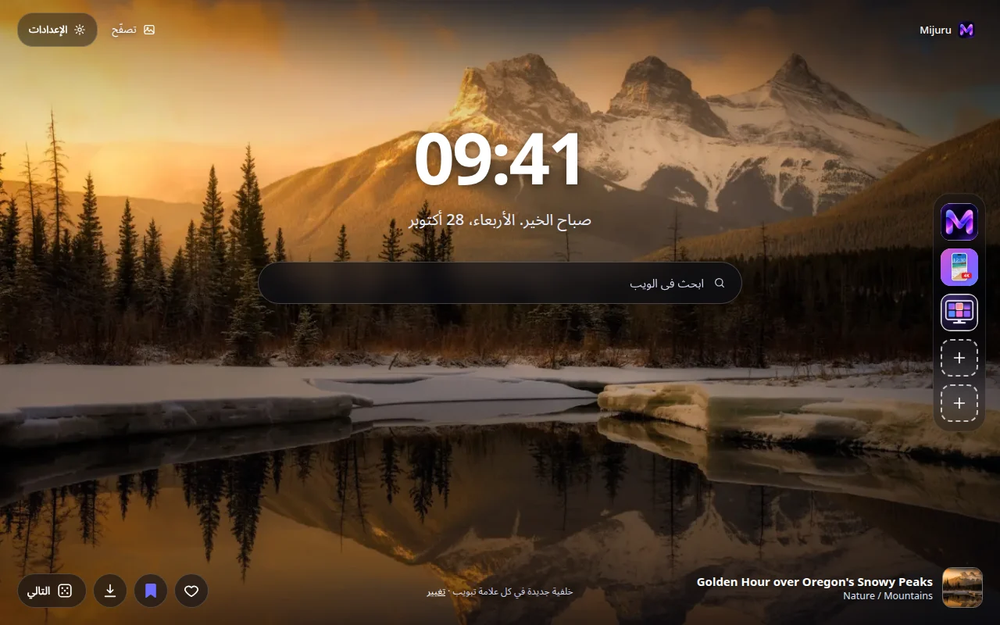
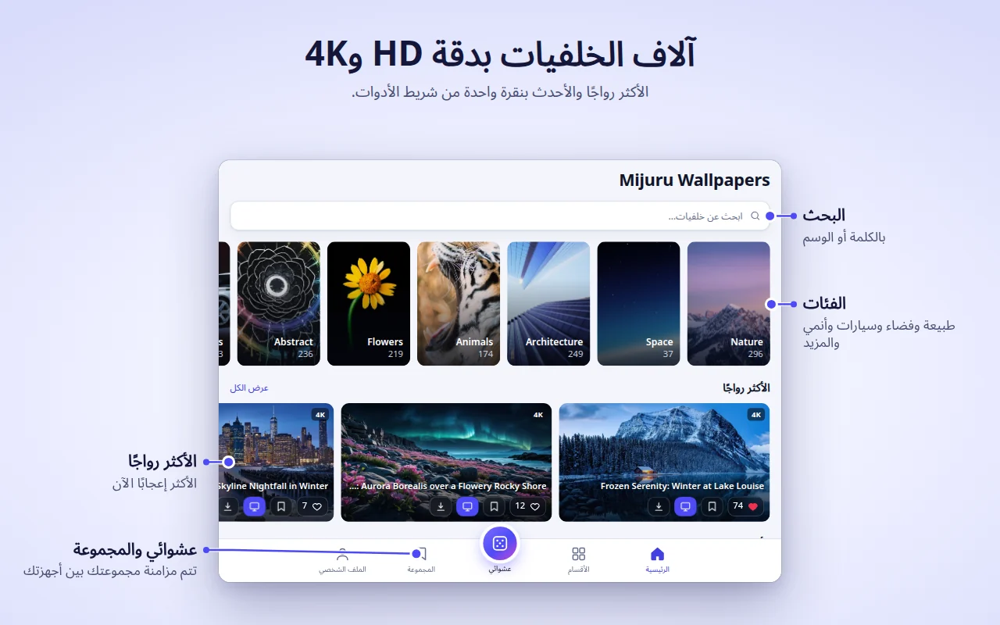
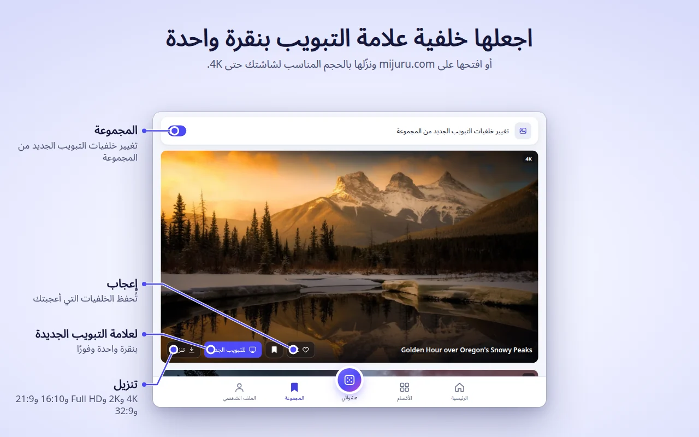
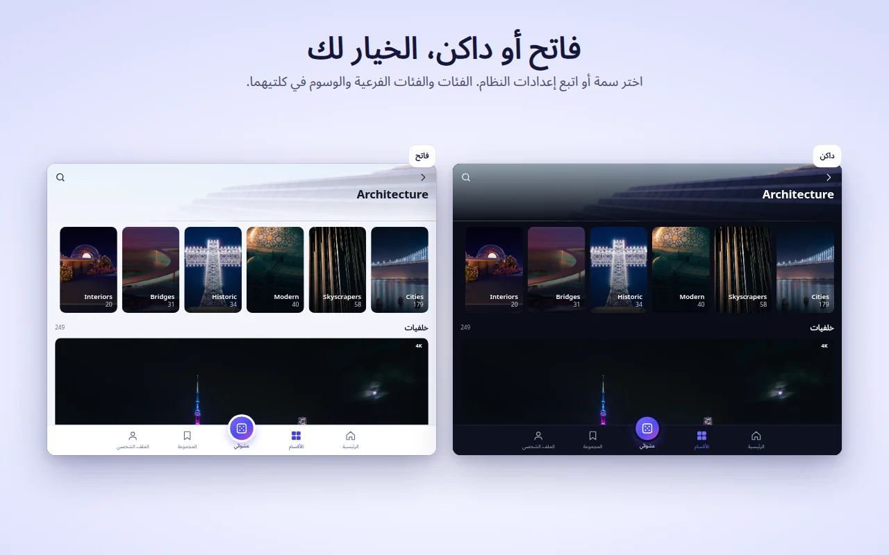
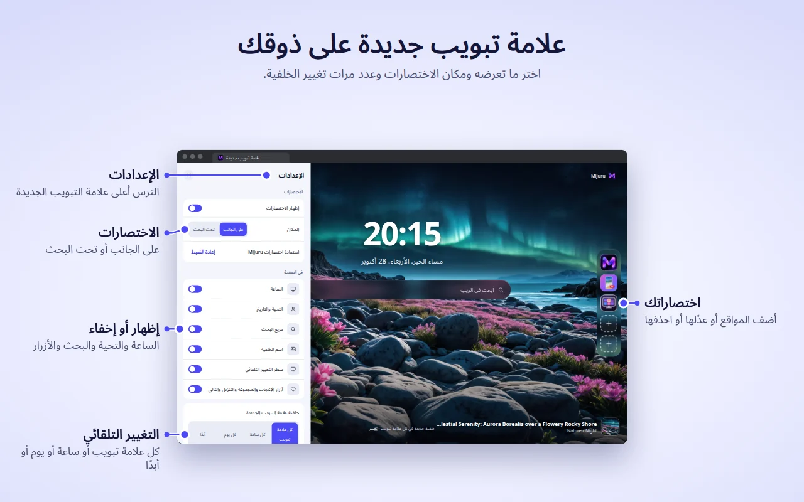

[English](README.md) · [Русский](README.ru.md) · [Українська](README.uk.md) · [Español](README.es.md) · [Português](README.pt.md) · [Deutsch](README.de.md) · [Français](README.fr.md) · [Italiano](README.it.md) · [Türkçe](README.tr.md) · [Polski](README.pl.md) · [한국어](README.ko.md) · [Tiếng Việt](README.vi.md) · [Bahasa Indonesia](README.id.md) · **العربية**

  

<h1 align="center">Mijuru Wallpapers</h1>

  <b>خلفية جديدة بدقة 4K في كل علامة تبويب جديدة.</b> 
  آلاف الخلفيات بدقة HD و4K من <a href="https://mijuru.com">mijuru.com</a>، على بُعد نقرة واحدة من شريط الأدوات. 
  مجانية · بلا إعلانات · بلا حساب.

  

يضم هذا المستودع **الوثائق ومتتبّع المشكلات العام** لإضافة المتصفح Mijuru Wallpapers. الشيفرة المصدرية للإضافة مغلقة.

## احصل على الإضافة

| المتصفح | المتجر | الحالة |
|---|---|---|
| Google Chrome | [سوق Chrome الإلكتروني](https://chromewebstore.google.com/detail/mijuru-wallpapers/jlkpdnlkhknaifdjfjdepbfmklfpamfh) | ✅ متاحة |
| Microsoft Edge | [وظائف Edge الإضافية](https://microsoftedge.microsoft.com/addons/detail/mijuru-wallpapers/cdnegcioifbeoldnojbgcopnklpneodo) | ✅ متاحة |
| Mozilla Firefox | [إضافات Firefox ‏(AMO)](https://addons.mozilla.org/firefox/addon/mijuru-wallpapers/) | ✅ متاحة |
| Opera | Opera add-ons | ⏳ قيد المراجعة في المتجر |

أحدث إصدار: **1.4.0** — راجع [سجل التغييرات](CHANGELOG.md). قد يتأخر وصول التحديث إلى المتاجر بضعة أيام بعد الإصدار.

## لقطات الشاشة

| | |
|---|---|
|  |  |
|  |  |
|  | |

## الميزات

**علامة التبويب الجديدة**
- خلفية بملء الشاشة بالحجم المناسب لشاشتك. إذا تعذّر تحميل الملف بالحجم الكامل تظهر معاينة بدلًا منه، فلا تبقى علامة التبويب فارغة أبدًا.
- تُنزَّل الخلفية التالية مسبقًا، لذا تُفتح علامات التبويب الجديدة فورًا.
- ساعة، وتحية مع التاريخ («صباح الخير…»)، ومربع بحث يستخدم محرك البحث الافتراضي في متصفحك.
- اسم الخلفية وقسمها — انقر لفتح صفحتها على mijuru.com.
- الأزرار: إعجاب، والإضافة إلى المجموعة، وتنزيل (يفتح الخلفية على mijuru.com)، والتالي.

**التغيير التلقائي**
- مع كل علامة تبويب جديدة (الافتراضي)، أو كل ساعة، أو كل يوم، أو أبدًا.
- تُختار الخلفية التالية عشوائيًا ولا تكرر آخر 10 خلفيات أبدًا.
- المصدر: كل الخلفيات، أو مجموعتك، أو قسم واحد.

**الاختصارات** *(جديد في 1.4.0)*
- 8 خانات: ثلاثة اختصارات لـ Mijuru افتراضيًا (كتالوج الخلفيات، وتطبيق أندرويد، وتطبيق الكمبيوتر) ومساحة لمواقعك الخاصة.
- أضِف أو عدّل أو احذف من القائمة «⋮»؛ ويعيد زر «إعادة الضبط» اختصارات Mijuru.
- ضعها في عمود على الجانب أو في صف تحت البحث.

**الإعدادات في علامة التبويب الجديدة** *(جديد في 1.4.0)*
- يتيح لك زر الترس (أعلى الصفحة في الزاوية) إظهار أو إخفاء الساعة والتحية والبحث والاختصارات واسم الخلفية وسطر التغيير التلقائي والأزرار.

**نافذة الإضافة — الكتالوج كاملًا**
- الرئيسية (الأكثر رواجًا والأحدث)، والأقسام ← الأقسام الفرعية، والبحث (خلفيات أو وسوم)، وموجز عشوائي لا ينتهي، ومجموعتك، وملفك الشخصي.
- على كل بطاقة خلفية: إعجاب، والإضافة إلى المجموعة، وللتبويب الجديد، وتنزيل.
- يعرض الكتالوج خلفيات بنسبة 16:9 بدقة 4K ‏(3840×2160) أو أعلى — وكلها تناسب الشاشات العريضة.

**المجموعة**
- احفظ الخلفيات التي تحبها وفعّل «تغيير خلفيات التبويب الجديد من المجموعة».

**تعيين خلفية من mijuru.com**
- في صفحة خلفية لسطح المكتب على mijuru.com، اضغط **تعيين كخلفية للتبويب الجديد** — وستطبّقها الإضافة فورًا.

**وأيضًا**
- سمة فاتحة أو داكنة أو حسب النظام.
- 14 لغة للواجهة: English، Русский، Українська، Español، Português (Brasil)، Deutsch، Français، Italiano، Türkçe، Polski، 한국어، Tiếng Việt، Bahasa Indonesia، العربية (من اليمين إلى اليسار).
- تنتقل الإعدادات والإعجابات والمجموعة والاختصارات مع مزامنة متصفحك، إذا كانت مفعّلة.

## المتصفحات المدعومة

| المتصفح | الحد الأدنى للإصدار | يستبدل علامة التبويب الجديدة | ملاحظات |
|---|---|---|---|
| Chrome | 116 | نعم | |
| Edge | الإصدارات الحالية | نعم | نفس الإصدار المخصص لـ Chrome |
| Firefox (سطح المكتب) | 140 | نعم | Firefox لأندرويد غير مدعوم |
| Opera | الإصدارات الحالية | **لا** | لا يسمح Opera للإضافات باستبدال علامة التبويب الجديدة — استخدم **علامة تبويب Mijuru** بدلًا من ذلك (انظر أدناه) |

## التثبيت

1. افتح صفحة المتجر الخاصة بمتصفحك من [الجدول أعلاه](#احصل-على-الإضافة).
2. انقر **إضافة إلى Chrome** / **احصل عليه** / **أضف إلى Firefox**.
3. افتح علامة تبويب جديدة. بعد التثبيت الأول تشرح صفحة ترحيب قصيرة على mijuru.com الأساسيات.

**Opera.** بعد نشر الإضافة، افتح نافذة الإضافة ← **الملف الشخصي ← فتح علامة تبويب Mijuru**. يمكنك جعل هذه الصفحة صفحة البدء من إعدادات Opera.

## البدء

1. **افتح علامة تبويب جديدة** — سترى خلفية والساعة والبحث.
2. **انقر أيقونة Mijuru** في شريط الأدوات لتصفّح الكتالوج. ثبّتها من قائمة الإضافات (قطعة الأحجية) لتبقى ظاهرة دائمًا.
3. **أعجِب بخلفية أو أضِفها إلى مجموعتك** من أي بطاقة أو مباشرة من علامة التبويب الجديدة.
4. **اختر عدد مرات تغيير الخلفية**: الملف الشخصي ← خلفية علامة التبويب الجديدة، أو رابط **تغيير** في علامة التبويب الجديدة.
5. **خصّص الصفحة**: يُظهر زر الترس في علامة التبويب الجديدة كل عنصر أو يخفيه.
6. **نزّل خلفية**: يفتح زر تنزيل صفحتها على mijuru.com، حيث تختار الحجم (4K UHD، 2K QHD، Full HD، 16:10، 21:9، 32:9…).

## الأسئلة الشائعة

<b>هل هي مجانية حقًا؟ هل فيها إعلانات؟</b>

نعم، إنها مجانية. لا إعلانات، ولا حساب، ولا تسجيل دخول.

<b>هل يمكنني استخدام صورتي الخاصة خلفيةً؟</b>

ليس حاليًا. تعرض الإضافة خلفيات من كتالوج mijuru.com. إذا كنت تريد هذه الميزة، صوّت لها أو اقترحها في [Ideas](https://github.com/orgs/mijuru-dev/discussions/categories/ideas).

<b>لماذا توجد خلفيات أفقية فقط؟</b>

صُممت الإضافة لشاشات الكمبيوتر، لذا يعرض الكتالوج في النافذة خلفيات بنسبة 16:9 بدقة 4K أو أعلى. خلفيات الهاتف متوفرة على [mijuru.com](https://mijuru.com) وفي [تطبيق أندرويد](https://play.google.com/store/apps/details?id=com.mijuru.wallpaper).

<b>كيف أُبقي على الخلفية نفسها؟</b>

اضبط التغيير التلقائي على **أبدًا** (الملف الشخصي ← خلفية علامة التبويب الجديدة، أو رابط **تغيير** في علامة التبويب الجديدة). تعيين خلفية يدويًا عبر **للتبويب الجديد** يوقف التغيير التلقائي أيضًا.

<b>كيف أعرض خلفيات من مجموعتي أو من قسم واحد فقط؟</b>

الملف الشخصي ← خلفية علامة التبويب الجديدة ← الاختيار من: **المجموعة** أو أحد الأقسام. وفي تبويب المجموعة يوجد أيضًا مفتاح «تغيير خلفيات التبويب الجديد من المجموعة».

<b>كيف أستعيد علامة التبويب الجديدة الافتراضية لمتصفحي؟</b>

عطّل الإضافة أو أزلها: افتح `chrome://extensions` أو `edge://extensions` أو `about:addons` ‏(Firefox) وأوقف Mijuru Wallpapers. ستعود علامة التبويب الجديدة الأصلية للمتصفح فورًا.

<b>هل تنتقل إعجاباتي ومجموعتي واختصاراتي إلى كمبيوتر آخر؟</b>

نعم، إذا كانت مزامنة المتصفح مفعّلة (حساب Google أو Microsoft أو Firefox). تستخدم الإضافة مساحة المزامنة المدمجة في المتصفح، وليس لها حساب خاص بها.

<b>من أين تأتي الخلفيات المنزّلة؟ هل يمكنني اختيار الحجم؟</b>

يفتح زر تنزيل صفحة الخلفية على mijuru.com، حيث تختار الحجم الدقيق. الإضافة نفسها لا تحفظ أي ملفات.

<b>هل يمكنني إخفاء الساعة أو التحية أو البحث؟</b>

نعم. انقر زر الترس في الزاوية العلوية من علامة التبويب الجديدة وأوقف أي عنصر تريده.

<b>هل يرسل مربع البحث عمليات بحثي إلى Mijuru؟</b>

لا. تذهب عمليات البحث مباشرة إلى محرك البحث الافتراضي في متصفحك عبر واجهة البحث الخاصة بالمتصفح نفسه. الإضافة لا تقرؤها ولا تحفظها.

<b>لماذا يعمل Opera بشكل مختلف؟</b>

لا يسمح Opera للإضافات باستبدال علامة التبويب الجديدة. استخدم **الملف الشخصي ← فتح علامة تبويب Mijuru** — إنها الصفحة نفسها في علامة تبويب عادية، ويمكنك تعيينها صفحةً للبدء.

<b>هل يمكنني استخدام الخلفيات لأغراض تجارية؟</b>

خلفيات mijuru.com مجانية للاستخدام الشخصي. إعادة البيع والاستخدام التجاري غير مسموحين.

## استكشاف الأخطاء وإصلاحها

**علامة التبويب الجديدة لا تعرض Mijuru.**
لا يمكن إلا لإضافة واحدة التحكم في علامة التبويب الجديدة في الوقت نفسه — هكذا تعمل المتصفحات. إذا كانت لديك إضافة أخرى لعلامة التبويب الجديدة، فسيستخدم المتصفح إحداهما. عطّل الإضافة الأخرى وافتح علامة تبويب جديدة مرة أخرى.

**يسألك Chrome هل تريد الرجوع إلى Google أم الاحتفاظ بالتغييرات.**
يعرض Chrome هذا السؤال بعد أن تستبدل أي إضافة علامة التبويب الجديدة. اختر **الاحتفاظ بالتغييرات** لتبقى مع Mijuru. إذا اخترت التراجع، فسيعطّل Chrome الإضافة — فعّلها من جديد في `chrome://extensions`.

**متصفح العمل لا يطبّق الإضافة.**
يمكن للمتصفحات المُدارة (في العمل أو المدرسة) حظر الإضافات أو فرض علامة تبويب جديدة محددة عبر السياسات. تواصل مع المسؤول.

**Opera: لا توجد خلفية في علامة التبويب الجديدة ولا زر «للتبويب الجديد».**
هذا متوقع — راجع [لماذا يعمل Opera بشكل مختلف؟](#الأسئلة-الشائعة). استخدم **علامة تبويب Mijuru**.

**عناوين الخلفيات بالإنجليزية رغم أنني اخترت لغة أخرى.**
بالنسبة للكورية والفيتنامية والإندونيسية والعربية، لا يحتوي الكتالوج بعد على عناوين مترجمة، لذا تظهر بالإنجليزية. أما الواجهة نفسها فمترجمة. تفتح روابط الكتالوج دائمًا النسخة الإنجليزية من mijuru.com.

**«تعذّر التحميل. تحقق من اتصالك.»**
تحتاج الإضافة إلى اتصال بالإنترنت للوصول إلى mijuru.com. تحقق من اتصالك أو الشبكة الافتراضية الخاصة (VPN) أو جدار الحماية، ثم اضغط **إعادة المحاولة**. إذا تعذّر تحميل الخلفية بالحجم الكامل، تظهر معاينة بدلًا منها.

**يظهر حرف بدلًا من أيقونة في أحد الاختصارات.**
تعذّر تحميل أيقونة الموقع (`/favicon.ico`)، لذا تعرض الخانة الحرف الأول من الاسم. الاختصار يعمل مع ذلك.

**توقفت الخلفية عن التغيّر.**
تحقق من الملف الشخصي ← خلفية علامة التبويب الجديدة: إذا عيّنت خلفية يدويًا، فقد تحوّل التغيير التلقائي إلى **أبدًا**. وإذا كان المصدر مجموعتك، فتأكد من أنها ليست فارغة.

ما زالت المشكلة قائمة؟ [افتح بلاغًا](https://github.com/mijuru-dev/wallpapers-browser-extension/issues/new/choose).

## الأذونات والخصوصية

لا تطلب الإضافة إلا ما تحتاج إليه:

| الإذن | السبب |
|---|---|
| `storage` | إعداداتك، ومعرّفات الخلفيات التي أعجبتك وتلك التي في مجموعتك، واختصاراتك، وذاكرة تخزين مؤقت. |
| `alarms` | التغيير التلقائي كل ساعة وكل يوم، وتنزيل الخلفية التالية مسبقًا. |
| `search` | يرسل مربع البحث في علامة التبويب الجديدة استعلامك إلى محرك البحث الافتراضي في المتصفح. الإضافة لا تقرأ الاستعلامات ولا تحفظها. |
| `https://mijuru.com/*` | تحميل كتالوج الخلفيات والصور من واجهة mijuru.com المخصصة للقراءة فقط، وزر «تعيين كخلفية للتبويب الجديد» على mijuru.com (انظر أدناه). |

**لا** وصول إلى علامات تبويبك أو سجلّ التصفح أو التنزيلات أو محتوى المواقع الأخرى.

**ما تفعله الإضافة وما لا تفعله**
- **لا تحليلات ولا إعلانات ولا ملفات تعريف ارتباط ولا حسابات ولا أدوات تتبّع من جهات خارجية.** تصرّح صفحة الإضافة في متجر Firefox بعدم جمع أي بيانات.
- **تُرسَل الطلبات إلى mijuru.com** — الكتالوج والصور (طلبات `GET` للقراءة فقط تتضمن اللغة أو القسم أو الوسم أو نص البحث أو معرّفات الخلفيات المختارة).
- **أيقونات الاختصارات.** بالنسبة للاختصارات التي تضيفها بنفسك، تحمّل علامة التبويب الجديدة أيقونة الموقع من `https://<ذلك الموقع>/favicon.ico`. هذا طلب عادي إلى الموقع الذي أضفته، ولا تُرفق به أي بيانات من الإضافة.
- **التكامل مع mijuru.com.** يعمل نص برمجي صغير على صفحات `https://mijuru.com/*` فقط. يتيح لزر «تعيين كخلفية للتبويب الجديد» في الموقع تمرير معرّف خلفية إلى الإضافة، ويُبلغ الموقع بإصدار الإضافة واسم المتصفح ومعرّف الخلفية الحالية ليعرض الزر الحالة الصحيحة. لا يقرأ أي شيء آخر ولا يعمل على أي موقع آخر.
- **إعجاباتك تبقى لديك.** تُحفظ الإعجابات والمجموعة في مساحة تخزين المتصفح (ويزامنها المتصفح إذا كانت المزامنة مفعّلة). لا يُرسَل شيء إلى الخادم عند إعجابك بخلفية.
- **صفحات التثبيت وإلغاء التثبيت.** بعد التثبيت الأول تفتح الإضافة صفحة ترحيب على mijuru.com؛ وعند إزالتها يفتح المتصفح صفحة وداع مع استبيان اختياري من سؤال واحد. لا تحتوي هذه الروابط إلا على اللغة واسم المتصفح وإصدار الإضافة ووسوم `utm_*` — دون أي معرّفات للمستخدم. تُضاف وسوم `utm_*` نفسها إلى الروابط الأخرى المؤدية إلى mijuru.com. وبمجرد وصولك إلى mijuru.com تسري سياسة الخصوصية الخاصة بالموقع.

السياسة الكاملة: **[mijuru.com/browser-extension-privacy-policy](https://mijuru.com/browser-extension-privacy-policy)**

## الملاحظات والدعم

| ماذا | أين | |
|---|---|---|
| 🐞 **شيء لا يعمل** | [أبلغ عن مشكلة](https://github.com/mijuru-dev/wallpapers-browser-extension/issues/new/choose) | GitHub Issues |
| 💡 **فكرة أو اقتراح** | [شارك فكرة](https://github.com/orgs/mijuru-dev/discussions/categories/ideas) | GitHub Discussions |
| ❓ **سؤال** | [اسأل في Q&A](https://github.com/orgs/mijuru-dev/discussions/categories/q-a) | GitHub Discussions |
| ✉️ **أمر خاص** | [m@mijuru.dev](mailto:m@mijuru.dev) | البريد الإلكتروني |

**البلاغات (Issues) مخصصة للمشكلات فقط** — أما الأفكار والاقتراحات والأسئلة فمكانها [Discussions](https://github.com/orgs/mijuru-dev/discussions)، حيث يمكن للجميع التصويت بعلامة 👍 للأفكار التي تعجبهم أكثر.
يُرجى الكتابة باللغة الإنجليزية ليتمكن الجميع من العثور على النقاش ومتابعته — ولا بأس إطلاقًا باستخدام ترجمة آلية من لغتك. قبل النشر، ابحث في البلاغات والنقاشات الموجودة: فعلامة 👍 على موضوع موجود تفيد أكثر من موضوع مكرر.

🚩 للإبلاغ عن خلفية (حقوق النشر، محتوى غير لائق)، استخدم **الإبلاغ عن الصورة** في صفحة الخلفية على mijuru.com.

## مزيد من الخلفيات على mijuru.com

المجموعة الكاملة موجودة على الموقع — وهي مفيدة عندما تريد اختيار خلفية لجهاز آخر أو بحجم لا تعرضه الإضافة:

- [خلفيات سطح المكتب حسب الدقة — 4K و2K وFull HD والشاشات فائقة العرض](https://mijuru.com/wallpapers/resolutions)
- [حزم الخلفيات — مجموعات حسب الموضوع](https://mijuru.com/wallpapers/packs)
- [خلفيات الهاتف حسب العلامة التجارية — iPhone وSamsung وXiaomi وغيرها](https://mijuru.com/wallpapers/device-brands)
- [صور رمزية وصور ملف شخصي لـ Instagram وDiscord وTikTok](https://mijuru.com/avatars)

## تطبيقات Mijuru الأخرى

- 🌐 **[mijuru.com](https://mijuru.com)** — خلفيات مجانية للهاتف والكمبيوتر والجهاز اللوحي بدقة HD و4K و8K.
- 📱 **[Wallpapers by Mijuru لأندرويد](https://play.google.com/store/apps/details?id=com.mijuru.wallpaper)** — عيّن الخلفيات على الشاشة الرئيسية وشاشة القفل.
- 🖥️ **[Wallpapers by Mijuru لنظام Linux](https://snapcraft.io/wallpapers-by-mijuru)** — عيّن الخلفيات بنقرة واحدة وغيّرها وفق جدول زمني.

جميع المنتجات والوثائق: **[github.com/mijuru-dev](https://github.com/mijuru-dev)**

## الترخيص

© 2026 Mijuru. جميع الحقوق محفوظة. استخدام الإضافة مجاني، وشيفرتها المصدرية غير منشورة. لا يجوز إعادة استخدام الوثائق والصور الموجودة في هذا المستودع دون إذن.

