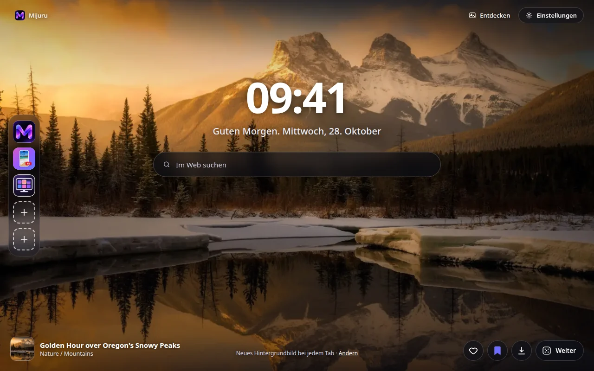
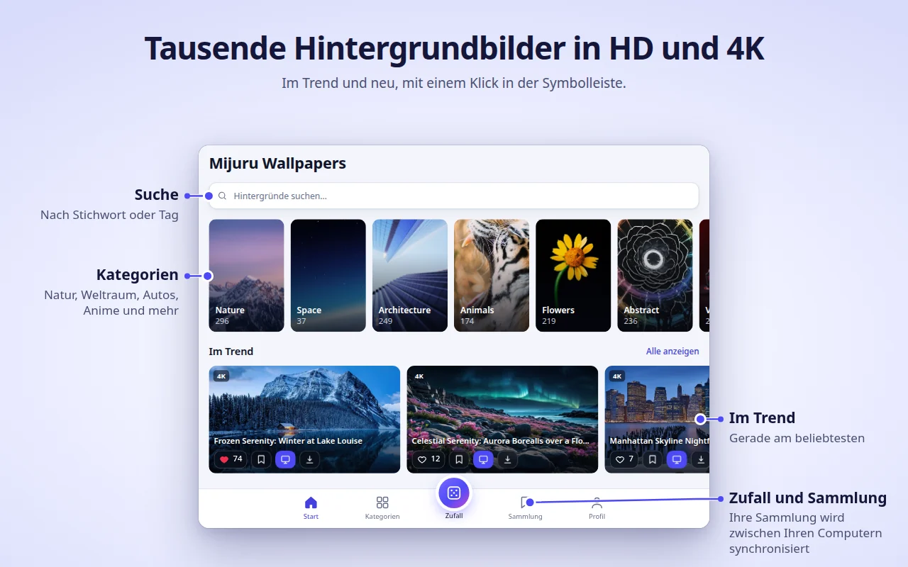
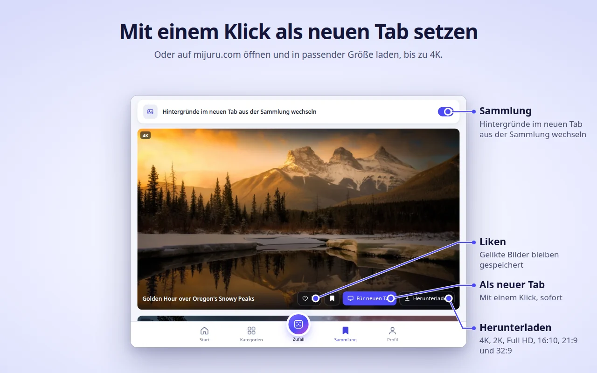
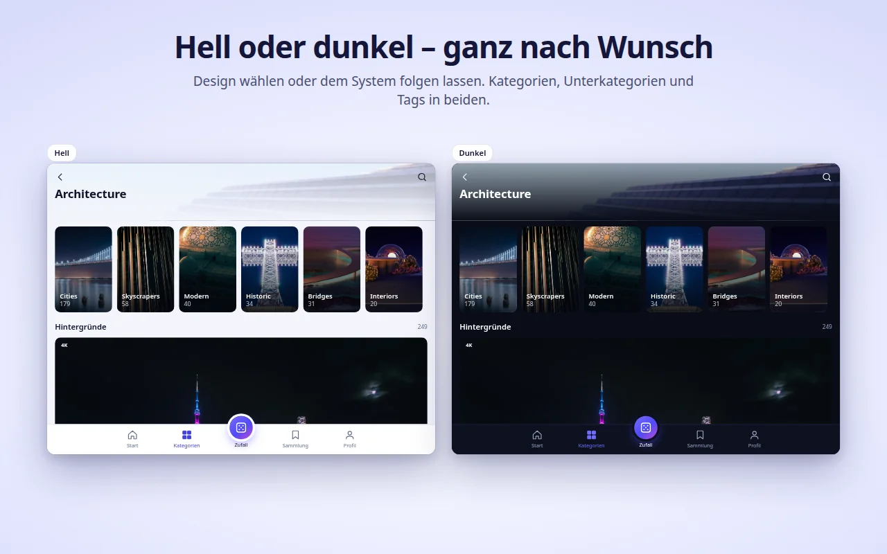
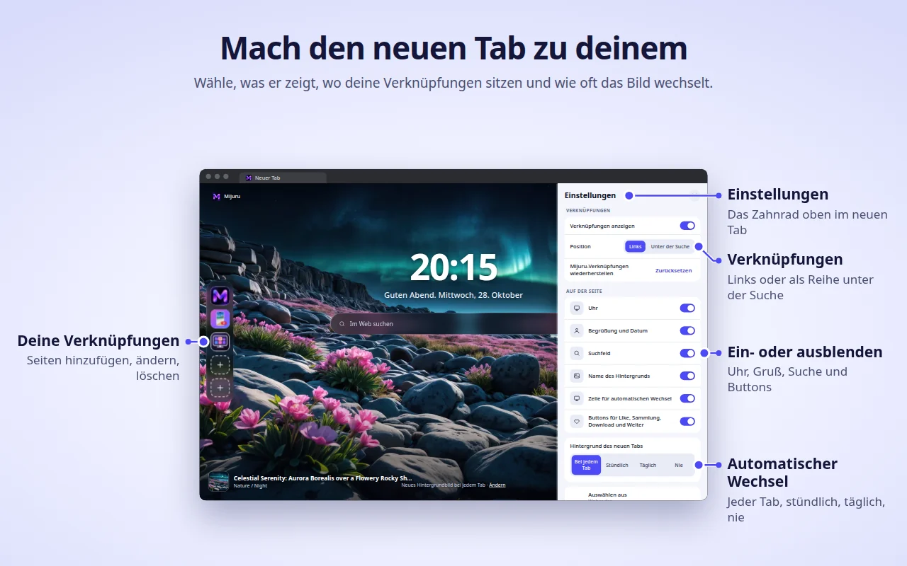

[English](README.md) · [Русский](README.ru.md) · [Українська](README.uk.md) · [Español](README.es.md) · [Português](README.pt.md) · **Deutsch** · [Français](README.fr.md) · [Italiano](README.it.md) · [Türkçe](README.tr.md) · [Polski](README.pl.md) · [한국어](README.ko.md) · [Tiếng Việt](README.vi.md) · [Bahasa Indonesia](README.id.md) · [العربية](README.ar.md)

  

<h1 align="center">Mijuru Wallpapers</h1>

  <b>Ein neuer 4K-Hintergrund in jedem neuen Tab.</b> 
  Tausende HD- und 4K-Hintergründe von <a href="https://mijuru.com">mijuru.com</a>, nur einen Klick entfernt in deiner Symbolleiste. 
  Kostenlos · ohne Werbung · ohne Konto.

  

Dieses Repository enthält die **Dokumentation und den öffentlichen Issue-Tracker** für die Browsererweiterung Mijuru Wallpapers. Der Quellcode der Erweiterung ist nicht öffentlich.

## Erweiterung herunterladen

| Browser | Store | Status |
|---|---|---|
| Google Chrome | [Chrome Web Store](https://chromewebstore.google.com/detail/mijuru-wallpapers/jlkpdnlkhknaifdjfjdepbfmklfpamfh) | ✅ Verfügbar |
| Microsoft Edge | [Edge-Add-ons](https://microsoftedge.microsoft.com/addons/detail/mijuru-wallpapers/cdnegcioifbeoldnojbgcopnklpneodo) | ✅ Verfügbar |
| Mozilla Firefox | [Firefox-Add-ons (AMO)](https://addons.mozilla.org/firefox/addon/mijuru-wallpapers/) | ✅ Verfügbar |
| Opera | Opera add-ons | ⏳ Wird vom Store geprüft |

Aktuelle Version: **1.4.0** – siehe [Änderungsprotokoll](CHANGELOG.md). In den Stores kann ein Update ein paar Tage nach dem Release erscheinen.

## Screenshots

| | |
|---|---|
|  |  |
|  |  |
|  | |

## Funktionen

**Neuer Tab**
- Ein bildschirmfüllender Hintergrund in der passenden Größe für deinen Bildschirm. Lässt sich die Datei in voller Größe nicht laden, wird eine Vorschau angezeigt – der Tab bleibt nie leer.
- Der nächste Hintergrund wird vorab geladen, deshalb öffnen sich neue Tabs sofort.
- Uhr, eine Begrüßung mit Datum („Guten Morgen…“) und ein Suchfeld, das die Standardsuchmaschine deines Browsers nutzt.
- Name und Kategorie des Hintergrunds – ein Klick öffnet seine Seite auf mijuru.com.
- Buttons: Like, zur Sammlung hinzufügen, Herunterladen (öffnet den Hintergrund auf mijuru.com) und Weiter.

**Automatischer Wechsel**
- Bei jedem neuen Tab (Standard), stündlich, täglich oder nie.
- Der nächste Hintergrund wird zufällig gewählt und wiederholt keinen der letzten 10.
- Quelle: alle Hintergründe, deine Sammlung oder eine einzelne Kategorie.

**Verknüpfungen** *(neu in 1.4.0)*
- 8 Plätze: standardmäßig drei Mijuru-Verknüpfungen (der Hintergrundkatalog, die Android-App, die PC-App) und Platz für deine eigenen Websites.
- Hinzufügen, bearbeiten oder löschen über das Menü „⋮“; „Zurücksetzen“ holt die Mijuru-Verknüpfungen zurück.
- Anordnung als Spalte links oder als Reihe unter der Suche.

**Einstellungen im neuen Tab** *(neu in 1.4.0)*
- Über das Zahnrad (oben rechts) kannst du Uhr, Begrüßung, Suche, Verknüpfungen, Name des Hintergrunds, die Zeile für automatischen Wechsel und die Buttons ein- oder ausblenden.

**Erweiterungsfenster – der ganze Katalog**
- Start (im Trend und neueste), Kategorien → Unterkategorien, Suche (Hintergründe oder Tags), ein endloser Zufall-Feed, deine Sammlung und dein Profil.
- Auf jeder Hintergrundkarte: Like, zur Sammlung hinzufügen, Für neuen Tab, Herunterladen.
- Der Katalog zeigt 16:9-Hintergründe in 4K (3840×2160) oder größer – jeder passt auf einen Breitbildmonitor.

**Sammlung**
- Speichere deine Lieblingshintergründe und aktiviere „Hintergründe im neuen Tab aus der Sammlung wechseln“.

**Hintergrund von mijuru.com übernehmen**
- Klicke auf mijuru.com auf der Seite eines Desktop-Hintergrunds auf **Als Hintergrund für neuen Tab festlegen** – die Erweiterung übernimmt ihn sofort.

**Außerdem**
- Helles, dunkles oder System-Design.
- 14 Oberflächensprachen: English, Русский, Українська, Español, Português (Brasil), Deutsch, Français, Italiano, Türkçe, Polski, 한국어, Tiếng Việt, Bahasa Indonesia, العربية (von rechts nach links).
- Einstellungen, Likes, Sammlung und Verknüpfungen werden mit deinem Browser synchronisiert, sofern die Synchronisierung aktiviert ist.

## Browser-Unterstützung

| Browser | Mindestversion | Ersetzt den neuen Tab | Hinweise |
|---|---|---|---|
| Chrome | 116 | Ja | |
| Edge | Aktuelle Versionen | Ja | Gleiche Version wie für Chrome |
| Firefox (Desktop) | 140 | Ja | Firefox für Android wird nicht unterstützt |
| Opera | Aktuelle Versionen | **Nein** | Opera erlaubt Erweiterungen nicht, den neuen Tab zu ersetzen – nutze stattdessen den **Mijuru-Tab** (siehe unten) |

## Installation

1. Öffne die Store-Seite für deinen Browser über die [Tabelle oben](#erweiterung-herunterladen).
2. Klicke auf **Hinzufügen** / **Abrufen** / **Zu Firefox hinzufügen**.
3. Öffne einen neuen Tab. Nach der ersten Installation erklärt eine kurze Willkommensseite auf mijuru.com die Grundlagen.

**Opera.** Sobald die Erweiterung veröffentlicht ist, öffne das Erweiterungsfenster → **Profil → Mijuru-Tab öffnen**. In den Opera-Einstellungen kannst du diese Seite als Startseite festlegen.

## Erste Schritte

1. **Öffne einen neuen Tab** – du siehst einen Hintergrund, die Uhr und die Suche.
2. **Klicke auf das Mijuru-Symbol** in der Symbolleiste, um den Katalog zu durchstöbern. Hefte es über das Erweiterungsmenü (Puzzleteil) an, damit es immer sichtbar ist.
3. **Like einen Hintergrund oder füge ihn deiner Sammlung hinzu** – auf jeder Karte oder direkt im neuen Tab.
4. **Lege fest, wie oft der Hintergrund wechselt**: Profil → Hintergrund des neuen Tabs oder der Link **Ändern** im neuen Tab.
5. **Passe die Seite an**: Das Zahnrad im neuen Tab blendet jedes Element ein oder aus.
6. **Lade einen Hintergrund herunter**: Der Button Herunterladen öffnet seine Seite auf mijuru.com, wo du die Größe wählst (4K UHD, 2K QHD, Full HD, 16:10, 21:9, 32:9…).

## Häufige Fragen

<b>Ist das wirklich kostenlos? Gibt es Werbung?</b>

Ja, es ist kostenlos. Es gibt keine Werbung, kein Konto und keine Anmeldung.

<b>Kann ich ein eigenes Bild als Hintergrund verwenden?</b>

Derzeit nicht. Die Erweiterung zeigt Hintergründe aus dem Katalog von mijuru.com. Wenn du dir diese Funktion wünschst, stimme dafür ab oder schlage sie unter [Ideas](https://github.com/orgs/mijuru-dev/discussions/categories/ideas) vor.

<b>Warum gibt es nur Hintergründe im Querformat?</b>

Die Erweiterung ist für Computerbildschirme gedacht, daher zeigt der Katalog im Fenster 16:9-Hintergründe in 4K oder größer. Hintergründe fürs Handy findest du auf [mijuru.com](https://mijuru.com) und in der [Android-App](https://play.google.com/store/apps/details?id=com.mijuru.wallpaper).

<b>Wie behalte ich denselben Hintergrund?</b>

Stelle den automatischen Wechsel auf **Nie** (Profil → Hintergrund des neuen Tabs oder der Link **Ändern** im neuen Tab). Wenn du einen Hintergrund manuell mit **Für neuen Tab** festlegst, wird der automatische Wechsel ebenfalls ausgeschaltet.

<b>Wie zeige ich nur Hintergründe aus meiner Sammlung oder einer Kategorie an?</b>

Profil → Hintergrund des neuen Tabs → Auswählen aus: **Sammlung** oder eine Kategorie. Im Tab Sammlung gibt es außerdem den Schalter „Hintergründe im neuen Tab aus der Sammlung wechseln“.

<b>Wie bekomme ich den Standard-Tab meines Browsers zurück?</b>

Deaktiviere oder entferne die Erweiterung: Öffne `chrome://extensions`, `edge://extensions` oder `about:addons` (Firefox) und schalte Mijuru Wallpapers aus. Der browsereigene neue Tab ist sofort wieder da.

<b>Kommen meine Likes, meine Sammlung und meine Verknüpfungen auf einen anderen Computer mit?</b>

Ja, wenn die Browser-Synchronisierung aktiviert ist (Google-, Microsoft- oder Firefox-Konto). Die Erweiterung nutzt den integrierten Synchronisierungsspeicher des Browsers; ein eigenes Konto hat sie nicht.

<b>Woher kommen die heruntergeladenen Hintergründe? Kann ich die Größe wählen?</b>

Herunterladen öffnet die Seite des Hintergrunds auf mijuru.com, wo du die genaue Größe auswählst. Die Erweiterung selbst speichert keine Dateien.

<b>Kann ich Uhr, Begrüßung oder Suche ausblenden?</b>

Ja. Klicke auf das Zahnrad oben rechts im neuen Tab und schalte beliebige Elemente aus.

<b>Sendet das Suchfeld meine Suchanfragen an Mijuru?</b>

Nein. Suchanfragen gehen über die browsereigene Such-API direkt an die Standardsuchmaschine deines Browsers. Die Erweiterung liest oder speichert sie nicht.

<b>Warum funktioniert Opera anders?</b>

Opera erlaubt Erweiterungen nicht, den neuen Tab zu ersetzen. Nutze **Profil → Mijuru-Tab öffnen** – das ist dieselbe Seite in einem normalen Tab, und du kannst sie als Startseite festlegen.

<b>Darf ich die Hintergründe kommerziell nutzen?</b>

Hintergründe von mijuru.com sind für die private Nutzung kostenlos. Weiterverkauf und kommerzielle Nutzung sind nicht erlaubt.

## Fehlerbehebung

**Der neue Tab zeigt Mijuru nicht an.**
Es kann immer nur eine Erweiterung den neuen Tab steuern – so funktionieren Browser. Wenn du eine andere Neuer-Tab-Erweiterung hast, verwendet der Browser eine davon. Deaktiviere die andere Erweiterung und öffne erneut einen neuen Tab.

**Chrome fragt, ob du zu Google zurückwechseln oder die Änderungen behalten möchtest.**
Chrome zeigt diese Abfrage, sobald eine Erweiterung den neuen Tab ersetzt. Wähle **Änderungen behalten**, um bei Mijuru zu bleiben. Wenn du dich fürs Zurücksetzen entschieden hast, deaktiviert Chrome die Erweiterung – aktiviere sie unter `chrome://extensions` wieder.

**Mein Firmenbrowser ignoriert die Erweiterung.**
Verwaltete Browser (Arbeit oder Schule) können Erweiterungen per Richtlinie blockieren oder einen bestimmten neuen Tab erzwingen. Wende dich an deinen Administrator.

**Opera: kein Hintergrund im neuen Tab und kein „Für neuen Tab“-Button.**
Das ist so gewollt – siehe [Warum funktioniert Opera anders?](#häufige-fragen). Nutze den **Mijuru-Tab**.

**Die Titel der Hintergründe sind auf Englisch, obwohl ich eine andere Sprache gewählt habe.**
Für Koreanisch, Vietnamesisch, Indonesisch und Arabisch hat der Katalog noch keine übersetzten Titel, daher erscheinen sie auf Englisch. Die Oberfläche selbst ist übersetzt. Katalog-Links öffnen immer die englische Version von mijuru.com.

**„Laden fehlgeschlagen. Prüfe deine Verbindung.“**
Die Erweiterung braucht Internetzugriff auf mijuru.com. Prüfe deine Verbindung, dein VPN oder deine Firewall und klicke dann auf **Erneut versuchen**. Lässt sich der Hintergrund in voller Größe nicht laden, wird stattdessen eine Vorschau angezeigt.

**Eine Verknüpfung zeigt einen Buchstaben statt eines Symbols.**
Das Symbol der Website (`/favicon.ico`) konnte nicht geladen werden, daher zeigt die Kachel den ersten Buchstaben des Namens. Die Verknüpfung funktioniert trotzdem.

**Der Hintergrund wechselt nicht mehr.**
Sieh unter Profil → Hintergrund des neuen Tabs nach: Wenn du einen Hintergrund manuell festgelegt hast, wurde der automatische Wechsel auf **Nie** gestellt. Ist deine Sammlung die Quelle, stelle sicher, dass sie nicht leer ist.

Kommst du nicht weiter? [Erstelle ein Issue](https://github.com/mijuru-dev/wallpapers-browser-extension/issues/new/choose).

## Berechtigungen und Datenschutz

Die Erweiterung fragt nur nach dem, was sie braucht:

| Berechtigung | Wofür |
|---|---|
| `storage` | Deine Einstellungen, die IDs gelikter und gesammelter Hintergründe, deine Verknüpfungen und ein Cache. |
| `alarms` | Stündlicher und täglicher automatischer Wechsel sowie das Vorabladen des nächsten Hintergrunds. |
| `search` | Das Suchfeld im neuen Tab sendet deine Anfrage an die Standardsuchmaschine des Browsers. Die Erweiterung liest oder speichert keine Anfragen. |
| `https://mijuru.com/*` | Laden des Hintergrundkatalogs und der Bilder über die schreibgeschützte API von mijuru.com sowie der Button „Als Hintergrund für neuen Tab festlegen“ auf mijuru.com (siehe unten). |

Es gibt **keinen** Zugriff auf deine Tabs, deinen Verlauf, deine Downloads oder die Inhalte anderer Websites.

**Was die Erweiterung tut und was nicht**
- **Keine Analysen, Werbung, Cookies, Konten oder Tracker von Drittanbietern.** Der Firefox-Eintrag gibt an, dass keine Daten erhoben werden.
- **Anfragen gehen an mijuru.com** – Katalog und Bilder (schreibgeschützte `GET`-Anfragen mit gewählter Sprache, Kategorie, Tag, Suchtext oder Hintergrund-IDs).
- **Symbole der Verknüpfungen.** Für selbst hinzugefügte Verknüpfungen lädt der neue Tab das Symbol der Website von `https://<diese Website>/favicon.ico`. Das ist eine normale Anfrage an die Website, die du hinzugefügt hast; Daten der Erweiterung werden nicht mitgeschickt.
- **Integration mit mijuru.com.** Ein kleines Skript läuft nur auf Seiten unter `https://mijuru.com/*`. Es ermöglicht dem Button „Als Hintergrund für neuen Tab festlegen“ der Website, eine Hintergrund-ID an die Erweiterung zu übergeben, und teilt der Website die Version der Erweiterung, den Browsernamen und die ID des aktuellen Hintergrunds mit, damit der Button den richtigen Zustand anzeigt. Es liest nichts anderes und läuft auf keiner anderen Website.
- **Likes bleiben bei dir.** Likes und deine Sammlung werden im Browserspeicher abgelegt (vom Browser synchronisiert, wenn die Synchronisierung aktiviert ist). Wenn du einen Hintergrund likest, wird nichts an den Server gesendet.
- **Installations- und Deinstallationsseiten.** Nach der ersten Installation öffnet die Erweiterung eine Willkommensseite auf mijuru.com; beim Entfernen öffnet der Browser eine Abschiedsseite mit einer optionalen Umfrage aus einer Frage. Diese Links enthalten nur Sprache, Browsernamen, Version der Erweiterung und `utm_*`-Parameter – keine Nutzerkennungen. Dieselben `utm_*`-Parameter werden auch anderen Links zu mijuru.com hinzugefügt. Sobald du auf mijuru.com bist, gilt die Datenschutzerklärung der Website.

Vollständige Datenschutzerklärung: **[mijuru.com/browser-extension-privacy-policy](https://mijuru.com/browser-extension-privacy-policy)**

## Feedback und Support

| Was | Wo | |
|---|---|---|
| 🐞 **Etwas funktioniert nicht** | [Problem melden](https://github.com/mijuru-dev/wallpapers-browser-extension/issues/new/choose) | GitHub Issues |
| 💡 **Idee oder Vorschlag** | [Idee teilen](https://github.com/orgs/mijuru-dev/discussions/categories/ideas) | GitHub Discussions |
| ❓ **Frage** | [In Q&A fragen](https://github.com/orgs/mijuru-dev/discussions/categories/q-a) | GitHub Discussions |
| ✉️ **Private Angelegenheit** | [m@mijuru.dev](mailto:m@mijuru.dev) | E-Mail |

**Issues sind nur für Probleme da** – Ideen, Vorschläge und Fragen gehören in die [Discussions](https://github.com/orgs/mijuru-dev/discussions), wo alle mit 👍 für die Ideen stimmen können, die ihnen am besten gefallen.
Bitte schreibe auf Englisch, damit alle die Unterhaltung finden und verfolgen können – eine maschinelle Übersetzung aus deiner Sprache ist völlig in Ordnung. Durchsuche vor dem Posten die bestehenden Issues und Diskussionen: Ein 👍 auf einem bestehenden Beitrag hilft mehr als ein Duplikat.

🚩 Um einen Hintergrund zu melden (Urheberrecht, unangemessene Inhalte), nutze **Bild melden** auf der Seite des Hintergrunds auf mijuru.com.

## Mehr Hintergründe auf mijuru.com

Die komplette Sammlung findest du auf der Website – praktisch, wenn du einen Hintergrund auf einem anderen Gerät oder in einer Größe wählen möchtest, die die Erweiterung nicht anzeigt:

- [Desktop-Hintergründe nach Auflösung – 4K, 2K, Full HD, Ultrawide](https://mijuru.com/wallpapers/resolutions)
- [Hintergrund-Pakete – thematische Sammlungen](https://mijuru.com/wallpapers/packs)
- [Handy-Hintergründe nach Marke – iPhone, Samsung, Xiaomi und mehr](https://mijuru.com/wallpapers/device-brands)
- [Avatare und Profilbilder für Instagram, Discord, TikTok](https://mijuru.com/avatars)

## Weitere Mijuru-Apps

- 🌐 **[mijuru.com](https://mijuru.com)** – kostenlose Hintergründe für Handy, Desktop und Tablet in HD, 4K und 8K.
- 📱 **[Wallpapers by Mijuru für Android](https://play.google.com/store/apps/details?id=com.mijuru.wallpaper)** – Hintergründe für Startbildschirm und Sperrbildschirm festlegen.
- 🖥️ **[Wallpapers by Mijuru für Linux](https://snapcraft.io/wallpapers-by-mijuru)** – Hintergründe mit einem Klick festlegen und nach Zeitplan wechseln.

Alle Produkte und Dokumentation: **[github.com/mijuru-dev](https://github.com/mijuru-dev)**

## Lizenz

© 2026 Mijuru. Alle Rechte vorbehalten. Die Nutzung der Erweiterung ist kostenlos; ihr Quellcode wird nicht veröffentlicht. Die Dokumentation und die Bilder in diesem Repository dürfen ohne Erlaubnis nicht weiterverwendet werden.
