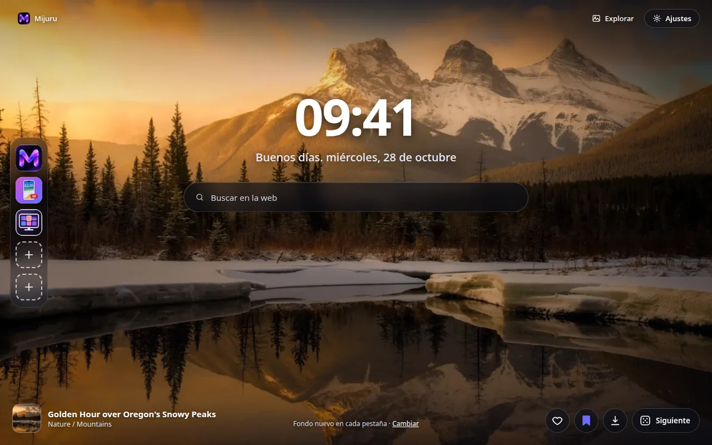
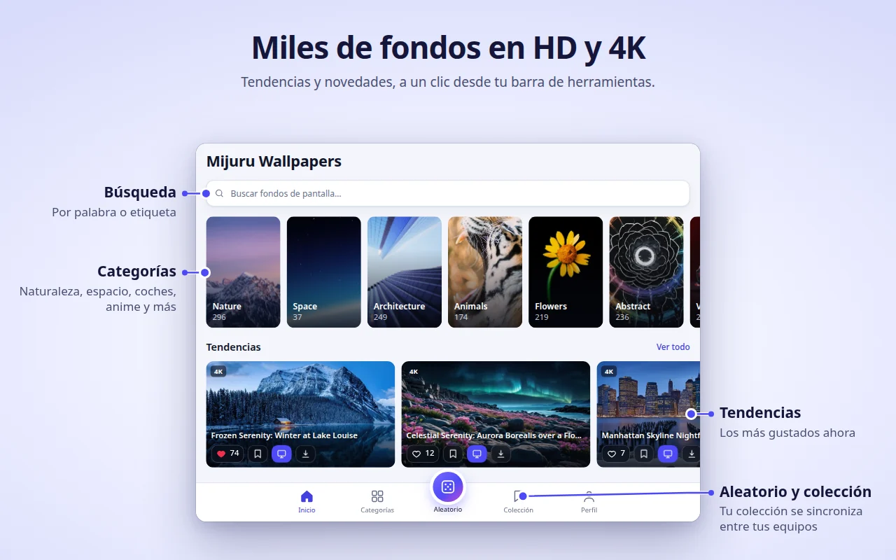
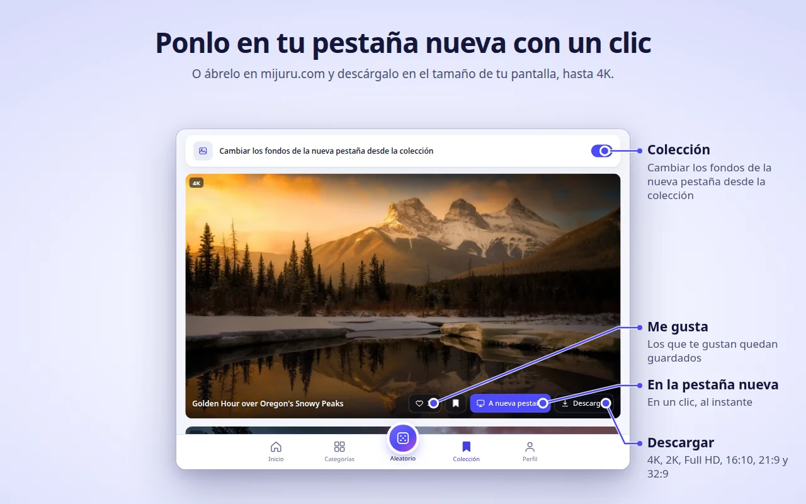
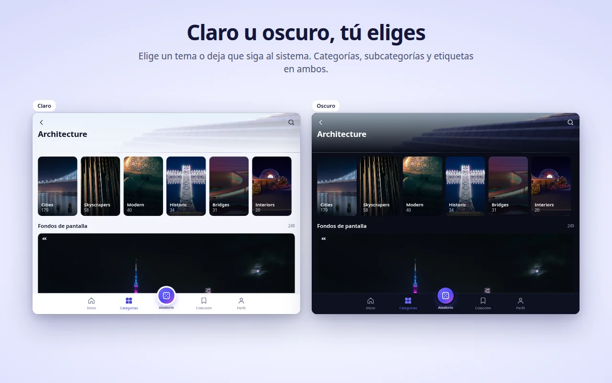
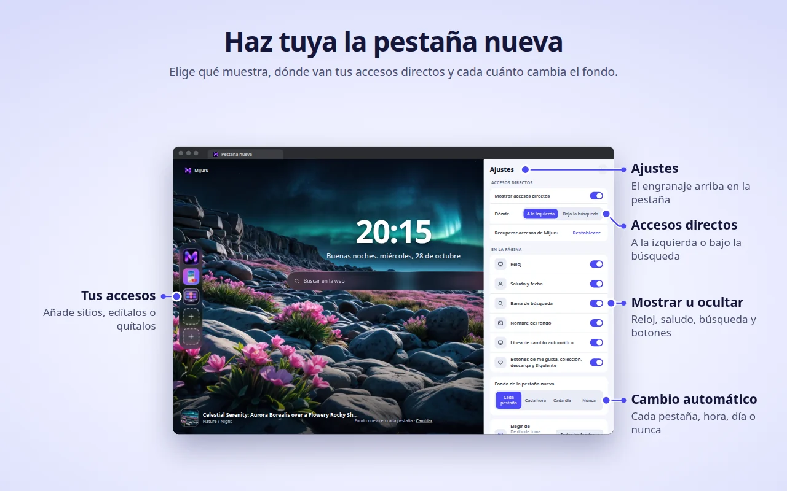

[English](README.md) · [Русский](README.ru.md) · [Українська](README.uk.md) · **Español** · [Português](README.pt.md) · [Deutsch](README.de.md) · [Français](README.fr.md) · [Italiano](README.it.md) · [Türkçe](README.tr.md) · [Polski](README.pl.md) · [한국어](README.ko.md) · [Tiếng Việt](README.vi.md) · [Bahasa Indonesia](README.id.md) · [العربية](README.ar.md)

  

<h1 align="center">Mijuru Wallpapers</h1>

  <b>Un fondo de pantalla 4K nuevo en cada pestaña.</b> 
  Miles de fondos HD y 4K de <a href="https://mijuru.com">mijuru.com</a>, a un clic desde la barra de herramientas. 
  Gratis · sin anuncios · sin cuenta.

  

Este repositorio contiene la **documentación y el gestor público de incidencias** de la extensión de navegador Mijuru Wallpapers. El código fuente de la extensión es cerrado.

## Descargar la extensión

| Navegador | Tienda | Estado |
|---|---|---|
| Google Chrome | [Chrome Web Store](https://chromewebstore.google.com/detail/mijuru-wallpapers/jlkpdnlkhknaifdjfjdepbfmklfpamfh) | ✅ Disponible |
| Microsoft Edge | [Complementos de Edge](https://microsoftedge.microsoft.com/addons/detail/mijuru-wallpapers/cdnegcioifbeoldnojbgcopnklpneodo) | ✅ Disponible |
| Mozilla Firefox | [Complementos de Firefox (AMO)](https://addons.mozilla.org/firefox/addon/mijuru-wallpapers/) | ✅ Disponible |
| Opera | Opera add-ons | ⏳ En revisión en la tienda |

Versión actual: **1.4.0**; consulta el [registro de cambios](CHANGELOG.md). Las tiendas pueden tardar unos días en publicar una nueva versión.

## Capturas de pantalla

| | |
|---|---|
|  |  |
|  |  |
|  | |

## Funciones

**Nueva pestaña**
- Un fondo a pantalla completa en el tamaño adecuado para tu pantalla. Si el archivo a tamaño completo no carga, se muestra una vista previa: la pestaña nunca se queda vacía.
- El siguiente fondo se descarga por adelantado, así que las pestañas nuevas se abren al instante.
- Reloj, un saludo con la fecha («Buenos días…») y una barra de búsqueda que usa el buscador predeterminado de tu navegador.
- El nombre y la categoría del fondo: haz clic para abrir su página en mijuru.com.
- Botones: Me gusta, añadir a la Colección, Descargar (abre el fondo en mijuru.com) y Siguiente.

**Cambio automático**
- En cada pestaña nueva (por defecto), cada hora, cada día o nunca.
- El siguiente fondo se elige al azar y nunca repite los 10 últimos.
- Origen: todos los fondos, tu Colección o una sola categoría.

**Accesos directos** *(novedad en 1.4.0)*
- 8 espacios: por defecto, tres accesos directos de Mijuru (el catálogo de fondos, la app para Android y la app para PC) y sitio para tus propias webs.
- Añade, edita o elimina desde el menú «⋮»; «Restablecer» recupera los accesos directos de Mijuru.
- Colócalos en una columna a la izquierda o en una fila bajo la búsqueda.

**Ajustes en la nueva pestaña** *(novedad en 1.4.0)*
- El botón del engranaje (arriba a la derecha) permite mostrar u ocultar el reloj, el saludo, la búsqueda, los accesos directos, el nombre del fondo, la línea de cambio automático y los botones.

**Ventana de la extensión: todo el catálogo**
- Inicio (tendencias y recientes), Categorías → subcategorías, Búsqueda (fondos o etiquetas), un feed Aleatorio infinito, tu Colección y tu Perfil.
- En cada tarjeta: Me gusta, añadir a la Colección, A nueva pestaña y Descargar.
- El catálogo muestra fondos 16:9 en 4K (3840×2160) o más: todos encajan en un monitor panorámico.

**Colección**
- Guarda los fondos que te encantan y activa «Cambiar los fondos de la nueva pestaña desde la colección».

**Poner un fondo desde mijuru.com**
- En la página de un fondo de escritorio en mijuru.com, pulsa **Poner como fondo de la nueva pestaña** y la extensión lo aplica al momento.

**Y además**
- Tema claro, oscuro o del sistema.
- 14 idiomas de interfaz: English, Русский, Українська, Español, Português (Brasil), Deutsch, Français, Italiano, Türkçe, Polski, 한국어, Tiếng Việt, Bahasa Indonesia, العربية (de derecha a izquierda).
- Los ajustes, los «me gusta», la Colección y los accesos directos se sincronizan con tu navegador, si la sincronización está activada.

## Navegadores compatibles

| Navegador | Versión mínima | Sustituye la nueva pestaña | Notas |
|---|---|---|---|
| Chrome | 116 | Sí | |
| Edge | Versiones actuales | Sí | La misma versión que para Chrome |
| Firefox (escritorio) | 140 | Sí | Firefox para Android no es compatible |
| Opera | Versiones actuales | **No** | Opera no permite que las extensiones sustituyan su nueva pestaña; usa la **pestaña de Mijuru** (ver más abajo) |

## Instalación

1. Abre la página de la tienda de tu navegador desde la [tabla de arriba](#descargar-la-extensión).
2. Haz clic en **Añadir a Chrome** / **Obtener** / **Agregar a Firefox**.
3. Abre una pestaña nueva. Tras la primera instalación, una breve página de bienvenida en mijuru.com explica lo básico.

**Opera.** Cuando la extensión esté publicada, abre la ventana de la extensión → **Perfil → Abrir la pestaña de Mijuru**. Puedes convertir esta página en tu página de inicio en los ajustes de Opera.

## Primeros pasos

1. **Abre una pestaña nueva**: verás un fondo, el reloj y la búsqueda.
2. **Haz clic en el icono de Mijuru** en la barra de herramientas para explorar el catálogo. Fíjalo desde el menú de extensiones (la pieza de puzle) para tenerlo siempre a la vista.
3. **Dale a Me gusta o añade un fondo a tu Colección** desde cualquier tarjeta o directamente desde la nueva pestaña.
4. **Elige cada cuánto cambia el fondo**: Perfil → Fondo de la pestaña nueva, o el enlace **Cambiar** en la nueva pestaña.
5. **Ajusta la página**: el botón del engranaje en la nueva pestaña muestra u oculta cada elemento.
6. **Descarga un fondo**: el botón Descargar abre su página en mijuru.com, donde eliges el tamaño (4K UHD, 2K QHD, Full HD, 16:10, 21:9, 32:9…).

## Preguntas frecuentes

<b>¿De verdad es gratis? ¿Tiene anuncios?</b>

Sí, es gratis. No hay anuncios, ni cuenta, ni inicio de sesión.

<b>¿Puedo usar mi propia imagen como fondo?</b>

Por ahora no. La extensión muestra fondos del catálogo de mijuru.com. Si quieres esta función, vota por ella o proponla en [Ideas](https://github.com/orgs/mijuru-dev/discussions/categories/ideas).

<b>¿Por qué solo hay fondos horizontales?</b>

La extensión está pensada para pantallas de ordenador, así que el catálogo de la ventana muestra fondos 16:9 en 4K o más. Los fondos para móvil están en [mijuru.com](https://mijuru.com) y en la [app para Android](https://play.google.com/store/apps/details?id=com.mijuru.wallpaper).

<b>¿Cómo mantengo siempre el mismo fondo?</b>

Pon el cambio automático en **Nunca** (Perfil → Fondo de la pestaña nueva, o el enlace **Cambiar** en la nueva pestaña). Si eliges un fondo manualmente con **A nueva pestaña**, el cambio automático también se desactiva.

<b>¿Cómo muestro solo fondos de mi Colección o de una categoría?</b>

Perfil → Fondo de la pestaña nueva → Elegir de: **Colección** o una categoría. En la pestaña Colección también hay un interruptor «Cambiar los fondos de la nueva pestaña desde la colección».

<b>¿Cómo recupero la nueva pestaña predeterminada del navegador?</b>

Desactiva o quita la extensión: abre `chrome://extensions`, `edge://extensions` o `about:addons` (Firefox) y desactiva Mijuru Wallpapers. La nueva pestaña del navegador vuelve de inmediato.

<b>¿Mis «me gusta», mi Colección y mis accesos directos pasarán a otro ordenador?</b>

Sí, si la sincronización del navegador está activada (con una cuenta de Google, Microsoft o Firefox). La extensión usa el almacenamiento sincronizado integrado del navegador; no tiene cuenta propia.

<b>¿De dónde salen los fondos descargados? ¿Puedo elegir el tamaño?</b>

Descargar abre la página del fondo en mijuru.com, donde eliges el tamaño exacto. La extensión en sí no guarda archivos.

<b>¿Puedo ocultar el reloj, el saludo o la búsqueda?</b>

Sí. Haz clic en el botón del engranaje, en la esquina superior derecha de la nueva pestaña, y desactiva el elemento que quieras.

<b>¿La barra de búsqueda envía mis consultas a Mijuru?</b>

No. Las consultas van directamente al buscador predeterminado de tu navegador mediante la API de búsqueda del propio navegador. La extensión no las lee ni las guarda.

<b>¿Por qué Opera funciona de otra manera?</b>

Opera no permite que las extensiones sustituyan su nueva pestaña. Usa **Perfil → Abrir la pestaña de Mijuru**: es la misma página en una pestaña normal, y puedes ponerla como página de inicio.

<b>¿Puedo usar los fondos con fines comerciales?</b>

Los fondos de mijuru.com son gratuitos para uso personal. No se permite su reventa ni su uso comercial.

## Solución de problemas

**La nueva pestaña no muestra Mijuru.**
Solo una extensión puede controlar la nueva pestaña a la vez: así funcionan los navegadores. Si tienes otra extensión de nueva pestaña, el navegador usará una de ellas. Desactiva la otra extensión y vuelve a abrir una pestaña nueva.

**Chrome pregunta si quieres volver a Google o conservar los cambios.**
Chrome muestra este aviso cuando cualquier extensión sustituye la nueva pestaña. Elige **conservar los cambios** para quedarte con Mijuru. Si elegiste volver a la configuración anterior, Chrome desactiva la extensión: vuelve a activarla en `chrome://extensions`.

**El navegador de mi empresa ignora la extensión.**
Los navegadores gestionados (del trabajo o del centro educativo) pueden bloquear extensiones o imponer una nueva pestaña concreta mediante directivas. Consulta a tu administrador.

**Opera: no hay fondo en la nueva pestaña ni botón «A nueva pestaña».**
Es lo esperado: consulta [¿Por qué Opera funciona de otra manera?](#preguntas-frecuentes). Usa la **pestaña de Mijuru**.

**Los títulos de los fondos están en inglés aunque elegí otro idioma.**
Para coreano, vietnamita, indonesio y árabe el catálogo aún no tiene títulos traducidos, así que se muestran en inglés. La interfaz sí está traducida. Los enlaces del catálogo siempre abren la versión en inglés de mijuru.com.

**«No se pudo cargar. Comprueba tu conexión.»**
La extensión necesita acceso a internet a mijuru.com. Revisa tu conexión, VPN o cortafuegos y pulsa **Reintentar**. Si el fondo a tamaño completo no carga, se muestra una vista previa en su lugar.

**Un acceso directo muestra una letra en lugar de un icono.**
No se pudo cargar el icono del sitio (`/favicon.ico`), así que el mosaico muestra la primera letra del nombre. El acceso directo sigue funcionando.

**El fondo ya no cambia.**
Revisa Perfil → Fondo de la pestaña nueva: si elegiste un fondo manualmente, el cambio automático pasó a **Nunca**. Si el origen es tu Colección, asegúrate de que no esté vacía.

¿Sigues con el problema? [Abre una incidencia](https://github.com/mijuru-dev/wallpapers-browser-extension/issues/new/choose).

## Permisos y privacidad

La extensión solo pide lo que necesita:

| Permiso | Para qué |
|---|---|
| `storage` | Tus ajustes, los ID de los fondos que te gustan y de tu colección, tus accesos directos y una caché. |
| `alarms` | El cambio automático cada hora y cada día, y la descarga anticipada del siguiente fondo. |
| `search` | La barra de búsqueda de la nueva pestaña envía tu consulta al buscador predeterminado del navegador. La extensión no lee ni guarda las consultas. |
| `https://mijuru.com/*` | Cargar el catálogo y las imágenes desde la API de solo lectura de mijuru.com, y el botón «Poner como fondo de la nueva pestaña» de mijuru.com (ver más abajo). |

**No** tiene acceso a tus pestañas, historial, descargas ni al contenido de otros sitios web.

**Qué hace y qué no hace la extensión**
- **Sin analíticas, anuncios, cookies, cuentas ni rastreadores de terceros.** La ficha de Firefox declara que no se recopilan datos.
- **Las solicitudes van a mijuru.com**: catálogo e imágenes (solicitudes `GET` de solo lectura con el idioma, la categoría, la etiqueta, el texto de búsqueda o los ID de fondos seleccionados).
- **Iconos de los accesos directos.** Para los accesos directos que añades tú, la nueva pestaña carga el icono desde `https://<ese sitio>/favicon.ico`. Es una solicitud normal al sitio que añadiste; no se adjunta ningún dato de la extensión.
- **Integración con mijuru.com.** Un pequeño script se ejecuta solo en las páginas `https://mijuru.com/*`. Permite que el botón «Poner como fondo de la nueva pestaña» del sitio pase el ID de un fondo a la extensión e informa al sitio de la versión de la extensión, el nombre del navegador y el ID del fondo actual, para que el botón muestre el estado correcto. No lee nada más y no se ejecuta en ningún otro sitio.
- **Tus «me gusta» se quedan contigo.** Los «me gusta» y tu Colección se guardan en el almacenamiento del navegador (sincronizado por el navegador si la sincronización está activada). Al dar Me gusta a un fondo no se envía nada al servidor.
- **Páginas de instalación y desinstalación.** Tras la primera instalación, la extensión abre una página de bienvenida en mijuru.com; al quitarla, el navegador abre una página de despedida con una encuesta opcional de una sola pregunta. Estos enlaces solo contienen el idioma, el nombre del navegador, la versión de la extensión y etiquetas `utm_*`, sin identificadores de usuario. Las mismas etiquetas `utm_*` se añaden a otros enlaces a mijuru.com. Una vez en mijuru.com, se aplica la política de privacidad del propio sitio.

Política completa: **[mijuru.com/browser-extension-privacy-policy](https://mijuru.com/browser-extension-privacy-policy)**

## Comentarios y soporte

| Qué | Dónde | |
|---|---|---|
| 🐞 **Algo no funciona** | [Informar de un problema](https://github.com/mijuru-dev/wallpapers-browser-extension/issues/new/choose) | GitHub Issues |
| 💡 **Idea o sugerencia** | [Compartir una idea](https://github.com/orgs/mijuru-dev/discussions/categories/ideas) | GitHub Discussions |
| ❓ **Pregunta** | [Preguntar en Q&A](https://github.com/orgs/mijuru-dev/discussions/categories/q-a) | GitHub Discussions |
| ✉️ **Asunto privado** | [m@mijuru.dev](mailto:m@mijuru.dev) | Correo |

**Las issues son solo para problemas**: las ideas, sugerencias y preguntas van en [Discussions](https://github.com/orgs/mijuru-dev/discussions), donde todos pueden votar con 👍 las ideas que más les gustan.
Escribe en inglés para que todos puedan encontrar y seguir la conversación; una traducción automática desde tu idioma está perfectamente bien. Antes de publicar, busca entre las issues y discusiones existentes: un 👍 en una ya existente ayuda más que un duplicado.

🚩 Para denunciar un fondo (derechos de autor, contenido inapropiado), usa **Denunciar imagen** en la página del fondo en mijuru.com.

## Más fondos en mijuru.com

La colección completa está en el sitio web, muy útil cuando quieres elegir un fondo en otro dispositivo o en un tamaño que la extensión no muestra:

- [Fondos de escritorio por resolución: 4K, 2K, Full HD, ultrapanorámicos](https://mijuru.com/wallpapers/resolutions)
- [Packs de fondos: colecciones temáticas](https://mijuru.com/wallpapers/packs)
- [Fondos para móvil por marca: iPhone, Samsung, Xiaomi y más](https://mijuru.com/wallpapers/device-brands)
- [Avatares y fotos de perfil para Instagram, Discord, TikTok](https://mijuru.com/avatars)

## Otras apps de Mijuru

- 🌐 **[mijuru.com](https://mijuru.com)**: fondos de pantalla gratuitos para móvil, ordenador y tableta en HD, 4K y 8K.
- 📱 **[Wallpapers by Mijuru para Android](https://play.google.com/store/apps/details?id=com.mijuru.wallpaper)**: pon fondos en la pantalla de inicio y de bloqueo.
- 🖥️ **[Wallpapers by Mijuru para Linux](https://snapcraft.io/wallpapers-by-mijuru)**: pon fondos con un clic y cámbialos de forma programada.

Todos los productos y la documentación: **[github.com/mijuru-dev](https://github.com/mijuru-dev)**

## Licencia

© 2026 Mijuru. Todos los derechos reservados. La extensión es de uso gratuito; su código fuente no se publica. La documentación y las imágenes de este repositorio no pueden reutilizarse sin permiso.
