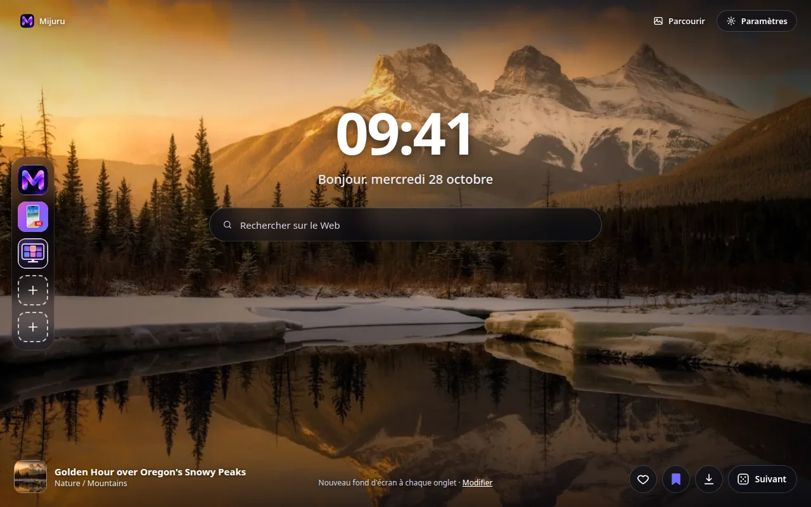
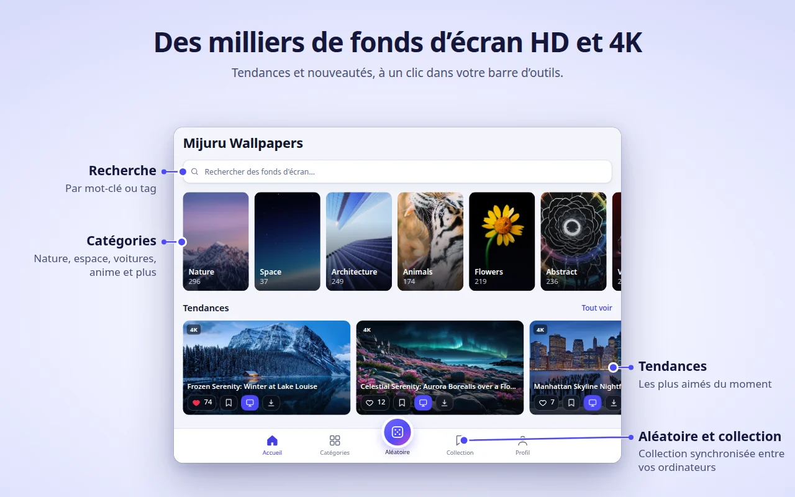
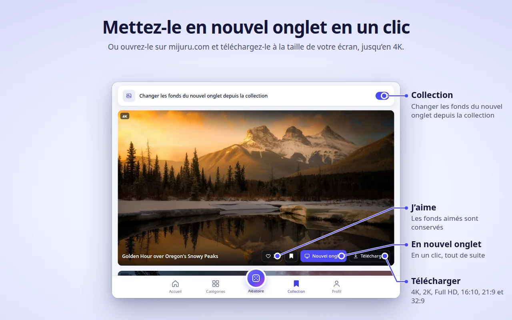
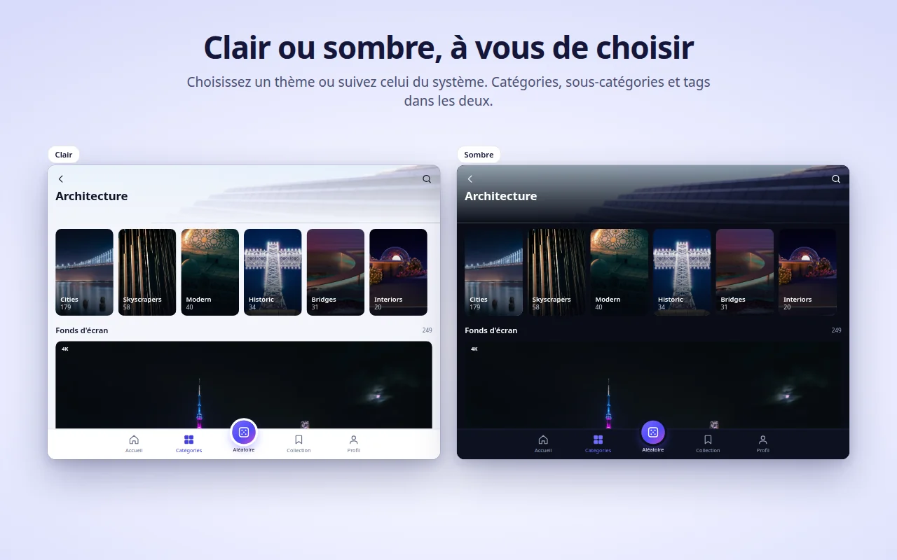
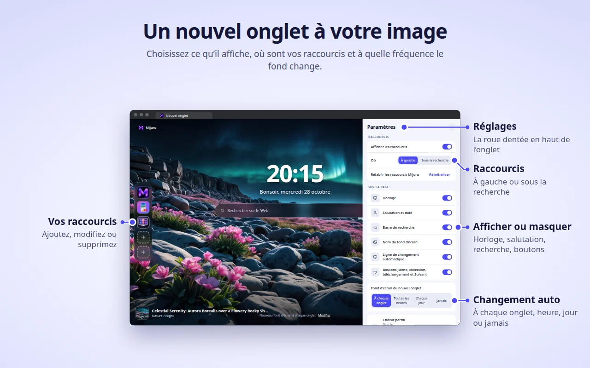

[English](README.md) · [Русский](README.ru.md) · [Українська](README.uk.md) · [Español](README.es.md) · [Português](README.pt.md) · [Deutsch](README.de.md) · **Français** · [Italiano](README.it.md) · [Türkçe](README.tr.md) · [Polski](README.pl.md) · [한국어](README.ko.md) · [Tiếng Việt](README.vi.md) · [Bahasa Indonesia](README.id.md) · [العربية](README.ar.md)

  

<h1 align="center">Mijuru Wallpapers</h1>

  <b>Un nouveau fond d'écran 4K à chaque nouvel onglet.</b> 
  Des milliers de fonds d'écran HD et 4K de <a href="https://mijuru.com">mijuru.com</a>, à un clic depuis votre barre d'outils. 
  Gratuit · sans publicité · sans compte.

  

Ce dépôt contient la **documentation et le suivi public des tickets** de l'extension de navigateur Mijuru Wallpapers. Le code source de l'extension est fermé.

## Obtenir l'extension

| Navigateur | Boutique | Statut |
|---|---|---|
| Google Chrome | [Chrome Web Store](https://chromewebstore.google.com/detail/mijuru-wallpapers/jlkpdnlkhknaifdjfjdepbfmklfpamfh) | ✅ Disponible |
| Microsoft Edge | [Modules complémentaires Edge](https://microsoftedge.microsoft.com/addons/detail/mijuru-wallpapers/cdnegcioifbeoldnojbgcopnklpneodo) | ✅ Disponible |
| Mozilla Firefox | [Modules complémentaires Firefox (AMO)](https://addons.mozilla.org/firefox/addon/mijuru-wallpapers/) | ✅ Disponible |
| Opera | Opera add-ons | ⏳ En cours d'examen par la boutique |

Dernière version : **1.4.0** — voir le [journal des modifications](CHANGELOG.md). Les boutiques peuvent publier une nouvelle version avec quelques jours de retard.

## Captures d'écran

| | |
|---|---|
|  |  |
|  |  |
|  | |

## Fonctionnalités

**Nouvel onglet**
- Un fond d'écran plein écran, à la taille adaptée à votre écran. Si le fichier en pleine taille ne se charge pas, un aperçu s'affiche — l'onglet n'est jamais vide.
- Le fond d'écran suivant est téléchargé à l'avance : les nouveaux onglets s'ouvrent instantanément.
- Horloge, salutation avec la date (« Bonjour… ») et barre de recherche qui utilise le moteur de recherche par défaut de votre navigateur.
- Le nom et la catégorie du fond d'écran — cliquez pour ouvrir sa page sur mijuru.com.
- Boutons : J'aime, ajouter à la Collection, Télécharger (ouvre le fond d'écran sur mijuru.com) et Suivant.

**Changement automatique**
- À chaque nouvel onglet (par défaut), toutes les heures, chaque jour ou jamais.
- Le fond d'écran suivant est choisi au hasard et ne reprend jamais l'un des 10 derniers.
- Source : tous les fonds d'écran, votre Collection ou une seule catégorie.

**Raccourcis** *(nouveau dans la 1.4.0)*
- 8 emplacements : trois raccourcis Mijuru par défaut (le catalogue de fonds d'écran, l'application Android, l'application PC) et de la place pour vos propres sites.
- Ajoutez, modifiez ou supprimez-les via le menu « ⋮ » ; « Réinitialiser » rétablit les raccourcis Mijuru.
- Placez-les en colonne à gauche ou en rangée sous la recherche.

**Paramètres dans le nouvel onglet** *(nouveau dans la 1.4.0)*
- Le bouton en forme d'engrenage (en haut à droite) permet d'afficher ou de masquer l'horloge, la salutation, la recherche, les raccourcis, le nom du fond d'écran, la ligne de changement automatique et les boutons.

**Fenêtre de l'extension — tout le catalogue**
- Accueil (tendances et récents), Catégories → sous-catégories, Recherche (fonds d'écran ou tags), un fil Aléatoire infini, votre Collection et votre Profil.
- Sur chaque carte : J'aime, ajouter à la Collection, Nouvel onglet, Télécharger.
- Le catalogue affiche des fonds d'écran 16:9 en 4K (3840×2160) ou plus — tous s'adaptent à un écran large.

**Collection**
- Enregistrez vos fonds d'écran préférés et activez « Changer les fonds du nouvel onglet depuis la collection ».

**Définir un fond d'écran depuis mijuru.com**
- Sur la page d'un fond d'écran pour ordinateur sur mijuru.com, cliquez sur **Définir comme fond du nouvel onglet** — l'extension l'applique aussitôt.

**Et aussi**
- Thème clair, sombre ou système.
- 14 langues d'interface : English, Русский, Українська, Español, Português (Brasil), Deutsch, Français, Italiano, Türkçe, Polski, 한국어, Tiếng Việt, Bahasa Indonesia, العربية (de droite à gauche).
- Les paramètres, les « J'aime », la Collection et les raccourcis suivent la synchronisation de votre navigateur, si elle est activée.

## Navigateurs pris en charge

| Navigateur | Version minimale | Remplace le nouvel onglet | Remarques |
|---|---|---|---|
| Chrome | 116 | Oui | |
| Edge | Versions actuelles | Oui | Même version que pour Chrome |
| Firefox (ordinateur) | 140 | Oui | Firefox pour Android n'est pas pris en charge |
| Opera | Versions actuelles | **Non** | Opera ne permet pas aux extensions de remplacer son nouvel onglet — utilisez plutôt l'**onglet Mijuru** (voir ci-dessous) |

## Installation

1. Ouvrez la page de la boutique de votre navigateur depuis le [tableau ci-dessus](#obtenir-lextension).
2. Cliquez sur **Ajouter à Chrome** / **Obtenir** / **Ajouter à Firefox**.
3. Ouvrez un nouvel onglet. Après la première installation, une courte page d'accueil sur mijuru.com présente l'essentiel.

**Opera.** Une fois l'extension publiée, ouvrez la fenêtre de l'extension → **Profil → Ouvrir l'onglet Mijuru**. Vous pouvez en faire votre page de démarrage dans les paramètres d'Opera.

## Premiers pas

1. **Ouvrez un nouvel onglet** — vous verrez un fond d'écran, l'horloge et la recherche.
2. **Cliquez sur l'icône Mijuru** dans la barre d'outils pour parcourir le catalogue. Épinglez-la via le menu des extensions (la pièce de puzzle) pour qu'elle reste toujours visible.
3. **Aimez un fond d'écran ou ajoutez-le à votre Collection** depuis n'importe quelle carte ou directement depuis le nouvel onglet.
4. **Choisissez la fréquence de changement** : Profil → Fond d'écran du nouvel onglet, ou le lien **Modifier** dans le nouvel onglet.
5. **Personnalisez la page** : le bouton en forme d'engrenage dans le nouvel onglet affiche ou masque chaque élément.
6. **Téléchargez un fond d'écran** : le bouton Télécharger ouvre sa page sur mijuru.com, où vous choisissez la taille (4K UHD, 2K QHD, Full HD, 16:10, 21:9, 32:9…).

## Questions fréquentes

<b>C'est vraiment gratuit ? Y a-t-il des publicités ?</b>

Oui, c'est gratuit. Pas de publicité, pas de compte, pas de connexion.

<b>Puis-je utiliser ma propre image comme fond ?</b>

Pas pour le moment. L'extension affiche les fonds d'écran du catalogue de mijuru.com. Si vous souhaitez cette fonctionnalité, votez pour elle ou suggérez-la dans [Ideas](https://github.com/orgs/mijuru-dev/discussions/categories/ideas).

<b>Pourquoi n'y a-t-il que des fonds d'écran au format paysage ?</b>

L'extension est conçue pour les écrans d'ordinateur : le catalogue de la fenêtre affiche donc des fonds d'écran 16:9 en 4K ou plus. Les fonds d'écran pour téléphone se trouvent sur [mijuru.com](https://mijuru.com) et dans l'[application Android](https://play.google.com/store/apps/details?id=com.mijuru.wallpaper).

<b>Comment garder le même fond d'écran ?</b>

Réglez le changement automatique sur **Jamais** (Profil → Fond d'écran du nouvel onglet, ou le lien **Modifier** dans le nouvel onglet). Définir un fond d'écran manuellement avec **Nouvel onglet** désactive aussi le changement automatique.

<b>Comment afficher uniquement les fonds de ma Collection ou d'une catégorie ?</b>

Profil → Fond d'écran du nouvel onglet → Choisir parmi : **Collection** ou une catégorie. L'onglet Collection propose aussi l'option « Changer les fonds du nouvel onglet depuis la collection ».

<b>Comment retrouver le nouvel onglet par défaut de mon navigateur ?</b>

Désactivez ou supprimez l'extension : ouvrez `chrome://extensions`, `edge://extensions` ou `about:addons` (Firefox) et désactivez Mijuru Wallpapers. Le nouvel onglet du navigateur revient immédiatement.

<b>Mes « J'aime », ma Collection et mes raccourcis passeront-ils sur un autre ordinateur ?</b>

Oui, si la synchronisation du navigateur est activée (compte Google, Microsoft ou Firefox). L'extension utilise le stockage synchronisé intégré du navigateur ; elle n'a pas de compte à elle.

<b>D'où viennent les fonds d'écran téléchargés ? Puis-je choisir la taille ?</b>

Télécharger ouvre la page du fond d'écran sur mijuru.com, où vous choisissez la taille exacte. L'extension elle-même n'enregistre aucun fichier.

<b>Puis-je masquer l'horloge, la salutation ou la recherche ?</b>

Oui. Cliquez sur le bouton en forme d'engrenage en haut à droite du nouvel onglet et désactivez l'élément de votre choix.

<b>La barre de recherche envoie-t-elle mes requêtes à Mijuru ?</b>

Non. Les requêtes vont directement au moteur de recherche par défaut de votre navigateur, via l'API de recherche du navigateur lui-même. L'extension ne les lit pas et ne les enregistre pas.

<b>Pourquoi Opera fonctionne-t-il différemment ?</b>

Opera ne permet pas aux extensions de remplacer son nouvel onglet. Utilisez **Profil → Ouvrir l'onglet Mijuru** — c'est la même page dans un onglet normal, et vous pouvez en faire votre page de démarrage.

<b>Puis-je utiliser les fonds d'écran à des fins commerciales ?</b>

Les fonds d'écran de mijuru.com sont gratuits pour un usage personnel. La revente et l'usage commercial ne sont pas autorisés.

## Dépannage

**Le nouvel onglet n'affiche pas Mijuru.**
Une seule extension peut contrôler le nouvel onglet à la fois — c'est ainsi que fonctionnent les navigateurs. Si vous avez une autre extension de nouvel onglet, le navigateur n'en utilise qu'une. Désactivez l'autre extension et ouvrez à nouveau un nouvel onglet.

**Chrome demande si vous voulez revenir à Google ou conserver les modifications.**
Chrome affiche ce message chaque fois qu'une extension remplace le nouvel onglet. Choisissez **conserver les modifications** pour garder Mijuru. Si vous avez choisi de rétablir l'ancien réglage, Chrome désactive l'extension — réactivez-la dans `chrome://extensions`.

**Le navigateur de mon entreprise ignore l'extension.**
Les navigateurs gérés (travail ou établissement scolaire) peuvent bloquer des extensions ou imposer un nouvel onglet précis via des stratégies. Adressez-vous à votre administrateur.

**Opera : pas de fond d'écran dans le nouvel onglet et pas de bouton « Nouvel onglet ».**
C'est normal — voir [Pourquoi Opera fonctionne-t-il différemment ?](#questions-fréquentes). Utilisez l'**onglet Mijuru**.

**Les titres des fonds d'écran sont en anglais alors que j'ai choisi une autre langue.**
Pour le coréen, le vietnamien, l'indonésien et l'arabe, le catalogue n'a pas encore de titres traduits ; ils s'affichent donc en anglais. L'interface, elle, est traduite. Les liens du catalogue ouvrent toujours la version anglaise de mijuru.com.

**« Chargement impossible. Vérifiez votre connexion. »**
L'extension a besoin d'un accès Internet à mijuru.com. Vérifiez votre connexion, votre VPN ou votre pare-feu, puis cliquez sur **Réessayer**. Si le fond en pleine taille ne se charge pas, un aperçu s'affiche à la place.

**Un raccourci affiche une lettre au lieu d'une icône.**
L'icône du site (`/favicon.ico`) n'a pas pu être chargée, la vignette affiche donc la première lettre du nom. Le raccourci fonctionne quand même.

**Le fond d'écran ne change plus.**
Vérifiez Profil → Fond d'écran du nouvel onglet : si vous avez défini un fond d'écran manuellement, le changement automatique est passé sur **Jamais**. Si la source est votre Collection, assurez-vous qu'elle n'est pas vide.

Toujours bloqué ? [Ouvrez un ticket](https://github.com/mijuru-dev/wallpapers-browser-extension/issues/new/choose).

## Autorisations et confidentialité

L'extension ne demande que ce dont elle a besoin :

| Autorisation | Pourquoi |
|---|---|
| `storage` | Vos paramètres, les identifiants des fonds d'écran aimés et de votre collection, vos raccourcis et un cache. |
| `alarms` | Le changement automatique toutes les heures et chaque jour, et le téléchargement anticipé du fond d'écran suivant. |
| `search` | La barre de recherche du nouvel onglet envoie votre requête au moteur de recherche par défaut du navigateur. L'extension ne lit ni n'enregistre les requêtes. |
| `https://mijuru.com/*` | Le chargement du catalogue et des images depuis l'API en lecture seule de mijuru.com, et le bouton « Définir comme fond du nouvel onglet » sur mijuru.com (voir ci-dessous). |

Elle n'a **aucun** accès à vos onglets, à votre historique, à vos téléchargements ni au contenu des autres sites web.

**Ce que fait l'extension et ce qu'elle ne fait pas**
- **Pas d'analyses, de publicités, de cookies, de comptes ni de traqueurs tiers.** La fiche Firefox déclare l'absence de collecte de données.
- **Les requêtes vont à mijuru.com** — catalogue et images (requêtes `GET` en lecture seule avec la langue, la catégorie, le tag, le texte de recherche ou les identifiants de fonds d'écran choisis).
- **Icônes des raccourcis.** Pour les raccourcis que vous ajoutez vous-même, le nouvel onglet charge l'icône du site depuis `https://<ce site>/favicon.ico`. C'est une requête ordinaire vers le site que vous avez ajouté ; aucune donnée de l'extension n'y est jointe.
- **Intégration avec mijuru.com.** Un petit script s'exécute uniquement sur les pages `https://mijuru.com/*`. Il permet au bouton « Définir comme fond du nouvel onglet » du site de transmettre l'identifiant d'un fond d'écran à l'extension, et indique au site la version de l'extension, le nom du navigateur et l'identifiant du fond d'écran actuel, pour que le bouton affiche le bon état. Il ne lit rien d'autre et ne s'exécute sur aucun autre site.
- **Vos « J'aime » restent chez vous.** Les « J'aime » et votre Collection sont stockés dans le navigateur (synchronisés par celui-ci si la synchronisation est activée). Rien n'est envoyé au serveur quand vous aimez un fond d'écran.
- **Pages d'installation et de désinstallation.** Après la première installation, l'extension ouvre une page d'accueil sur mijuru.com ; à la suppression, le navigateur ouvre une page d'au revoir avec un sondage facultatif d'une seule question. Ces liens ne contiennent que la langue, le nom du navigateur, la version de l'extension et des balises `utm_*` — aucun identifiant d'utilisateur. Les mêmes balises `utm_*` sont ajoutées aux autres liens vers mijuru.com. Une fois sur mijuru.com, c'est la politique de confidentialité du site qui s'applique.

Politique complète : **[mijuru.com/browser-extension-privacy-policy](https://mijuru.com/browser-extension-privacy-policy)**

## Retours et assistance

| Quoi | Où | |
|---|---|---|
| 🐞 **Quelque chose ne fonctionne pas** | [Signaler un problème](https://github.com/mijuru-dev/wallpapers-browser-extension/issues/new/choose) | GitHub Issues |
| 💡 **Idée ou suggestion** | [Partager une idée](https://github.com/orgs/mijuru-dev/discussions/categories/ideas) | GitHub Discussions |
| ❓ **Question** | [Demander dans Q&A](https://github.com/orgs/mijuru-dev/discussions/categories/q-a) | GitHub Discussions |
| ✉️ **Demande privée** | [m@mijuru.dev](mailto:m@mijuru.dev) | E-mail |

**Les issues sont réservées aux problèmes** : les idées, suggestions et questions vont dans les [Discussions](https://github.com/orgs/mijuru-dev/discussions), où chacun peut voter 👍 pour les idées qu'il préfère.
Merci d'écrire en anglais pour que tout le monde puisse trouver et suivre la conversation — une traduction automatique depuis votre langue convient parfaitement. Avant de publier, recherchez parmi les issues et discussions existantes : un 👍 sur une existante aide davantage qu'un doublon.

🚩 Pour signaler un fond d'écran (droits d'auteur, contenu inapproprié), utilisez **Signaler l'image** sur la page du fond d'écran sur mijuru.com.

## Plus de fonds d'écran sur mijuru.com

La collection complète se trouve sur le site — pratique pour choisir un fond d'écran sur un autre appareil ou dans une taille que l'extension n'affiche pas :

- [Fonds d'écran pour ordinateur par résolution — 4K, 2K, Full HD, ultra-large](https://mijuru.com/wallpapers/resolutions)
- [Packs de fonds d'écran — collections thématiques](https://mijuru.com/wallpapers/packs)
- [Fonds d'écran pour téléphone par marque — iPhone, Samsung, Xiaomi et plus](https://mijuru.com/wallpapers/device-brands)
- [Avatars et photos de profil pour Instagram, Discord, TikTok](https://mijuru.com/avatars)

## Autres applications Mijuru

- 🌐 **[mijuru.com](https://mijuru.com)** — fonds d'écran gratuits pour téléphone, ordinateur et tablette en HD, 4K et 8K.
- 📱 **[Wallpapers by Mijuru pour Android](https://play.google.com/store/apps/details?id=com.mijuru.wallpaper)** — définissez des fonds d'écran sur l'écran d'accueil et l'écran de verrouillage.
- 🖥️ **[Wallpapers by Mijuru pour Linux](https://snapcraft.io/wallpapers-by-mijuru)** — définissez des fonds d'écran en un clic et changez-les selon un planning.

Tous les produits et la documentation : **[github.com/mijuru-dev](https://github.com/mijuru-dev)**

## Licence

© 2026 Mijuru. Tous droits réservés. L'utilisation de l'extension est gratuite ; son code source n'est pas publié. La documentation et les images de ce dépôt ne peuvent pas être réutilisées sans autorisation.
