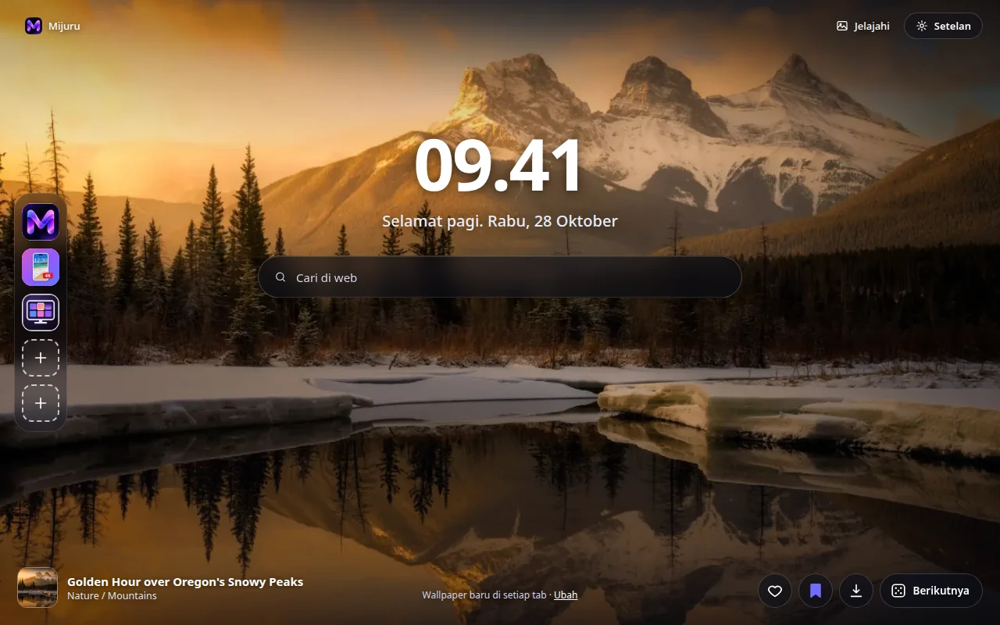
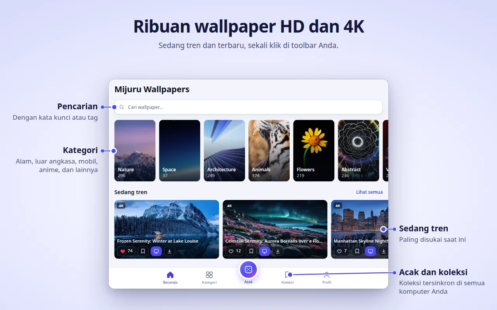
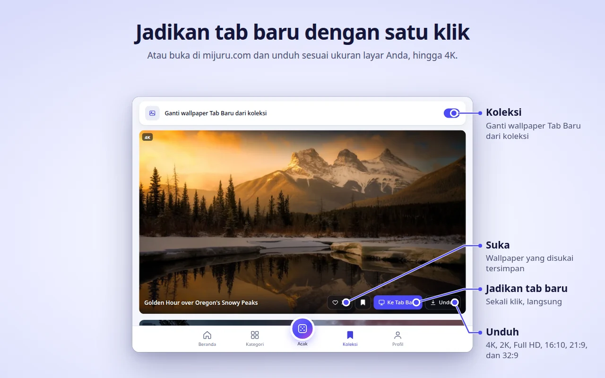
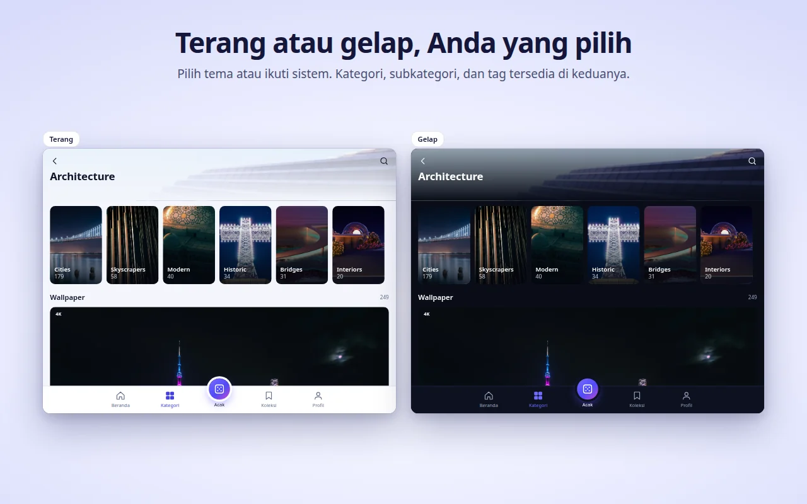
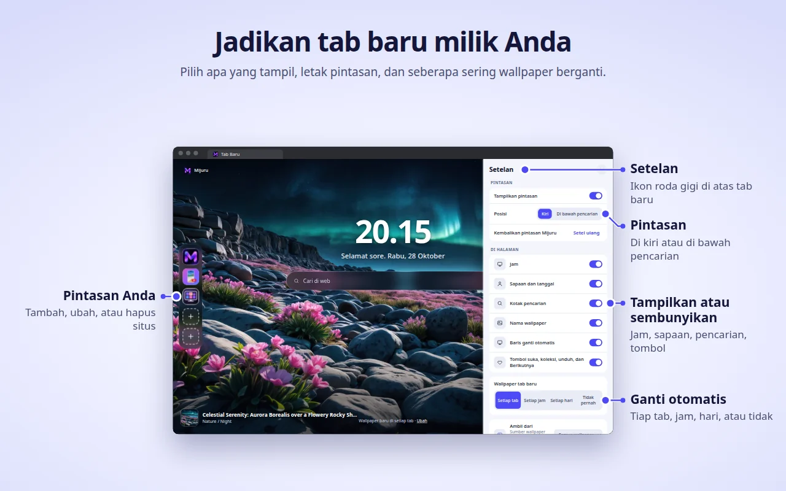

[English](README.md) · [Русский](README.ru.md) · [Українська](README.uk.md) · [Español](README.es.md) · [Português](README.pt.md) · [Deutsch](README.de.md) · [Français](README.fr.md) · [Italiano](README.it.md) · [Türkçe](README.tr.md) · [Polski](README.pl.md) · [한국어](README.ko.md) · [Tiếng Việt](README.vi.md) · **Bahasa Indonesia** · [العربية](README.ar.md)

  

<h1 align="center">Mijuru Wallpapers</h1>

  <b>Wallpaper 4K baru di setiap tab baru.</b> 
  Ribuan wallpaper HD dan 4K dari <a href="https://mijuru.com">mijuru.com</a>, cukup sekali klik dari toolbar. 
  Gratis · tanpa iklan · tanpa akun.

  

Repositori ini berisi **dokumentasi dan pelacak masalah publik** untuk ekstensi browser Mijuru Wallpapers. Kode sumber ekstensi ini tertutup.

## Dapatkan ekstensi

| Browser | Toko | Status |
|---|---|---|
| Google Chrome | [Chrome Web Store](https://chromewebstore.google.com/detail/mijuru-wallpapers/jlkpdnlkhknaifdjfjdepbfmklfpamfh) | ✅ Tersedia |
| Microsoft Edge | [Add-on Edge](https://microsoftedge.microsoft.com/addons/detail/mijuru-wallpapers/cdnegcioifbeoldnojbgcopnklpneodo) | ✅ Tersedia |
| Mozilla Firefox | [Add-on Firefox (AMO)](https://addons.mozilla.org/firefox/addon/mijuru-wallpapers/) | ✅ Tersedia |
| Opera | Opera add-ons | ⏳ Menunggu peninjauan toko |

Versi terbaru: **1.4.0** — lihat [log perubahan](CHANGELOG.md). Pembaruan di toko bisa muncul beberapa hari setelah rilis.

## Tangkapan layar

| | |
|---|---|
|  |  |
|  |  |
|  | |

## Fitur

**Tab Baru**
- Wallpaper layar penuh dengan ukuran yang pas untuk layar Anda. Jika file ukuran penuh gagal dimuat, pratinjau akan ditampilkan — tab tidak pernah kosong.
- Wallpaper berikutnya diunduh lebih dulu, jadi tab baru langsung terbuka.
- Jam, sapaan dengan tanggal ("Selamat pagi…"), dan kotak pencarian yang memakai mesin pencari default browser Anda.
- Nama dan kategori wallpaper — klik untuk membuka halamannya di mijuru.com.
- Tombol: Suka, Tambahkan ke koleksi, Unduh (membuka wallpaper di mijuru.com), dan Berikutnya.

**Ganti otomatis**
- Di setiap tab baru (default), setiap jam, setiap hari, atau tidak pernah.
- Wallpaper berikutnya dipilih secara acak dan tidak pernah mengulang 10 wallpaper terakhir.
- Sumber: semua wallpaper, Koleksi Anda, atau satu kategori.

**Pintasan** *(baru di 1.4.0)*
- 8 slot: tiga pintasan Mijuru secara default (katalog wallpaper, aplikasi Android, aplikasi PC) dan tempat untuk situs Anda sendiri.
- Tambah, edit, atau hapus lewat menu "⋮"; "Setel ulang" mengembalikan pintasan Mijuru.
- Letakkan dalam kolom di kiri atau dalam baris di bawah pencarian.

**Setelan di Tab Baru** *(baru di 1.4.0)*
- Tombol roda gigi (kanan atas) memungkinkan Anda menampilkan atau menyembunyikan jam, sapaan, pencarian, pintasan, nama wallpaper, baris ganti otomatis, dan tombol-tombol.

**Jendela ekstensi — seluruh katalog**
- Beranda (sedang tren dan terbaru), Kategori → subkategori, Pencarian (wallpaper atau tag), feed Acak tanpa batas, Koleksi, dan Profil Anda.
- Di setiap kartu wallpaper: Suka, Tambahkan ke koleksi, Ke Tab Baru, Unduh.
- Katalog menampilkan wallpaper 16:9 dalam 4K (3840×2160) atau lebih besar — semuanya pas di monitor layar lebar.

**Koleksi**
- Simpan wallpaper favorit Anda dan aktifkan "Ganti wallpaper Tab Baru dari koleksi".

**Pasang wallpaper dari mijuru.com**
- Di halaman wallpaper desktop di mijuru.com, tekan **Jadikan wallpaper Tab Baru** — ekstensi langsung memasangnya.

**Dan juga**
- Tema terang, gelap, atau mengikuti sistem.
- 14 bahasa antarmuka: English, Русский, Українська, Español, Português (Brasil), Deutsch, Français, Italiano, Türkçe, Polski, 한국어, Tiếng Việt, Bahasa Indonesia, العربية (kanan ke kiri).
- Setelan, suka, Koleksi, dan pintasan ikut tersinkron lewat sinkronisasi browser, jika aktif.

## Dukungan browser

| Browser | Versi minimum | Menggantikan Tab Baru | Catatan |
|---|---|---|---|
| Chrome | 116 | Ya | |
| Edge | Versi terkini | Ya | Build yang sama dengan Chrome |
| Firefox (desktop) | 140 | Ya | Firefox untuk Android tidak didukung |
| Opera | Versi terkini | **Tidak** | Opera tidak mengizinkan ekstensi menggantikan Tab Baru — gunakan **tab Mijuru** sebagai gantinya (lihat di bawah) |

## Pemasangan

1. Buka halaman toko untuk browser Anda dari [tabel di atas](#dapatkan-ekstensi).
2. Klik **Tambahkan ke Chrome** / **Dapatkan** / **Tambahkan ke Firefox**.
3. Buka tab baru. Setelah pemasangan pertama, halaman sambutan singkat di mijuru.com akan menjelaskan dasar-dasarnya.

**Opera.** Setelah ekstensi dipublikasikan, buka jendela ekstensi → **Profil → Buka tab Mijuru**. Anda bisa menjadikan halaman ini halaman awal di setelan Opera.

## Memulai

1. **Buka tab baru** — Anda akan melihat wallpaper, jam, dan pencarian.
2. **Klik ikon Mijuru** di toolbar untuk menjelajahi katalog. Sematkan lewat menu kepingan puzzle (Ekstensi) agar selalu terlihat.
3. **Sukai wallpaper atau tambahkan ke Koleksi** dari kartu mana pun atau langsung dari Tab Baru.
4. **Pilih seberapa sering wallpaper berganti**: Profil → Wallpaper tab baru, atau tautan **Ubah** di Tab Baru.
5. **Atur halaman**: tombol roda gigi di Tab Baru menampilkan atau menyembunyikan setiap elemen.
6. **Unduh wallpaper**: tombol Unduh membuka halamannya di mijuru.com, tempat Anda memilih ukuran (4K UHD, 2K QHD, Full HD, 16:10, 21:9, 32:9…).

## Pertanyaan umum

<b>Benarkah gratis? Ada iklannya?</b>

Ya, gratis. Tanpa iklan, tanpa akun, dan tanpa login.

<b>Bisakah saya memakai gambar sendiri sebagai latar?</b>

Untuk saat ini belum. Ekstensi menampilkan wallpaper dari katalog mijuru.com. Jika Anda ingin fitur ini, beri suara atau usulkan di [Ideas](https://github.com/orgs/mijuru-dev/discussions/categories/ideas).

<b>Kenapa hanya ada wallpaper lanskap?</b>

Ekstensi ini dibuat untuk layar komputer, jadi katalog di jendela ekstensi menampilkan wallpaper 16:9 dalam 4K atau lebih besar. Wallpaper ponsel tersedia di [mijuru.com](https://mijuru.com) dan di [aplikasi Android](https://play.google.com/store/apps/details?id=com.mijuru.wallpaper).

<b>Bagaimana cara mempertahankan wallpaper yang sama?</b>

Setel ganti otomatis ke **Tidak pernah** (Profil → Wallpaper tab baru, atau tautan **Ubah** di Tab Baru). Memasang wallpaper secara manual dengan **Ke Tab Baru** juga mematikan ganti otomatis.

<b>Bagaimana cara menampilkan wallpaper hanya dari Koleksi atau satu kategori?</b>

Profil → Wallpaper tab baru → Ambil dari: **Koleksi** atau sebuah kategori. Di tab Koleksi juga ada sakelar "Ganti wallpaper Tab Baru dari koleksi".

<b>Bagaimana cara mengembalikan Tab Baru bawaan browser?</b>

Nonaktifkan atau hapus ekstensi: buka `chrome://extensions`, `edge://extensions`, atau `about:addons` (Firefox) lalu matikan Mijuru Wallpapers. Tab Baru bawaan browser langsung kembali.

<b>Apakah suka, Koleksi, dan pintasan saya ikut pindah ke komputer lain?</b>

Ya, jika sinkronisasi browser aktif (akun Google, Microsoft, atau Firefox). Ekstensi memakai penyimpanan sinkronisasi bawaan browser; ekstensi ini tidak punya akun sendiri.

<b>Dari mana wallpaper yang diunduh berasal? Bisakah saya memilih ukurannya?</b>

Unduh membuka halaman wallpaper di mijuru.com, tempat Anda memilih ukuran yang tepat. Ekstensi sendiri tidak menyimpan file.

<b>Bisakah saya menyembunyikan jam, sapaan, atau pencarian?</b>

Bisa. Klik tombol roda gigi di pojok kanan atas Tab Baru dan matikan elemen mana pun.

<b>Apakah kotak pencarian mengirim kueri saya ke Mijuru?</b>

Tidak. Kueri langsung dikirim ke mesin pencari default browser Anda melalui API pencarian milik browser itu sendiri. Ekstensi tidak membaca atau menyimpannya.

<b>Kenapa Opera bekerja berbeda?</b>

Opera tidak mengizinkan ekstensi menggantikan Tab Baru. Gunakan **Profil → Buka tab Mijuru** — halamannya sama, hanya dibuka di tab biasa, dan Anda bisa menjadikannya halaman awal.

<b>Bolehkah wallpaper dipakai untuk keperluan komersial?</b>

Wallpaper dari mijuru.com gratis untuk penggunaan pribadi. Penjualan kembali dan penggunaan komersial tidak diizinkan.

## Pemecahan masalah

**Tab Baru tidak menampilkan Mijuru.**
Hanya satu ekstensi yang bisa mengendalikan Tab Baru dalam satu waktu — begitulah cara kerja browser. Jika Anda punya ekstensi tab baru lain, browser akan memakai salah satunya. Nonaktifkan ekstensi lain itu lalu buka tab baru lagi.

**Chrome bertanya apakah ingin kembali ke Google atau mempertahankan perubahan.**
Chrome menampilkan pertanyaan ini setelah ekstensi apa pun menggantikan Tab Baru. Pilih **pertahankan perubahan** agar tetap memakai Mijuru. Jika Anda memilih untuk mengembalikan, Chrome akan menonaktifkan ekstensi — aktifkan lagi di `chrome://extensions`.

**Browser kantor saya mengabaikan ekstensi.**
Browser yang dikelola (kantor atau sekolah) bisa memblokir ekstensi atau memaksakan Tab Baru tertentu melalui kebijakan. Hubungi administrator Anda.

**Opera: tidak ada wallpaper di Tab Baru dan tidak ada tombol "Ke Tab Baru".**
Ini memang seharusnya begitu — lihat [Kenapa Opera bekerja berbeda?](#pertanyaan-umum). Gunakan **tab Mijuru**.

**Judul wallpaper berbahasa Inggris padahal saya memilih bahasa lain.**
Untuk bahasa Korea, Vietnam, Indonesia, dan Arab, katalog belum memiliki judul terjemahan, jadi judul ditampilkan dalam bahasa Inggris. Antarmukanya sendiri sudah diterjemahkan. Tautan katalog selalu membuka versi bahasa Inggris mijuru.com.

**"Gagal memuat. Periksa koneksi Anda."**
Ekstensi memerlukan akses internet ke mijuru.com. Periksa koneksi, VPN, atau firewall Anda, lalu tekan **Coba lagi**. Jika latar ukuran penuh gagal dimuat, pratinjau akan ditampilkan sebagai gantinya.

**Pintasan menampilkan huruf, bukan ikon.**
Ikon situs (`/favicon.ico`) tidak dapat dimuat, jadi ubin menampilkan huruf pertama namanya. Pintasan tetap berfungsi.

**Wallpaper berhenti berganti.**
Periksa Profil → Wallpaper tab baru: jika Anda memasang wallpaper secara manual, ganti otomatis telah diubah ke **Tidak pernah**. Jika sumbernya Koleksi Anda, pastikan Koleksi tidak kosong.

Masih bermasalah? [Laporkan masalah](https://github.com/mijuru-dev/wallpapers-browser-extension/issues/new/choose).

## Izin dan privasi

Ekstensi hanya meminta apa yang dibutuhkan:

| Izin | Alasan |
|---|---|
| `storage` | Setelan Anda, ID wallpaper yang disukai dan dikoleksi, pintasan Anda, serta cache. |
| `alarms` | Ganti otomatis setiap jam dan setiap hari, serta pengunduhan wallpaper berikutnya lebih awal. |
| `search` | Kotak pencarian di Tab Baru mengirim kueri Anda ke mesin pencari default browser. Ekstensi tidak membaca atau menyimpan kueri. |
| `https://mijuru.com/*` | Memuat katalog wallpaper dan gambar dari API mijuru.com yang hanya-baca, serta tombol "Jadikan wallpaper Tab Baru" di mijuru.com (lihat di bawah). |

**Tidak ada** akses ke tab, riwayat, unduhan, atau konten situs web lain milik Anda.

**Apa yang dilakukan dan tidak dilakukan ekstensi**
- **Tanpa analitik, iklan, cookie, akun, atau pelacak pihak ketiga.** Halaman Firefox menyatakan tidak ada pengumpulan data.
- **Permintaan dikirim ke mijuru.com** — katalog dan gambar (permintaan `GET` hanya-baca dengan bahasa, kategori, tag, teks pencarian, atau ID wallpaper yang dipilih).
- **Ikon pintasan.** Untuk pintasan yang Anda tambahkan sendiri, Tab Baru memuat ikon situs dari `https://<situs tersebut>/favicon.ico`. Ini permintaan biasa ke situs yang Anda tambahkan; tidak ada data dari ekstensi yang disertakan.
- **Integrasi mijuru.com.** Sebuah skrip kecil hanya berjalan di halaman `https://mijuru.com/*`. Skrip ini memungkinkan tombol "Jadikan wallpaper Tab Baru" di situs meneruskan ID wallpaper ke ekstensi, dan memberi tahu situs versi ekstensi, nama browser, serta ID wallpaper saat ini agar tombol menampilkan status yang benar. Skrip ini tidak membaca hal lain dan tidak berjalan di situs lain.
- **Suka tetap milik Anda.** Suka dan Koleksi disimpan di penyimpanan browser (disinkronkan oleh browser jika sinkronisasi aktif). Tidak ada yang dikirim ke server saat Anda menyukai wallpaper.
- **Halaman pemasangan / pencopotan.** Setelah pemasangan pertama, ekstensi membuka halaman sambutan di mijuru.com; saat dihapus, browser membuka halaman perpisahan dengan survei opsional berisi satu pertanyaan. Tautan ini hanya berisi bahasa, nama browser, versi ekstensi, dan tag `utm_*` — tanpa pengenal pengguna. Tag `utm_*` yang sama juga ditambahkan ke tautan lain menuju mijuru.com. Begitu Anda berada di mijuru.com, kebijakan privasi situs tersebut yang berlaku.

Kebijakan lengkap: **[mijuru.com/browser-extension-privacy-policy](https://mijuru.com/browser-extension-privacy-policy)**

## Masukan dan dukungan

| Apa | Di mana | |
|---|---|---|
| 🐞 **Ada yang tidak berfungsi** | [Laporkan masalah](https://github.com/mijuru-dev/wallpapers-browser-extension/issues/new/choose) | GitHub Issues |
| 💡 **Ide atau saran** | [Bagikan ide](https://github.com/orgs/mijuru-dev/discussions/categories/ideas) | GitHub Discussions |
| ❓ **Pertanyaan** | [Tanyakan di Q&A](https://github.com/orgs/mijuru-dev/discussions/categories/q-a) | GitHub Discussions |
| ✉️ **Urusan pribadi** | [m@mijuru.dev](mailto:m@mijuru.dev) | Email |

**Issues hanya untuk masalah** — ide, saran, dan pertanyaan ada di [Discussions](https://github.com/orgs/mijuru-dev/discussions), tempat semua orang bisa memberi 👍 pada ide yang paling mereka sukai.
Harap tulis dalam bahasa Inggris agar semua orang dapat menemukan dan mengikuti percakapan — terjemahan mesin dari bahasa Anda sama sekali tidak masalah. Sebelum memposting, cari di issue dan diskusi yang sudah ada: 👍 pada yang sudah ada lebih membantu daripada duplikat.

🚩 Untuk melaporkan wallpaper (hak cipta, konten tidak pantas), gunakan **Laporkan gambar** di halaman wallpaper di mijuru.com.

## Lebih banyak wallpaper di mijuru.com

Koleksi lengkapnya ada di situs web — berguna saat Anda ingin memilih wallpaper untuk perangkat lain atau dalam ukuran yang tidak ditampilkan ekstensi:

- [Wallpaper desktop berdasarkan resolusi — 4K, 2K, Full HD, ultrawide](https://mijuru.com/wallpapers/resolutions)
- [Paket wallpaper — koleksi bertema](https://mijuru.com/wallpapers/packs)
- [Wallpaper ponsel berdasarkan merek — iPhone, Samsung, Xiaomi, dan lainnya](https://mijuru.com/wallpapers/device-brands)
- [Avatar dan foto profil untuk Instagram, Discord, TikTok](https://mijuru.com/avatars)

## Aplikasi Mijuru lainnya

- 🌐 **[mijuru.com](https://mijuru.com)** — wallpaper gratis untuk ponsel, desktop, dan tablet dalam HD, 4K, dan 8K.
- 📱 **[Wallpapers by Mijuru untuk Android](https://play.google.com/store/apps/details?id=com.mijuru.wallpaper)** — pasang wallpaper di layar utama dan layar kunci.
- 🖥️ **[Wallpapers by Mijuru untuk Linux](https://snapcraft.io/wallpapers-by-mijuru)** — pasang wallpaper dengan sekali klik dan ganti sesuai jadwal.

Semua produk dan dokumentasi: **[github.com/mijuru-dev](https://github.com/mijuru-dev)**

## Lisensi

© 2026 Mijuru. Hak cipta dilindungi undang-undang. Ekstensi ini gratis digunakan; kode sumbernya tidak dipublikasikan. Dokumentasi dan gambar di repositori ini tidak boleh digunakan ulang tanpa izin.
