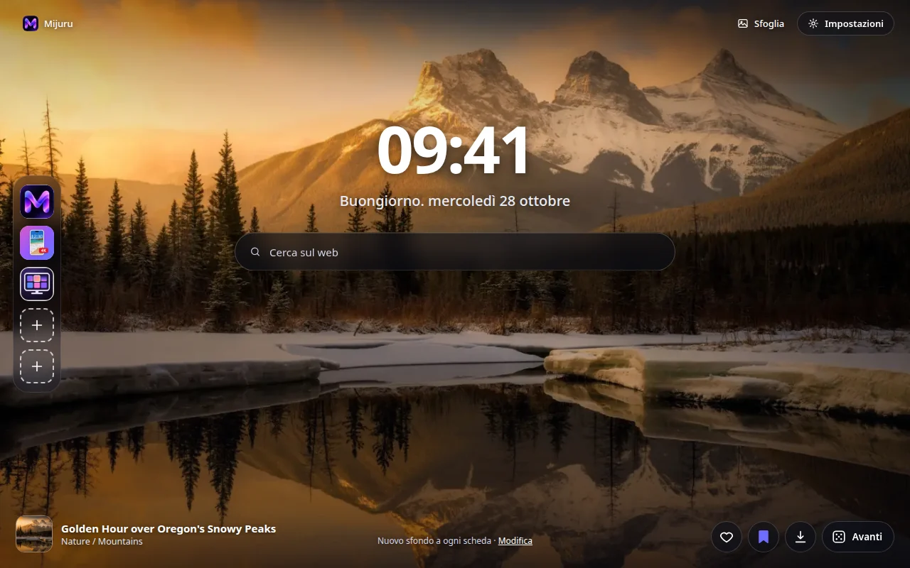
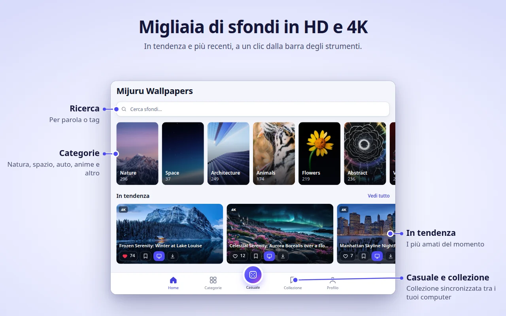
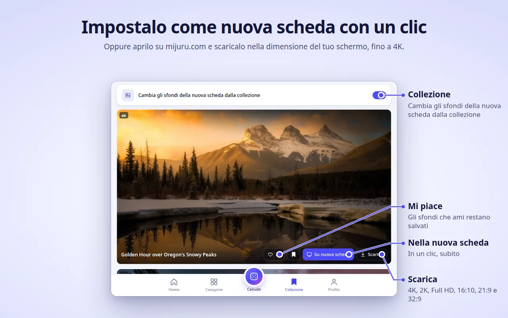
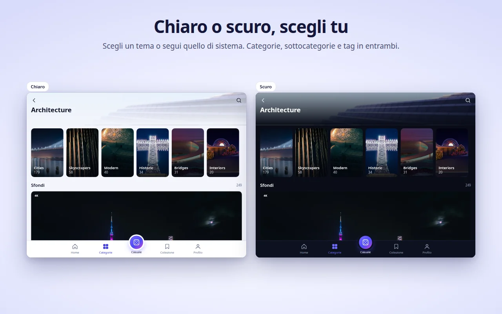
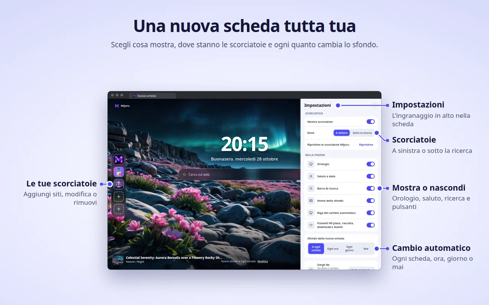

[English](README.md) · [Русский](README.ru.md) · [Українська](README.uk.md) · [Español](README.es.md) · [Português](README.pt.md) · [Deutsch](README.de.md) · [Français](README.fr.md) · **Italiano** · [Türkçe](README.tr.md) · [Polski](README.pl.md) · [한국어](README.ko.md) · [Tiếng Việt](README.vi.md) · [Bahasa Indonesia](README.id.md) · [العربية](README.ar.md)

  

<h1 align="center">Mijuru Wallpapers</h1>

  <b>Uno sfondo 4K nuovo a ogni nuova scheda.</b> 
  Migliaia di sfondi HD e 4K da <a href="https://mijuru.com">mijuru.com</a>, a un clic dalla barra degli strumenti. 
  Gratis · senza pubblicità · senza account.

  

Questo repository contiene la **documentazione e il tracker pubblico delle segnalazioni** per l'estensione del browser Mijuru Wallpapers. Il codice sorgente dell'estensione è chiuso.

## Scarica l'estensione

| Browser | Store | Stato |
|---|---|---|
| Google Chrome | [Chrome Web Store](https://chromewebstore.google.com/detail/mijuru-wallpapers/jlkpdnlkhknaifdjfjdepbfmklfpamfh) | ✅ Disponibile |
| Microsoft Edge | [Componenti aggiuntivi di Edge](https://microsoftedge.microsoft.com/addons/detail/mijuru-wallpapers/cdnegcioifbeoldnojbgcopnklpneodo) | ✅ Disponibile |
| Mozilla Firefox | [Componenti aggiuntivi di Firefox (AMO)](https://addons.mozilla.org/firefox/addon/mijuru-wallpapers/) | ✅ Disponibile |
| Opera | Opera add-ons | ⏳ In revisione nello store |

Versione attuale: **1.4.0** — consulta il [registro delle modifiche](CHANGELOG.md). Negli store un aggiornamento può arrivare qualche giorno dopo il rilascio.

## Screenshot

| | |
|---|---|
|  |  |
|  |  |
|  | |

## Funzionalità

**Nuova scheda**
- Uno sfondo a schermo intero nella dimensione adatta al tuo schermo. Se il file a piena risoluzione non si carica, viene mostrata un'anteprima: la scheda non resta mai vuota.
- Lo sfondo successivo viene scaricato in anticipo, così le nuove schede si aprono all'istante.
- Orologio, un saluto con la data ("Buongiorno…") e una barra di ricerca che usa il motore di ricerca predefinito del browser.
- Il nome e la categoria dello sfondo: fai clic per aprire la sua pagina su mijuru.com.
- Pulsanti: Mi piace, aggiungi alla Collezione, Scarica (apre lo sfondo su mijuru.com) e Avanti.

**Cambio automatico**
- A ogni nuova scheda (predefinito), ogni ora, ogni giorno o mai.
- Lo sfondo successivo è scelto a caso e non ripete mai gli ultimi 10.
- Origine: tutti gli sfondi, la tua Collezione o una sola categoria.

**Scorciatoie** *(novità della 1.4.0)*
- 8 posti: tre scorciatoie Mijuru predefinite (il catalogo di sfondi, l'app per Android, l'app per PC) e spazio per i tuoi siti.
- Aggiungi, modifica o elimina dal menu "⋮"; "Ripristina" riporta le scorciatoie Mijuru.
- Disponile in una colonna a sinistra o in una riga sotto la ricerca.

**Impostazioni nella nuova scheda** *(novità della 1.4.0)*
- Il pulsante a forma di ingranaggio (in alto a destra) permette di mostrare o nascondere orologio, saluto, ricerca, scorciatoie, nome dello sfondo, riga del cambio automatico e pulsanti.

**Finestra dell'estensione: tutto il catalogo**
- Home (in tendenza e più recenti), Categorie → sottocategorie, Ricerca (sfondi o tag), un feed Casuale infinito, la tua Collezione e il Profilo.
- Su ogni scheda dello sfondo: Mi piace, aggiungi alla Collezione, Su nuova scheda, Scarica.
- Il catalogo mostra sfondi 16:9 in 4K (3840×2160) o superiori: ognuno si adatta a un monitor widescreen.

**Collezione**
- Salva gli sfondi che ami e attiva "Cambia gli sfondi della nuova scheda dalla collezione".

**Imposta uno sfondo da mijuru.com**
- Nella pagina di uno sfondo per desktop su mijuru.com, premi **Imposta come sfondo della nuova scheda**: l'estensione lo applica subito.

**E inoltre**
- Tema chiaro, scuro o di sistema.
- 14 lingue dell'interfaccia: English, Русский, Українська, Español, Português (Brasil), Deutsch, Français, Italiano, Türkçe, Polski, 한국어, Tiếng Việt, Bahasa Indonesia, العربية (da destra a sinistra).
- Impostazioni, Mi piace, Collezione e scorciatoie seguono la sincronizzazione del browser, se attiva.

## Browser supportati

| Browser | Versione minima | Sostituisce la nuova scheda | Note |
|---|---|---|---|
| Chrome | 116 | Sì | |
| Edge | Versioni attuali | Sì | Stessa versione di Chrome |
| Firefox (desktop) | 140 | Sì | Firefox per Android non è supportato |
| Opera | Versioni attuali | **No** | Opera non consente alle estensioni di sostituire la nuova scheda: usa invece la **scheda Mijuru** (vedi sotto) |

## Installazione

1. Apri la pagina dello store del tuo browser dalla [tabella sopra](#scarica-lestensione).
2. Fai clic su **Aggiungi** / **Ottieni** / **Aggiungi a Firefox**.
3. Apri una nuova scheda. Dopo la prima installazione, una breve pagina di benvenuto su mijuru.com spiega le basi.

**Opera.** Quando l'estensione sarà pubblicata, apri la finestra dell'estensione → **Profilo → Apri la scheda Mijuru**. Puoi impostare questa pagina come pagina iniziale nelle impostazioni di Opera.

## Primi passi

1. **Apri una nuova scheda**: vedrai uno sfondo, l'orologio e la ricerca.
2. **Fai clic sull'icona di Mijuru** nella barra degli strumenti per sfogliare il catalogo. Fissala dal menu delle estensioni (il pezzo di puzzle) per averla sempre a portata di mano.
3. **Metti Mi piace a uno sfondo o aggiungilo alla Collezione** da qualsiasi scheda dello sfondo o direttamente dalla nuova scheda.
4. **Scegli ogni quanto cambia lo sfondo**: Profilo → Sfondo della nuova scheda, oppure il link **Modifica** nella nuova scheda.
5. **Personalizza la pagina**: il pulsante a forma di ingranaggio nella nuova scheda mostra o nasconde ogni elemento.
6. **Scarica uno sfondo**: il pulsante Scarica apre la sua pagina su mijuru.com, dove scegli la dimensione (4K UHD, 2K QHD, Full HD, 16:10, 21:9, 32:9…).

## Domande frequenti

<b>È davvero gratis? Ci sono pubblicità?</b>

Sì, è gratis. Niente pubblicità, niente account e nessun accesso richiesto.

<b>Posso usare una mia immagine come sfondo?</b>

Al momento no. L'estensione mostra sfondi dal catalogo di mijuru.com. Se ti serve questa funzione, votala o proponila in [Ideas](https://github.com/orgs/mijuru-dev/discussions/categories/ideas).

<b>Perché ci sono solo sfondi orizzontali?</b>

L'estensione è pensata per gli schermi dei computer, quindi il catalogo nella finestra mostra sfondi 16:9 in 4K o superiori. Gli sfondi per smartphone sono su [mijuru.com](https://mijuru.com) e nell'[app per Android](https://play.google.com/store/apps/details?id=com.mijuru.wallpaper).

<b>Come tengo sempre lo stesso sfondo?</b>

Imposta il cambio automatico su **Mai** (Profilo → Sfondo della nuova scheda, oppure il link **Modifica** nella nuova scheda). Anche impostare uno sfondo manualmente con **Su nuova scheda** disattiva il cambio automatico.

<b>Come mostro solo gli sfondi della mia Collezione o di una categoria?</b>

Profilo → Sfondo della nuova scheda → Scegli da: **Collezione** o una categoria. Nella scheda Collezione c'è anche l'interruttore "Cambia gli sfondi della nuova scheda dalla collezione".

<b>Come ripristino la nuova scheda predefinita del browser?</b>

Disattiva o rimuovi l'estensione: apri `chrome://extensions`, `edge://extensions` o `about:addons` (Firefox) e disattiva Mijuru Wallpapers. La nuova scheda del browser torna subito.

<b>I miei Mi piace, la Collezione e le scorciatoie passeranno a un altro computer?</b>

Sì, se la sincronizzazione del browser è attiva (account Google, Microsoft o Firefox). L'estensione usa lo spazio di sincronizzazione integrato del browser; non ha un account proprio.

<b>Da dove arrivano gli sfondi scaricati? Posso scegliere la dimensione?</b>

Scarica apre la pagina dello sfondo su mijuru.com, dove scegli la dimensione esatta. L'estensione di per sé non salva file.

<b>Posso nascondere l'orologio, il saluto o la ricerca?</b>

Sì. Fai clic sul pulsante a forma di ingranaggio in alto a destra nella nuova scheda e disattiva gli elementi che vuoi.

<b>La barra di ricerca invia le mie ricerche a Mijuru?</b>

No. Le ricerche vanno direttamente al motore di ricerca predefinito del browser tramite l'API di ricerca del browser stesso. L'estensione non le legge né le salva.

<b>Perché Opera funziona in modo diverso?</b>

Opera non consente alle estensioni di sostituire la nuova scheda. Usa **Profilo → Apri la scheda Mijuru**: è la stessa pagina in una scheda normale e puoi impostarla come pagina iniziale.

<b>Posso usare gli sfondi per scopi commerciali?</b>

Gli sfondi di mijuru.com sono gratuiti per uso personale. Rivendita e uso commerciale non sono consentiti.

## Risoluzione dei problemi

**La nuova scheda non mostra Mijuru.**
Solo un'estensione alla volta può controllare la nuova scheda: i browser funzionano così. Se hai un'altra estensione per la nuova scheda, il browser ne usa una sola. Disattiva l'altra estensione e apri di nuovo una nuova scheda.

**Chrome chiede se tornare a Google o mantenere le modifiche.**
Chrome mostra questo avviso ogni volta che un'estensione sostituisce la nuova scheda. Scegli **mantieni le modifiche** per tenere Mijuru. Se hai scelto di ripristinare, Chrome disattiva l'estensione: riattivala da `chrome://extensions`.

**Il browser aziendale ignora l'estensione.**
I browser gestiti (lavoro o scuola) possono bloccare le estensioni o imporre una nuova scheda specifica tramite criteri. Rivolgiti al tuo amministratore.

**Opera: nessuno sfondo nella nuova scheda e nessun pulsante "Su nuova scheda".**
È previsto: vedi [Perché Opera funziona in modo diverso?](#domande-frequenti). Usa la **scheda Mijuru**.

**I titoli degli sfondi sono in inglese anche se ho scelto un'altra lingua.**
Per coreano, vietnamita, indonesiano e arabo il catalogo non ha ancora titoli tradotti, quindi appaiono in inglese. L'interfaccia invece è tradotta. I link del catalogo aprono sempre la versione inglese di mijuru.com.

**"Impossibile caricare. Controlla la connessione."**
L'estensione ha bisogno dell'accesso a internet verso mijuru.com. Controlla la connessione, la VPN o il firewall, poi premi **Riprova**. Se lo sfondo a piena risoluzione non si carica, al suo posto viene mostrata un'anteprima.

**Una scorciatoia mostra una lettera invece di un'icona.**
Non è stato possibile caricare l'icona del sito (`/favicon.ico`), quindi il riquadro mostra la prima lettera del nome. La scorciatoia funziona comunque.

**Lo sfondo non cambia più.**
Controlla Profilo → Sfondo della nuova scheda: se hai impostato uno sfondo manualmente, il cambio automatico è passato a **Mai**. Se l'origine è la tua Collezione, assicurati che non sia vuota.

Ancora problemi? [Apri una segnalazione](https://github.com/mijuru-dev/wallpapers-browser-extension/issues/new/choose).

## Autorizzazioni e privacy

L'estensione chiede solo ciò che le serve:

| Autorizzazione | Perché |
|---|---|
| `storage` | Le tue impostazioni, gli ID degli sfondi che ti piacciono e della collezione, le tue scorciatoie e una cache. |
| `alarms` | Il cambio automatico ogni ora e ogni giorno e il download anticipato dello sfondo successivo. |
| `search` | La barra di ricerca della nuova scheda invia la tua ricerca al motore di ricerca predefinito del browser. L'estensione non legge né salva le ricerche. |
| `https://mijuru.com/*` | Il caricamento del catalogo e delle immagini dall'API in sola lettura di mijuru.com e il pulsante "Imposta come sfondo della nuova scheda" su mijuru.com (vedi sotto). |

**Non** c'è accesso alle tue schede, alla cronologia, ai download o al contenuto di altri siti web.

**Cosa fa e cosa non fa l'estensione**
- **Niente analisi, pubblicità, cookie, account o tracker di terze parti.** La scheda di Firefox dichiara che non vengono raccolti dati.
- **Le richieste vanno a mijuru.com**: catalogo e immagini (richieste `GET` in sola lettura con la lingua, la categoria, il tag, il testo di ricerca o gli ID degli sfondi selezionati).
- **Icone delle scorciatoie.** Per le scorciatoie che aggiungi tu, la nuova scheda carica l'icona del sito da `https://<quel sito>/favicon.ico`. È una normale richiesta al sito che hai aggiunto; non viene allegato alcun dato dell'estensione.
- **Integrazione con mijuru.com.** Un piccolo script viene eseguito solo sulle pagine `https://mijuru.com/*`. Permette al pulsante "Imposta come sfondo della nuova scheda" del sito di passare l'ID di uno sfondo all'estensione e comunica al sito la versione dell'estensione, il nome del browser e l'ID dello sfondo attuale, così il pulsante mostra lo stato corretto. Non legge nient'altro e non viene eseguito su nessun altro sito.
- **I Mi piace restano a te.** I Mi piace e la Collezione sono salvati nello spazio di archiviazione del browser (sincronizzati dal browser se la sincronizzazione è attiva). Quando metti Mi piace a uno sfondo non viene inviato nulla al server.
- **Pagine di installazione e disinstallazione.** Dopo la prima installazione l'estensione apre una pagina di benvenuto su mijuru.com; alla rimozione il browser apre una pagina di saluto con un sondaggio facoltativo di una sola domanda. Questi link contengono solo la lingua, il nome del browser, la versione dell'estensione e i tag `utm_*`, senza identificativi utente. Gli stessi tag `utm_*` vengono aggiunti agli altri link verso mijuru.com. Una volta su mijuru.com, si applica l'informativa sulla privacy del sito.

Informativa completa: **[mijuru.com/browser-extension-privacy-policy](https://mijuru.com/browser-extension-privacy-policy)**

## Feedback e supporto

| Cosa | Dove | |
|---|---|---|
| 🐞 **Qualcosa non funziona** | [Segnala un problema](https://github.com/mijuru-dev/wallpapers-browser-extension/issues/new/choose) | GitHub Issues |
| 💡 **Idea o suggerimento** | [Condividi un'idea](https://github.com/orgs/mijuru-dev/discussions/categories/ideas) | GitHub Discussions |
| ❓ **Domanda** | [Chiedi in Q&A](https://github.com/orgs/mijuru-dev/discussions/categories/q-a) | GitHub Discussions |
| ✉️ **Questione privata** | [m@mijuru.dev](mailto:m@mijuru.dev) | Email |

**Le issue sono solo per i problemi**: idee, suggerimenti e domande vanno nelle [Discussions](https://github.com/orgs/mijuru-dev/discussions), dove tutti possono votare con 👍 le idee che preferiscono.
Scrivi in inglese, così tutti possono trovare e seguire la conversazione: una traduzione automatica dalla tua lingua va benissimo. Prima di pubblicare, cerca tra le issue e le discussioni esistenti: un 👍 su una già aperta aiuta più di un duplicato.

🚩 Per segnalare uno sfondo (copyright, contenuti inappropriati), usa **Segnala immagine** nella pagina dello sfondo su mijuru.com.

## Altri sfondi su mijuru.com

La collezione completa è sul sito, comodo quando vuoi scegliere uno sfondo su un altro dispositivo o in una dimensione che l'estensione non mostra:

- [Sfondi per desktop per risoluzione: 4K, 2K, Full HD, ultrawide](https://mijuru.com/wallpapers/resolutions)
- [Pacchetti di sfondi: raccolte a tema](https://mijuru.com/wallpapers/packs)
- [Sfondi per smartphone per marca: iPhone, Samsung, Xiaomi e altri](https://mijuru.com/wallpapers/device-brands)
- [Avatar e immagini del profilo per Instagram, Discord, TikTok](https://mijuru.com/avatars)

## Altre app Mijuru

- 🌐 **[mijuru.com](https://mijuru.com)**: sfondi gratuiti per smartphone, desktop e tablet in HD, 4K e 8K.
- 📱 **[Wallpapers by Mijuru per Android](https://play.google.com/store/apps/details?id=com.mijuru.wallpaper)**: imposta sfondi sulla schermata home e sulla schermata di blocco.
- 🖥️ **[Wallpapers by Mijuru per Linux](https://snapcraft.io/wallpapers-by-mijuru)**: imposta sfondi con un clic e cambiali secondo una programmazione.

Tutti i prodotti e la documentazione: **[github.com/mijuru-dev](https://github.com/mijuru-dev)**

## Licenza

© 2026 Mijuru. Tutti i diritti riservati. L'uso dell'estensione è gratuito; il codice sorgente non è pubblicato. La documentazione e le immagini di questo repository non possono essere riutilizzate senza autorizzazione.
