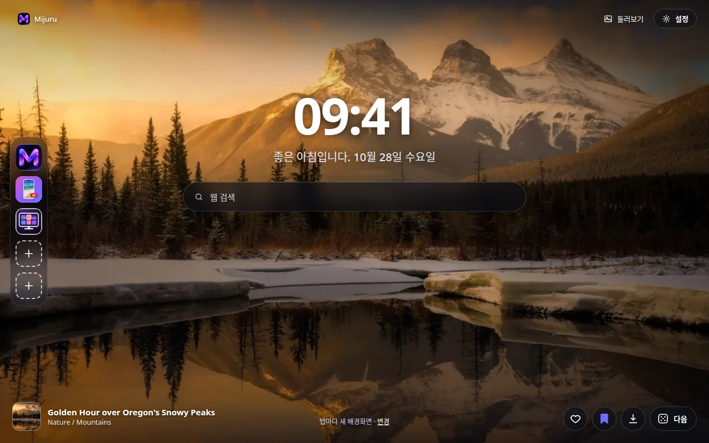
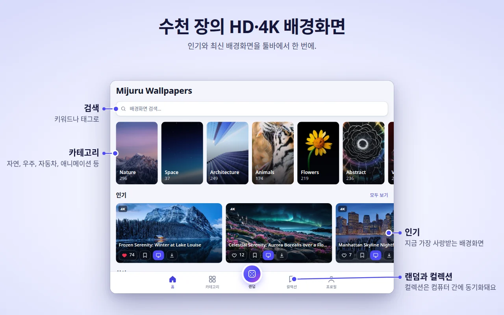
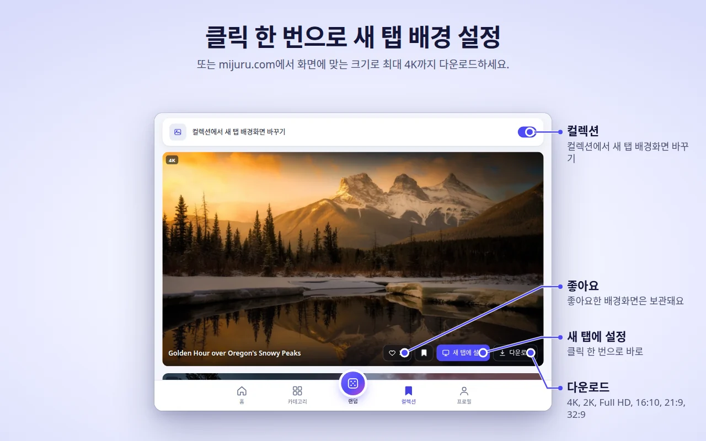
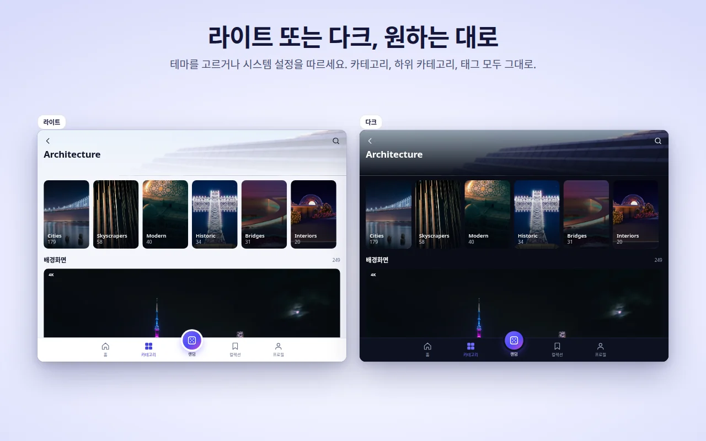
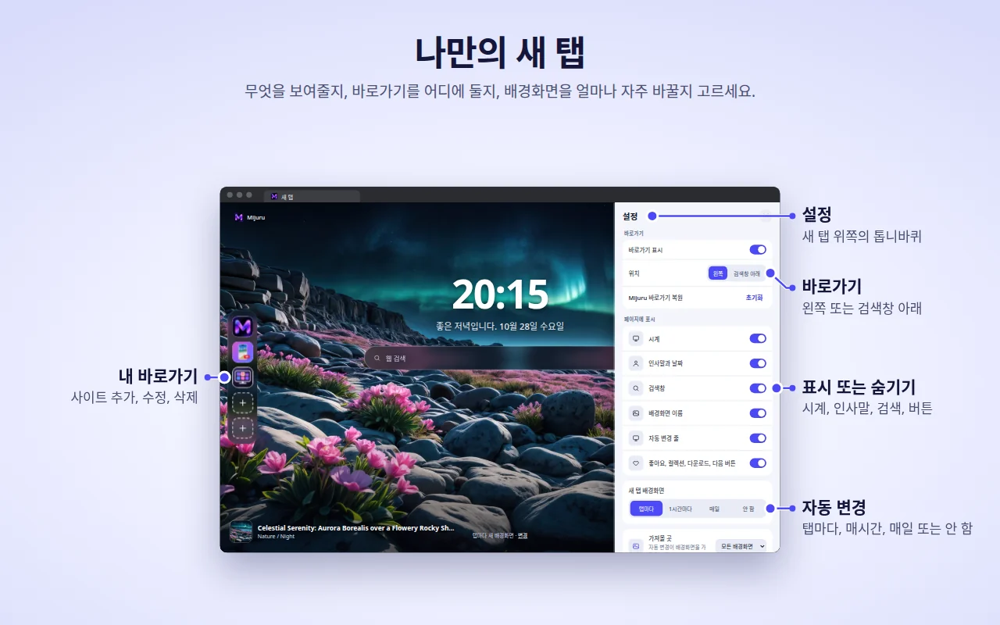

[English](README.md) · [Русский](README.ru.md) · [Українська](README.uk.md) · [Español](README.es.md) · [Português](README.pt.md) · [Deutsch](README.de.md) · [Français](README.fr.md) · [Italiano](README.it.md) · [Türkçe](README.tr.md) · [Polski](README.pl.md) · **한국어** · [Tiếng Việt](README.vi.md) · [Bahasa Indonesia](README.id.md) · [العربية](README.ar.md)

  

<h1 align="center">Mijuru Wallpapers</h1>

  <b>새 탭을 열 때마다 새로운 4K 배경화면.</b> 
  <a href="https://mijuru.com">mijuru.com</a>의 HD·4K 배경화면 수천 장을 툴바에서 클릭 한 번으로. 
  무료 · 광고 없음 · 계정 필요 없음.

  

이 저장소에는 Mijuru Wallpapers 브라우저 확장 프로그램의 **문서와 공개 이슈 트래커**가 있습니다. 확장 프로그램의 소스 코드는 비공개입니다.

## 확장 프로그램 설치

| 브라우저 | 스토어 | 상태 |
|---|---|---|
| Google Chrome | [Chrome 웹 스토어](https://chromewebstore.google.com/detail/mijuru-wallpapers/jlkpdnlkhknaifdjfjdepbfmklfpamfh) | ✅ 이용 가능 |
| Microsoft Edge | [Edge 추가 기능](https://microsoftedge.microsoft.com/addons/detail/mijuru-wallpapers/cdnegcioifbeoldnojbgcopnklpneodo) | ✅ 이용 가능 |
| Mozilla Firefox | [Firefox 부가 기능 (AMO)](https://addons.mozilla.org/firefox/addon/mijuru-wallpapers/) | ✅ 이용 가능 |
| Opera | Opera add-ons | ⏳ 스토어 심사 중 |

최신 버전: **1.4.0** — [변경 내역](CHANGELOG.md)을 확인하세요. 스토어 반영은 출시 후 며칠 늦어질 수 있습니다.

## 스크린샷

| | |
|---|---|
|  |  |
|  |  |
|  | |

## 기능

**새 탭**
- 화면 크기에 맞는 전체 화면 배경화면. 원본 크기 파일을 불러오지 못하면 미리보기가 표시되어 탭이 비어 있는 일이 없습니다.
- 다음 배경화면을 미리 내려받아 두기 때문에 새 탭이 바로 열립니다.
- 시계, 날짜가 함께 표시되는 인사말("좋은 아침입니다…"), 브라우저 기본 검색 엔진을 사용하는 검색창.
- 배경화면 이름과 카테고리 — 클릭하면 mijuru.com의 해당 페이지가 열립니다.
- 버튼: 좋아요, 컬렉션에 추가, 다운로드(mijuru.com에서 배경화면을 엶), 다음.

**자동 변경**
- 탭마다(기본값), 1시간마다, 매일, 또는 안 함.
- 다음 배경화면은 무작위로 선택되며 최근 10장과 겹치지 않습니다.
- 가져올 곳: 모든 배경화면, 내 컬렉션, 또는 특정 카테고리 하나.

**바로가기** *(1.4.0 신규)*
- 8칸: 기본으로 Mijuru 바로가기 3개(배경화면 카탈로그, Android 앱, PC 앱)가 있고 나머지는 원하는 사이트를 넣을 수 있습니다.
- "⋮" 메뉴에서 추가, 수정, 삭제할 수 있고, "초기화"를 누르면 Mijuru 바로가기가 돌아옵니다.
- 왼쪽에 세로로 놓거나 검색창 아래에 가로로 놓을 수 있습니다.

**새 탭에서 바로 설정** *(1.4.0 신규)*
- 오른쪽 위 톱니바퀴 버튼으로 시계, 인사말, 검색창, 바로가기, 배경화면 이름, 자동 변경 줄, 버튼을 표시하거나 숨길 수 있습니다.

**확장 프로그램 창 — 카탈로그 전체**
- 홈(인기 및 최신), 카테고리 → 하위 카테고리, 검색(배경화면 또는 태그), 끝없이 이어지는 랜덤 피드, 내 컬렉션, 프로필.
- 모든 배경화면 카드에서: 좋아요, 컬렉션에 추가, 새 탭에 설정, 다운로드.
- 카탈로그에는 4K(3840×2160) 이상의 16:9 배경화면만 표시되어 모든 와이드 모니터에 잘 맞습니다.

**컬렉션**
- 마음에 드는 배경화면을 저장하고 "컬렉션에서 새 탭 배경화면 바꾸기"를 켜 보세요.

**mijuru.com에서 배경화면 설정**
- mijuru.com의 데스크톱 배경화면 페이지에서 **새 탭 배경화면으로 설정**을 누르면 확장 프로그램이 바로 적용합니다.

**그 밖에**
- 라이트, 다크, 시스템 테마.
- 14개 인터페이스 언어: English, Русский, Українська, Español, Português (Brasil), Deutsch, Français, Italiano, Türkçe, Polski, 한국어, Tiếng Việt, Bahasa Indonesia, العربية(오른쪽에서 왼쪽).
- 브라우저 동기화가 켜져 있으면 설정, 좋아요, 컬렉션, 바로가기가 함께 동기화됩니다.

## 브라우저 지원

| 브라우저 | 최소 버전 | 새 탭 대체 | 참고 |
|---|---|---|---|
| Chrome | 116 | 예 | |
| Edge | 최신 버전 | 예 | Chrome과 같은 빌드 |
| Firefox(데스크톱) | 140 | 예 | Android용 Firefox는 지원하지 않음 |
| Opera | 최신 버전 | **아니요** | Opera는 확장 프로그램이 새 탭을 대체하는 것을 허용하지 않습니다 — 대신 **Mijuru 탭**을 사용하세요(아래 참고) |

## 설치

1. [위 표](#확장-프로그램-설치)에서 사용하는 브라우저의 스토어 페이지를 엽니다.
2. **Chrome에 추가** / **받기** / **Firefox에 추가**를 클릭합니다.
3. 새 탭을 엽니다. 처음 설치하면 mijuru.com에서 기본 사용법을 알려 주는 짧은 환영 페이지가 열립니다.

**Opera.** 확장 프로그램이 게시되면 확장 프로그램 창 → **프로필 → Mijuru 탭 열기**를 여세요. Opera 설정에서 이 페이지를 시작 페이지로 지정할 수 있습니다.

## 시작하기

1. **새 탭을 엽니다** — 배경화면, 시계, 검색창이 보입니다.
2. 툴바의 **Mijuru 아이콘을 클릭**해 카탈로그를 둘러보세요. 퍼즐 조각(확장 프로그램) 메뉴에서 고정해 두면 항상 보입니다.
3. 어떤 카드에서든, 또는 새 탭에서 바로 **배경화면에 좋아요를 누르거나 컬렉션에 추가**하세요.
4. **배경화면 변경 주기를 선택하세요**: 프로필 → 새 탭 배경화면, 또는 새 탭의 **변경** 링크.
5. **페이지를 다듬으세요**: 새 탭의 톱니바퀴 버튼으로 각 요소를 표시하거나 숨깁니다.
6. **배경화면을 다운로드하세요**: 다운로드 버튼을 누르면 mijuru.com의 해당 페이지가 열리고, 거기서 크기(4K UHD, 2K QHD, Full HD, 16:10, 21:9, 32:9…)를 고를 수 있습니다.

## 자주 묻는 질문

<b>정말 무료인가요? 광고가 있나요?</b>

네, 무료입니다. 광고, 계정, 로그인이 모두 없습니다.

<b>내 이미지를 배경으로 쓸 수 있나요?</b>

현재는 지원하지 않습니다. 확장 프로그램은 mijuru.com 카탈로그의 배경화면을 보여 줍니다. 이 기능이 필요하다면 투표하거나 [Ideas](https://github.com/orgs/mijuru-dev/discussions/categories/ideas)에서 제안해 주세요.

<b>왜 가로 배경화면만 있나요?</b>

확장 프로그램은 컴퓨터 화면용으로 만들어져, 창의 카탈로그에는 4K 이상의 16:9 배경화면이 표시됩니다. 휴대폰 배경화면은 [mijuru.com](https://mijuru.com)과 [Android 앱](https://play.google.com/store/apps/details?id=com.mijuru.wallpaper)에서 찾을 수 있습니다.

<b>같은 배경화면을 계속 유지하려면 어떻게 하나요?</b>

자동 변경을 **안 함**으로 설정하세요(프로필 → 새 탭 배경화면, 또는 새 탭의 **변경** 링크). **새 탭에 설정**으로 배경화면을 직접 지정해도 자동 변경이 꺼집니다.

<b>내 컬렉션이나 특정 카테고리의 배경화면만 보려면 어떻게 하나요?</b>

프로필 → 새 탭 배경화면 → 가져올 곳: **컬렉션** 또는 카테고리. 컬렉션 탭에도 "컬렉션에서 새 탭 배경화면 바꾸기" 스위치가 있습니다.

<b>브라우저 기본 새 탭으로 되돌리려면 어떻게 하나요?</b>

확장 프로그램을 끄거나 삭제하세요. `chrome://extensions`, `edge://extensions`, 또는 `about:addons`(Firefox)를 열고 Mijuru Wallpapers를 끄면 브라우저 기본 새 탭이 바로 돌아옵니다.

<b>좋아요, 컬렉션, 바로가기가 다른 컴퓨터로도 옮겨지나요?</b>

네, 브라우저 동기화(Google, Microsoft 또는 Firefox 계정)가 켜져 있다면 옮겨집니다. 확장 프로그램은 브라우저에 내장된 동기화 저장소를 사용하며, 자체 계정은 없습니다.

<b>다운로드하는 배경화면은 어디서 오나요? 크기를 고를 수 있나요?</b>

다운로드를 누르면 mijuru.com의 배경화면 페이지가 열리고, 거기서 정확한 크기를 고를 수 있습니다. 확장 프로그램 자체는 파일을 저장하지 않습니다.

<b>시계, 인사말, 검색창을 숨길 수 있나요?</b>

네. 새 탭 오른쪽 위의 톱니바퀴 버튼을 클릭하고 원하는 요소를 끄세요.

<b>검색창에 입력한 검색어가 Mijuru로 전송되나요?</b>

아니요. 검색어는 브라우저 자체 검색 API를 통해 브라우저 기본 검색 엔진으로 바로 전달됩니다. 확장 프로그램은 검색어를 읽거나 저장하지 않습니다.

<b>Opera에서는 왜 다르게 동작하나요?</b>

Opera는 확장 프로그램이 새 탭을 대체하는 것을 허용하지 않습니다. **프로필 → Mijuru 탭 열기**를 사용하세요. 일반 탭에서 열리는 같은 페이지이며, 시작 페이지로 지정할 수 있습니다.

<b>배경화면을 상업적으로 사용할 수 있나요?</b>

mijuru.com의 배경화면은 개인적인 용도로 무료입니다. 재판매와 상업적 사용은 허용되지 않습니다.

## 문제 해결

**새 탭에 Mijuru가 나타나지 않습니다.**
새 탭은 한 번에 하나의 확장 프로그램만 제어할 수 있습니다 — 브라우저가 원래 그렇게 동작합니다. 다른 새 탭 확장 프로그램이 있다면 브라우저는 그중 하나만 사용합니다. 다른 확장 프로그램을 끄고 새 탭을 다시 여세요.

**Chrome이 Google로 되돌릴지, 변경사항을 유지할지 묻습니다.**
Chrome은 확장 프로그램이 새 탭을 대체하면 이 안내를 표시합니다. Mijuru를 계속 쓰려면 **변경사항 유지**를 선택하세요. 되돌리기를 선택했다면 Chrome이 확장 프로그램을 사용 중지합니다. `chrome://extensions`에서 다시 켜세요.

**회사 브라우저에서 확장 프로그램이 적용되지 않습니다.**
관리되는(회사 또는 학교) 브라우저는 정책으로 확장 프로그램을 차단하거나 특정 새 탭을 강제할 수 있습니다. 관리자에게 문의하세요.

**Opera: 새 탭에 배경화면이 없고 "새 탭에 설정" 버튼도 없습니다.**
정상입니다 — [Opera에서는 왜 다르게 동작하나요?](#자주-묻는-질문)를 참고하세요. **Mijuru 탭**을 사용하세요.

**다른 언어를 선택했는데 배경화면 제목이 영어로 나옵니다.**
한국어, 베트남어, 인도네시아어, 아랍어는 아직 카탈로그에 번역된 제목이 없어 영어로 표시됩니다. 인터페이스 자체는 번역되어 있습니다. 카탈로그 링크는 항상 mijuru.com 영어 버전으로 열립니다.

**"불러오지 못했습니다. 연결을 확인하세요."**
확장 프로그램이 mijuru.com에 인터넷으로 접속할 수 있어야 합니다. 인터넷 연결, VPN, 방화벽을 확인한 뒤 **다시 시도**를 누르세요. 원본 크기 배경을 불러오지 못하면 대신 미리보기가 표시됩니다.

**바로가기에 아이콘 대신 글자가 표시됩니다.**
사이트 아이콘(`/favicon.ico`)을 불러오지 못해 타일에 이름의 첫 글자가 표시된 것입니다. 바로가기는 정상적으로 작동합니다.

**배경화면이 더 이상 바뀌지 않습니다.**
프로필 → 새 탭 배경화면을 확인하세요. 배경화면을 직접 설정했다면 자동 변경이 **안 함**으로 바뀌었을 것입니다. 가져올 곳이 컬렉션이라면 컬렉션이 비어 있지 않은지 확인하세요.

그래도 해결되지 않나요? [이슈를 올려 주세요](https://github.com/mijuru-dev/wallpapers-browser-extension/issues/new/choose).

## 권한 및 개인정보 보호

확장 프로그램은 꼭 필요한 권한만 요청합니다.

| 권한 | 용도 |
|---|---|
| `storage` | 설정, 좋아요 및 컬렉션에 담은 배경화면의 ID, 바로가기, 캐시. |
| `alarms` | 1시간마다·매일 자동 변경, 다음 배경화면 미리 내려받기. |
| `search` | 새 탭 검색창이 검색어를 브라우저 기본 검색 엔진으로 보냅니다. 확장 프로그램은 검색어를 읽거나 저장하지 않습니다. |
| `https://mijuru.com/*` | 읽기 전용 mijuru.com API에서 배경화면 카탈로그와 이미지를 불러오고, mijuru.com의 "새 탭 배경화면으로 설정" 버튼을 지원합니다(아래 참고). |

탭, 방문 기록, 다운로드, 다른 웹사이트의 콘텐츠에는 **전혀** 접근하지 않습니다.

**확장 프로그램이 하는 일과 하지 않는 일**
- **분석 도구, 광고, 쿠키, 계정, 서드파티 추적기 없음.** Firefox 등록 정보에도 데이터를 수집하지 않는다고 명시되어 있습니다.
- **요청은 mijuru.com으로 전송** — 카탈로그와 이미지(선택한 언어, 카테고리, 태그, 검색어 또는 배경화면 ID를 담은 읽기 전용 `GET` 요청).
- **바로가기 아이콘.** 직접 추가한 바로가기의 경우 새 탭이 `https://<해당 사이트>/favicon.ico`에서 사이트 아이콘을 불러옵니다. 추가한 사이트에 보내는 일반 요청이며, 확장 프로그램의 데이터는 첨부되지 않습니다.
- **mijuru.com 연동.** 작은 스크립트가 `https://mijuru.com/*` 페이지에서만 실행됩니다. 사이트의 "새 탭 배경화면으로 설정" 버튼이 배경화면 ID를 확장 프로그램에 전달할 수 있게 하고, 버튼이 올바른 상태를 표시하도록 확장 프로그램 버전, 브라우저 이름, 현재 배경화면 ID를 사이트에 알려 줍니다. 그 외에는 아무것도 읽지 않으며 다른 사이트에서는 실행되지 않습니다.
- **좋아요는 내 브라우저에만.** 좋아요와 컬렉션은 브라우저 저장소에 저장됩니다(동기화가 켜져 있으면 브라우저가 동기화). 배경화면에 좋아요를 눌러도 서버로는 아무것도 전송되지 않습니다.
- **설치/삭제 페이지.** 처음 설치하면 확장 프로그램이 mijuru.com의 환영 페이지를 열고, 삭제하면 브라우저가 선택형 한 문항 설문이 있는 작별 페이지를 엽니다. 이 링크에는 언어, 브라우저 이름, 확장 프로그램 버전, `utm_*` 태그만 포함되며 사용자 식별자는 없습니다. 같은 `utm_*` 태그가 mijuru.com으로 가는 다른 링크에도 붙습니다. mijuru.com에 접속한 뒤에는 웹사이트 자체의 개인정보 처리방침이 적용됩니다.

전체 방침: **[mijuru.com/browser-extension-privacy-policy](https://mijuru.com/browser-extension-privacy-policy)**

## 피드백 및 지원

| 항목 | 위치 | |
|---|---|---|
| 🐞 **작동하지 않는 문제** | [문제 신고하기](https://github.com/mijuru-dev/wallpapers-browser-extension/issues/new/choose) | GitHub Issues |
| 💡 **아이디어 또는 제안** | [아이디어 공유하기](https://github.com/orgs/mijuru-dev/discussions/categories/ideas) | GitHub Discussions |
| ❓ **질문** | [Q&A에서 질문하기](https://github.com/orgs/mijuru-dev/discussions/categories/q-a) | GitHub Discussions |
| ✉️ **개인적인 문의** | [m@mijuru.dev](mailto:m@mijuru.dev) | 이메일 |

**Issues는 문제 신고 전용입니다** — 아이디어, 제안, 질문은 [Discussions](https://github.com/orgs/mijuru-dev/discussions)에 올려 주세요. 누구나 마음에 드는 아이디어에 👍로 투표할 수 있습니다.
모두가 대화를 찾아보고 따라갈 수 있도록 영어로 작성해 주세요. 사용하는 언어에서 기계 번역한 글이어도 전혀 문제없습니다. 글을 올리기 전에 기존 이슈와 토론을 검색해 주세요. 중복 글보다 기존 글에 남긴 👍가 더 도움이 됩니다.

🚩 배경화면을 신고하려면(저작권, 부적절한 콘텐츠) mijuru.com의 배경화면 페이지에서 **이미지 신고**를 사용하세요.

## mijuru.com에서 더 많은 배경화면 보기

전체 컬렉션은 웹사이트에 있습니다 — 다른 기기용 배경화면이나 확장 프로그램에 표시되지 않는 크기를 고를 때 편리합니다.

- [해상도별 데스크톱 배경화면 — 4K, 2K, Full HD, 울트라와이드](https://mijuru.com/wallpapers/resolutions)
- [배경화면 팩 — 테마별 컬렉션](https://mijuru.com/wallpapers/packs)
- [브랜드별 휴대폰 배경화면 — iPhone, Samsung, Xiaomi 등](https://mijuru.com/wallpapers/device-brands)
- [Instagram, Discord, TikTok용 아바타와 프로필 사진](https://mijuru.com/avatars)

## 다른 Mijuru 앱

- 🌐 **[mijuru.com](https://mijuru.com)** — 휴대폰, 데스크톱, 태블릿용 HD·4K·8K 무료 배경화면.
- 📱 **[Android용 Wallpapers by Mijuru](https://play.google.com/store/apps/details?id=com.mijuru.wallpaper)** — 홈 화면과 잠금 화면에 배경화면을 설정하세요.
- 🖥️ **[Linux용 Wallpapers by Mijuru](https://snapcraft.io/wallpapers-by-mijuru)** — 클릭 한 번으로 배경화면을 설정하고 일정에 따라 바꿔 보세요.

모든 제품과 문서: **[github.com/mijuru-dev](https://github.com/mijuru-dev)**

## 라이선스

© 2026 Mijuru. 모든 권리 보유. 확장 프로그램은 무료로 사용할 수 있으며, 소스 코드는 공개되지 않습니다. 이 저장소의 문서와 이미지는 허가 없이 재사용할 수 없습니다.
