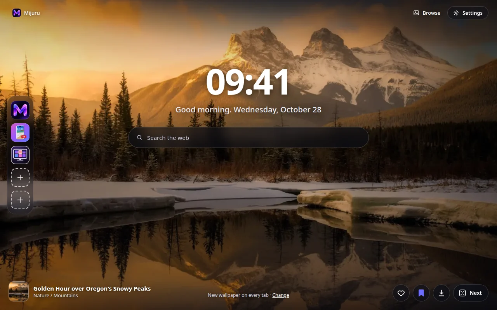
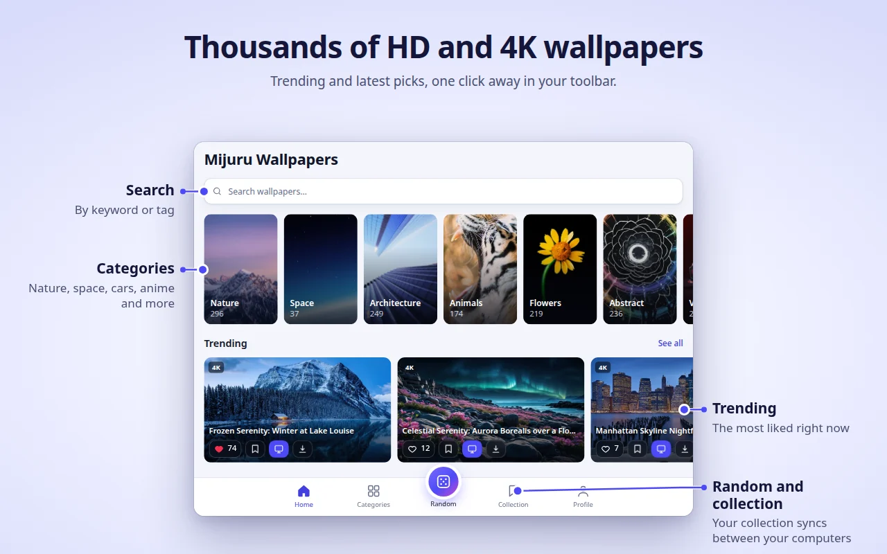
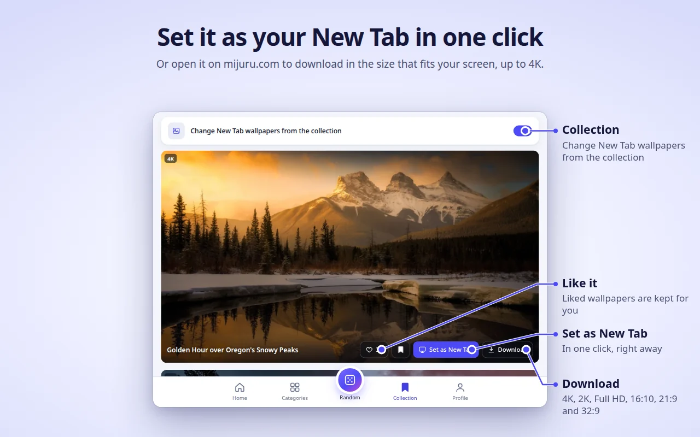
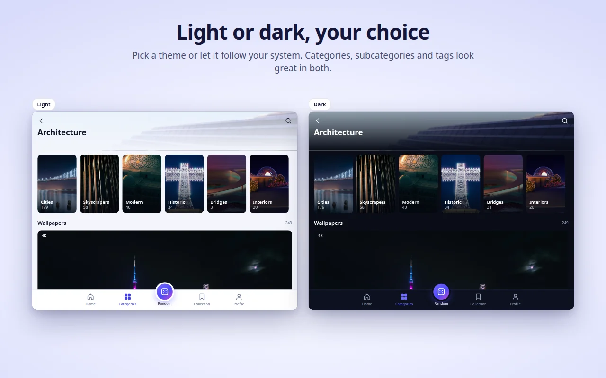
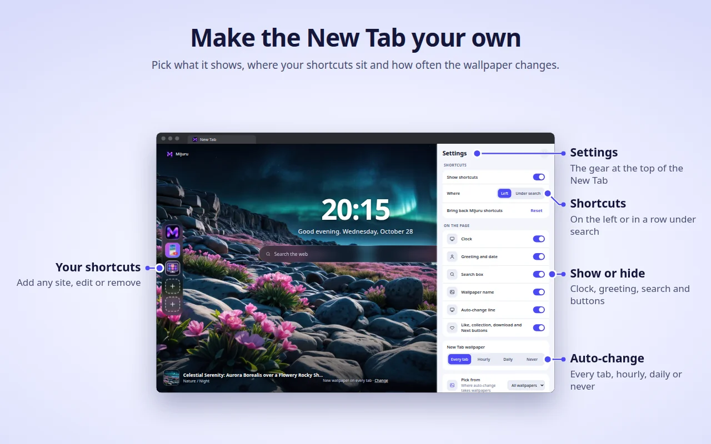

**English** · [Русский](README.ru.md) · [Українська](README.uk.md) · [Español](README.es.md) · [Português](README.pt.md) · [Deutsch](README.de.md) · [Français](README.fr.md) · [Italiano](README.it.md) · [Türkçe](README.tr.md) · [Polski](README.pl.md) · [한국어](README.ko.md) · [Tiếng Việt](README.vi.md) · [Bahasa Indonesia](README.id.md) · [العربية](README.ar.md)

  

<h1 align="center">Mijuru Wallpapers</h1>

  <b>A fresh 4K wallpaper on every new tab.</b> 
  Thousands of HD and 4K wallpapers from <a href="https://mijuru.com">mijuru.com</a>, one click away in your toolbar. 
  Free · no ads · no account.

  

This repository holds the **documentation and the public issue tracker** for the Mijuru Wallpapers browser extension. The extension's source code is closed.

## Get the extension

| Browser | Store | Status |
|---|---|---|
| Google Chrome | [Chrome Web Store](https://chromewebstore.google.com/detail/mijuru-wallpapers/jlkpdnlkhknaifdjfjdepbfmklfpamfh) | ✅ Available |
| Microsoft Edge | [Edge Add-ons](https://microsoftedge.microsoft.com/addons/detail/mijuru-wallpapers/cdnegcioifbeoldnojbgcopnklpneodo) | ✅ Available |
| Mozilla Firefox | [Firefox Add-ons (AMO)](https://addons.mozilla.org/firefox/addon/mijuru-wallpapers/) | ✅ Available |
| Opera | Opera add-ons | ⏳ Awaiting store review |

Latest version: **1.4.0** — see the [changelog](CHANGELOG.md). Store rollouts can lag a few days behind a release.

## Screenshots

| | |
|---|---|
|  |  |
|  |  |
|  | |

## Features

**New Tab**
- A full-screen wallpaper in the size that fits your screen. If the full-size file can't load, a preview is shown — the tab never stays empty.
- The next wallpaper is downloaded in advance, so new tabs open instantly.
- Clock, a greeting with the date ("Good morning…") and a web search box that uses your browser's default search engine.
- The wallpaper's name and category — click to open its page on mijuru.com.
- Buttons: Like, add to Collection, Download (opens the wallpaper on mijuru.com) and Next.

**Auto-change**
- On every new tab (default), every hour, every day, or never.
- The next wallpaper is picked at random and never repeats the last 10.
- Source: all wallpapers, your Collection, or a single category.

**Shortcuts** *(new in 1.4.0)*
- 8 slots: three Mijuru shortcuts by default (the wallpaper catalogue, the Android app, the PC app) and room for your own sites.
- Add, edit or delete through the "⋮" menu; "Reset" brings the Mijuru shortcuts back.
- Place them in a column on the left or in a row under the search box.

**Settings on the New Tab** *(new in 1.4.0)*
- The gear button (top right) lets you show or hide the clock, greeting, search, shortcuts, wallpaper name, auto-change line and buttons.

**Toolbar popup — the whole catalogue**
- Home (trending and latest), Categories → subcategories, Search (wallpapers or tags), an endless Random feed, your Collection and Profile.
- On every wallpaper card: Like, add to Collection, Set as New Tab, Download.
- The catalogue shows 16:9 wallpapers in 4K (3840×2160) or larger — every one fits a widescreen monitor.

**Collection**
- Save wallpapers you love and switch on "Change New Tab wallpapers from the collection".

**Set a wallpaper from mijuru.com**
- On a desktop wallpaper page on mijuru.com, press **Set as New Tab wallpaper** — the extension sets it right away.

**And also**
- Light, dark or system theme.
- 14 interface languages: English, Русский, Українська, Español, Português (Brasil), Deutsch, Français, Italiano, Türkçe, Polski, 한국어, Tiếng Việt, Bahasa Indonesia, العربية (right-to-left).
- Settings, likes, Collection and shortcuts follow your browser's sync, if it is on.

## Browser support

| Browser | Minimum version | Replaces the New Tab | Notes |
|---|---|---|---|
| Chrome | 116 | Yes | |
| Edge | Current versions | Yes | Same build as Chrome |
| Firefox (desktop) | 140 | Yes | Firefox for Android is not supported |
| Opera | Current versions | **No** | Opera does not let extensions replace its New Tab — use the **Mijuru tab** instead (see below) |

## Install

1. Open the store page for your browser from the [table above](#get-the-extension).
2. Click **Add to Chrome** / **Get** / **Add to Firefox**.
3. Open a new tab. After the first install a short welcome page on mijuru.com explains the basics.

**Opera.** Once the extension is published, open the toolbar popup → **Profile → Open Mijuru tab**. You can make this page your startup page in Opera's settings.

## Getting started

1. **Open a new tab** — you'll see a wallpaper, the clock and search.
2. **Click the Mijuru icon** in the toolbar to browse the catalogue. Pin it via the puzzle-piece (Extensions) menu so it's always visible.
3. **Like a wallpaper or add it to your Collection** from any card or straight from the New Tab.
4. **Choose how often the wallpaper changes**: Profile → New Tab wallpaper, or the **Change** link on the New Tab.
5. **Tune the page**: the gear button on the New Tab shows or hides each element.
6. **Download a wallpaper**: the Download button opens its page on mijuru.com, where you choose a size (4K UHD, 2K QHD, Full HD, 16:10, 21:9, 32:9…).

## FAQ

<b>Is it really free? Are there ads?</b>

Yes, it is free. There are no ads, no account and no sign-in.

<b>Can I use my own image as the background?</b>

Not at the moment. The extension shows wallpapers from the mijuru.com catalogue. If you'd like this feature, vote for it or suggest it in [Ideas](https://github.com/orgs/mijuru-dev/discussions/categories/ideas).

<b>Why are there only landscape wallpapers?</b>

The extension is made for computer screens, so the catalogue in the popup shows 16:9 wallpapers in 4K or larger. Phone wallpapers are on [mijuru.com](https://mijuru.com) and in the [Android app](https://play.google.com/store/apps/details?id=com.mijuru.wallpaper).

<b>How do I keep the same wallpaper?</b>

Set auto-change to **Never** (Profile → New Tab wallpaper, or the **Change** link on the New Tab). Setting a wallpaper manually with **Set as New Tab** also turns auto-change off.

<b>How do I show wallpapers only from my Collection or one category?</b>

Profile → New Tab wallpaper → Source: **Collection** or a category. In the Collection tab there is also a switch "Change New Tab wallpapers from the collection".

<b>How do I get my browser's default New Tab back?</b>

Disable or remove the extension: open `chrome://extensions`, `edge://extensions` or `about:addons` (Firefox) and turn Mijuru Wallpapers off. The browser's own New Tab returns immediately.

<b>Will my likes, Collection and shortcuts move to another computer?</b>

Yes, if browser sync is on (a Google, Microsoft or Firefox account). The extension uses the browser's built-in sync storage; it has no account of its own.

<b>Where do the downloaded wallpapers come from? Can I choose the size?</b>

Download opens the wallpaper page on mijuru.com, where you pick the exact size. The extension itself doesn't save files.

<b>Can I hide the clock, greeting or search?</b>

Yes. Click the gear button in the top right corner of the New Tab and switch off any element.

<b>Does the search box send my queries to Mijuru?</b>

No. Queries go straight to your browser's default search engine through the browser's own search API. The extension doesn't read or store them.

<b>Why does Opera work differently?</b>

Opera doesn't allow extensions to replace its New Tab. Use **Profile → Open Mijuru tab** — it's the same page in a normal tab, and you can set it as your startup page.

<b>Can I use the wallpapers commercially?</b>

Wallpapers from mijuru.com are free for personal use. Resale and commercial use aren't allowed.

## Troubleshooting

**The New Tab doesn't show Mijuru.**
Only one extension can control the New Tab at a time — this is how browsers work. If you have another new-tab extension, the browser uses one of them. Disable the other extension and open a new tab again.

**Chrome asks "Change back to Google?" / "Keep changes?"**
Chrome shows this prompt after any extension replaces the New Tab. Click **Keep it** (Keep changes) to keep Mijuru. If you clicked "Change it back", Chrome disables the extension — turn it back on in `chrome://extensions`.

**My company browser ignores the extension.**
Managed (work or school) browsers can block extensions or force a specific New Tab through policies. Ask your administrator.

**Opera: no wallpaper on the New Tab and no "Set as New Tab" button.**
This is expected — see [Why does Opera work differently?](#faq). Use the **Mijuru tab**.

**Wallpaper titles are in English although I chose another language.**
For Korean, Vietnamese, Indonesian and Arabic the catalogue doesn't have translated titles yet, so they show in English. The interface itself is translated. Catalogue links always open the English version of mijuru.com.

**"Couldn't load. Check your connection."**
The extension needs internet access to mijuru.com. Check your connection, VPN or firewall, then press **Retry**. If the full-size background can't load, a preview is shown instead.

**A shortcut shows a letter instead of an icon.**
The site's icon (`/favicon.ico`) couldn't be loaded, so the tile shows the first letter of the name. The shortcut still works.

**The wallpaper stopped changing.**
Check Profile → New Tab wallpaper: if you set a wallpaper manually, auto-change was switched to **Never**. If the source is your Collection, make sure it isn't empty.

Still stuck? [Open an issue](https://github.com/mijuru-dev/wallpapers-browser-extension/issues/new/choose).

## Permissions and privacy

The extension asks only for what it needs:

| Permission | Why |
|---|---|
| `storage` | Your settings, the IDs of liked and collected wallpapers, your shortcuts and a cache. |
| `alarms` | Hourly and daily auto-change, and downloading the next wallpaper in advance. |
| `search` | The New Tab search box sends your query to the browser's default search engine. The extension doesn't read or store queries. |
| `https://mijuru.com/*` | Loading the wallpaper catalogue and images from the read-only mijuru.com API, and the "Set as New Tab wallpaper" button on mijuru.com (see below). |

There is **no** access to your tabs, history, downloads or other websites' content.

**What the extension does and doesn't do**
- **No analytics, ads, cookies, accounts or third-party trackers.** Firefox's listing declares no data collection.
- **Requests go to mijuru.com** — catalogue and images (read-only `GET` requests with the selected language, category, tag, search text or wallpaper IDs).
- **Shortcut icons.** For shortcuts you add yourself, the New Tab loads the site's icon from `https://<that site>/favicon.ico`. This is a normal request to the site you added; no data from the extension is attached.
- **mijuru.com integration.** A small script runs only on `https://mijuru.com/*` pages. It lets the site's "Set as New Tab wallpaper" button pass a wallpaper ID to the extension and tells the site the extension's version, browser name and the current wallpaper ID, so the button shows the right state. It doesn't read anything else and doesn't run on any other site.
- **Likes stay with you.** Likes and your Collection are stored in browser storage (synced by the browser if sync is on). Nothing is sent to the server when you like a wallpaper.
- **Install / uninstall pages.** After the first install the extension opens a welcome page on mijuru.com; on removal the browser opens a goodbye page with an optional one-question survey. These links contain only the language, browser name, extension version and `utm_*` tags — no user identifiers. The same `utm_*` tags are added to other links to mijuru.com. Once you're on mijuru.com, the website's own privacy policy applies.

Full policy: **[mijuru.com/browser-extension-privacy-policy](https://mijuru.com/browser-extension-privacy-policy)**

## Feedback and support

| What | Where | |
|---|---|---|
| 🐞 **Something doesn't work** | [Report a problem](https://github.com/mijuru-dev/wallpapers-browser-extension/issues/new/choose) | GitHub Issues |
| 💡 **Idea or suggestion** | [Share an idea](https://github.com/orgs/mijuru-dev/discussions/categories/ideas) | GitHub Discussions |
| ❓ **Question** | [Ask in Q&A](https://github.com/orgs/mijuru-dev/discussions/categories/q-a) | GitHub Discussions |
| ✉️ **Private matter** | [m@mijuru.dev](mailto:m@mijuru.dev) | Email |

**Issues are for problems only** — ideas, suggestions and questions live in [Discussions](https://github.com/orgs/mijuru-dev/discussions), where everyone can vote 👍 for the ideas they like most.
Please write in English so everyone can find and follow the conversation — a machine translation from your language is perfectly fine. Before posting, search existing issues and discussions: a 👍 on an existing one helps more than a duplicate.

🚩 To report a wallpaper (copyright, inappropriate content), use **Report image** on the wallpaper's page on mijuru.com.

## More wallpapers on mijuru.com

The full collection lives on the website — handy when you want to pick a wallpaper on another device or a size the app doesn't show:

- [Desktop wallpapers by resolution — 4K, 2K, Full HD, ultrawide](https://mijuru.com/wallpapers/resolutions)
- [Wallpaper packs — themed collections](https://mijuru.com/wallpapers/packs)
- [Phone wallpapers by brand — iPhone, Samsung, Xiaomi and more](https://mijuru.com/wallpapers/device-brands)
- [Avatars and profile pictures for Instagram, Discord, TikTok](https://mijuru.com/avatars)

## Other Mijuru apps

- 🌐 **[mijuru.com](https://mijuru.com)** — free wallpapers for phone, desktop and tablet in HD, 4K and 8K.
- 📱 **[Wallpapers by Mijuru for Android](https://play.google.com/store/apps/details?id=com.mijuru.wallpaper)** — set wallpapers on your home and lock screen.
- 🖥️ **[Wallpapers by Mijuru for Linux](https://snapcraft.io/wallpapers-by-mijuru)** — set wallpapers in one click and change them on a schedule.

All products and documentation: **[github.com/mijuru-dev](https://github.com/mijuru-dev)**

## License

© 2026 Mijuru. All rights reserved. The extension is free to use; its source code is not published. The documentation and images in this repository may not be reused without permission.
