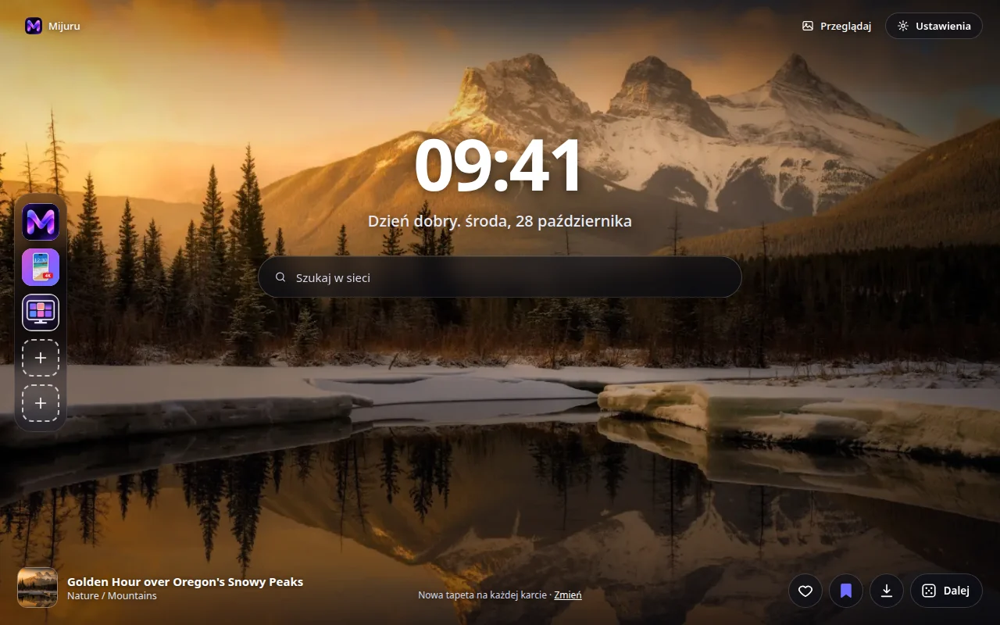
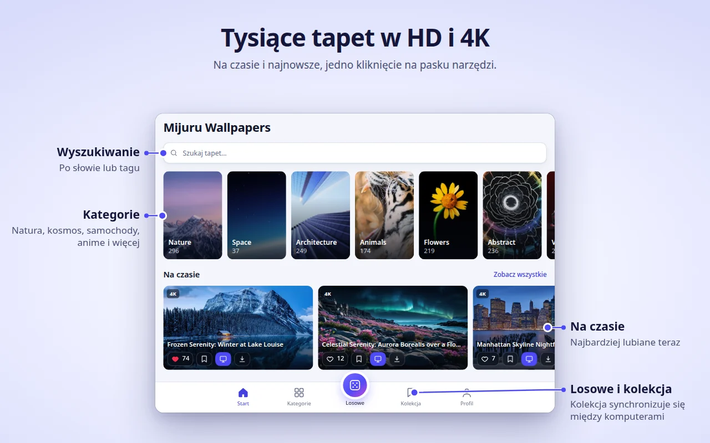
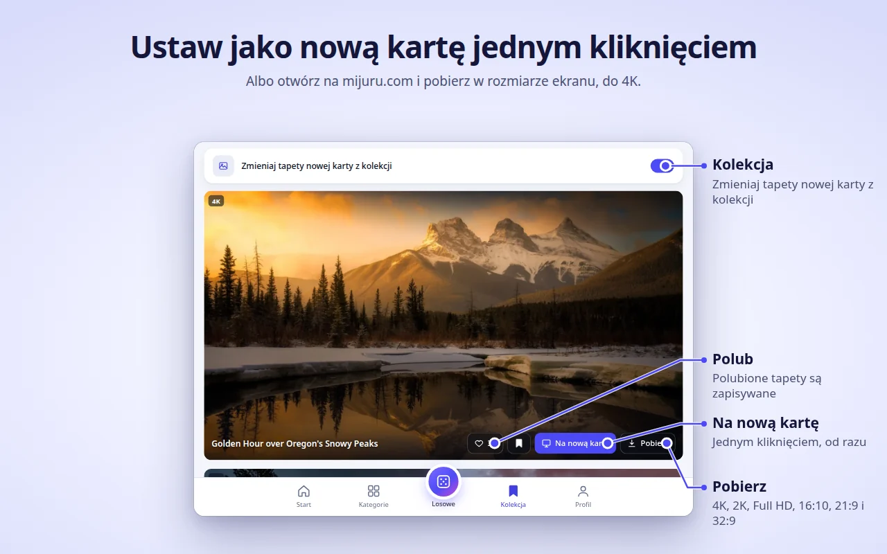
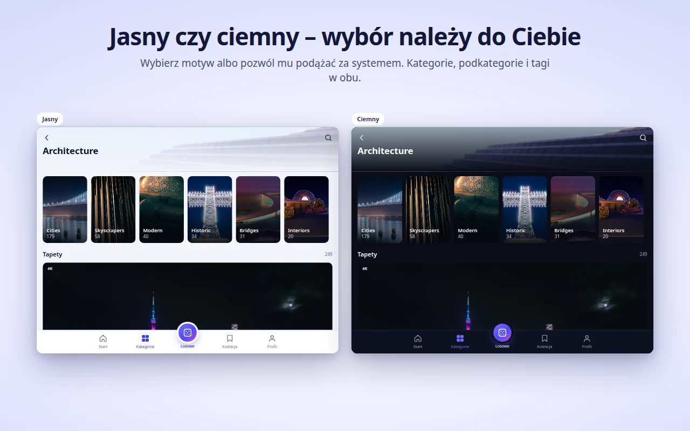
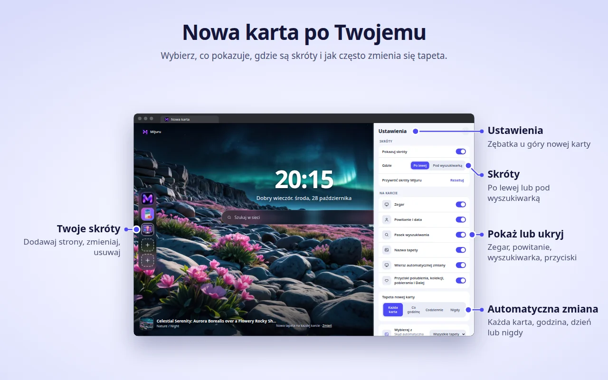

[English](README.md) · [Русский](README.ru.md) · [Українська](README.uk.md) · [Español](README.es.md) · [Português](README.pt.md) · [Deutsch](README.de.md) · [Français](README.fr.md) · [Italiano](README.it.md) · [Türkçe](README.tr.md) · **Polski** · [한국어](README.ko.md) · [Tiếng Việt](README.vi.md) · [Bahasa Indonesia](README.id.md) · [العربية](README.ar.md)

  

<h1 align="center">Mijuru Wallpapers</h1>

  <b>Nowa tapeta 4K na każdej nowej karcie.</b> 
  Tysiące tapet HD i 4K z <a href="https://mijuru.com">mijuru.com</a>, jedno kliknięcie od paska narzędzi. 
  Za darmo · bez reklam · bez konta.

  

To repozytorium zawiera **dokumentację i publiczny system zgłoszeń** dla rozszerzenia przeglądarki Mijuru Wallpapers. Kod źródłowy rozszerzenia jest zamknięty.

## Pobierz rozszerzenie

| Przeglądarka | Sklep | Status |
|---|---|---|
| Google Chrome | [Chrome Web Store](https://chromewebstore.google.com/detail/mijuru-wallpapers/jlkpdnlkhknaifdjfjdepbfmklfpamfh) | ✅ Dostępne |
| Microsoft Edge | [Dodatki Edge](https://microsoftedge.microsoft.com/addons/detail/mijuru-wallpapers/cdnegcioifbeoldnojbgcopnklpneodo) | ✅ Dostępne |
| Mozilla Firefox | [Dodatki Firefoksa (AMO)](https://addons.mozilla.org/firefox/addon/mijuru-wallpapers/) | ✅ Dostępne |
| Opera | Opera add-ons | ⏳ W trakcie weryfikacji w sklepie |

Najnowsza wersja: **1.4.0** — zobacz [listę zmian](CHANGELOG.md). Aktualizacja w sklepach może pojawić się kilka dni po wydaniu.

## Zrzuty ekranu

| | |
|---|---|
|  |  |
|  |  |
|  | |

## Funkcje

**Nowa karta**
- Tapeta na cały ekran w rozmiarze dopasowanym do Twojego monitora. Jeśli pełnowymiarowy plik się nie wczyta, pojawi się podgląd — karta nigdy nie zostaje pusta.
- Następna tapeta jest pobierana z wyprzedzeniem, więc nowe karty otwierają się natychmiast.
- Zegar, powitanie z datą („Dzień dobry…”) i pole wyszukiwania korzystające z domyślnej wyszukiwarki przeglądarki.
- Nazwa i kategoria tapety — kliknij, aby otworzyć jej stronę na mijuru.com.
- Przyciski: Polub, Dodaj do kolekcji, Pobierz (otwiera tapetę na mijuru.com) i Dalej.

**Automatyczna zmiana**
- Na każdej nowej karcie (domyślnie), co godzinę, codziennie lub nigdy.
- Następna tapeta jest wybierana losowo i nigdy nie powtarza 10 ostatnich.
- Źródło: wszystkie tapety, Twoja Kolekcja lub jedna kategoria.

**Skróty** *(nowość w 1.4.0)*
- 8 miejsc: domyślnie trzy skróty Mijuru (katalog tapet, aplikacja na Androida, aplikacja na PC) i miejsce na Twoje własne strony.
- Dodawaj, edytuj lub usuwaj przez menu „⋮”; „Resetuj” przywraca skróty Mijuru.
- Ustaw je w kolumnie po lewej lub w wierszu pod wyszukiwarką.

**Ustawienia na nowej karcie** *(nowość w 1.4.0)*
- Przycisk z kołem zębatym (w prawym górnym rogu) pozwala pokazać lub ukryć zegar, powitanie, wyszukiwarkę, skróty, nazwę tapety, wiersz automatycznej zmiany i przyciski.

**Okno rozszerzenia — cały katalog**
- Start (na czasie i najnowsze), Kategorie → podkategorie, Wyszukiwanie (tapety lub tagi), niekończący się kanał Losowe, Twoja Kolekcja i Profil.
- Na każdej karcie tapety: Polub, Dodaj do kolekcji, Na nową kartę, Pobierz.
- Katalog pokazuje tapety 16:9 w 4K (3840×2160) lub większe — każda pasuje do monitora panoramicznego.

**Kolekcja**
- Zapisuj ulubione tapety i włącz opcję „Zmieniaj tapety nowej karty z kolekcji”.

**Ustawianie tapety z mijuru.com**
- Na stronie tapety na pulpit w serwisie mijuru.com naciśnij **Ustaw jako tapetę nowej karty** — rozszerzenie od razu ją ustawi.

**A także**
- Motyw jasny, ciemny lub systemowy.
- 14 języków interfejsu: English, Русский, Українська, Español, Português (Brasil), Deutsch, Français, Italiano, Türkçe, Polski, 한국어, Tiếng Việt, Bahasa Indonesia, العربية (od prawej do lewej).
- Ustawienia, polubienia, Kolekcja i skróty są synchronizowane przez przeglądarkę, jeśli synchronizacja jest włączona.

## Obsługiwane przeglądarki

| Przeglądarka | Minimalna wersja | Zastępuje nową kartę | Uwagi |
|---|---|---|---|
| Chrome | 116 | Tak | |
| Edge | Aktualne wersje | Tak | Ta sama wersja co dla Chrome |
| Firefox (komputer) | 140 | Tak | Firefox na Androida nie jest obsługiwany |
| Opera | Aktualne wersje | **Nie** | Opera nie pozwala rozszerzeniom zastępować nowej karty — zamiast tego użyj **karty Mijuru** (patrz niżej) |

## Instalacja

1. Otwórz stronę sklepu dla swojej przeglądarki z [tabeli powyżej](#pobierz-rozszerzenie).
2. Kliknij **Dodaj do Chrome** / **Pobierz** / **Dodaj do Firefoksa**.
3. Otwórz nową kartę. Po pierwszej instalacji krótka strona powitalna na mijuru.com wyjaśni podstawy.

**Opera.** Gdy rozszerzenie zostanie opublikowane, otwórz okno rozszerzenia → **Profil → Otwórz kartę Mijuru**. W ustawieniach Opery możesz ustawić tę stronę jako stronę startową.

## Pierwsze kroki

1. **Otwórz nową kartę** — zobaczysz tapetę, zegar i wyszukiwarkę.
2. **Kliknij ikonę Mijuru** na pasku narzędzi, aby przeglądać katalog. Przypnij ją w menu rozszerzeń (ikona puzzla), żeby zawsze była widoczna.
3. **Polub tapetę lub dodaj ją do Kolekcji** z dowolnej karty tapety albo bezpośrednio z nowej karty.
4. **Wybierz, jak często zmienia się tapeta**: Profil → Tapeta nowej karty lub link **Zmień** na nowej karcie.
5. **Dostosuj stronę**: przycisk z kołem zębatym na nowej karcie pokazuje lub ukrywa każdy element.
6. **Pobierz tapetę**: przycisk Pobierz otwiera jej stronę na mijuru.com, gdzie wybierasz rozmiar (4K UHD, 2K QHD, Full HD, 16:10, 21:9, 32:9…).

## Najczęstsze pytania

<b>Czy to naprawdę za darmo? Są reklamy?</b>

Tak, za darmo. Nie ma reklam, konta ani logowania.

<b>Czy mogę ustawić własny obraz jako tło?</b>

Na razie nie. Rozszerzenie pokazuje tapety z katalogu mijuru.com. Jeśli chcesz tej funkcji, zagłosuj na nią lub zaproponuj ją w [Ideas](https://github.com/orgs/mijuru-dev/discussions/categories/ideas).

<b>Dlaczego są tylko poziome tapety?</b>

Rozszerzenie jest stworzone z myślą o ekranach komputerów, dlatego katalog w oknie pokazuje tapety 16:9 w 4K lub większe. Tapety na telefon znajdziesz na [mijuru.com](https://mijuru.com) i w [aplikacji na Androida](https://play.google.com/store/apps/details?id=com.mijuru.wallpaper).

<b>Jak zostawić tę samą tapetę na stałe?</b>

Ustaw automatyczną zmianę na **Nigdy** (Profil → Tapeta nowej karty lub link **Zmień** na nowej karcie). Ręczne ustawienie tapety przyciskiem **Na nową kartę** również wyłącza automatyczną zmianę.

<b>Jak pokazywać tylko tapety z mojej Kolekcji lub jednej kategorii?</b>

Profil → Tapeta nowej karty → Wybieraj z: **Kolekcja** lub kategoria. W zakładce Kolekcja jest też przełącznik „Zmieniaj tapety nowej karty z kolekcji”.

<b>Jak przywrócić domyślną nową kartę przeglądarki?</b>

Wyłącz lub usuń rozszerzenie: otwórz `chrome://extensions`, `edge://extensions` lub `about:addons` (Firefox) i wyłącz Mijuru Wallpapers. Nowa karta przeglądarki wróci od razu.

<b>Czy moje polubienia, Kolekcja i skróty przeniosą się na inny komputer?</b>

Tak, jeśli synchronizacja przeglądarki jest włączona (konto Google, Microsoft lub Firefox). Rozszerzenie korzysta z wbudowanej pamięci synchronizacji przeglądarki; nie ma własnego konta.

<b>Skąd pochodzą pobierane tapety? Czy mogę wybrać rozmiar?</b>

Pobierz otwiera stronę tapety na mijuru.com, gdzie wybierasz dokładny rozmiar. Samo rozszerzenie nie zapisuje plików.

<b>Czy mogę ukryć zegar, powitanie lub wyszukiwarkę?</b>

Tak. Kliknij przycisk z kołem zębatym w prawym górnym rogu nowej karty i wyłącz wybrany element.

<b>Czy pole wyszukiwania wysyła moje zapytania do Mijuru?</b>

Nie. Zapytania trafiają bezpośrednio do domyślnej wyszukiwarki przeglądarki przez jej własny interfejs wyszukiwania. Rozszerzenie ich nie odczytuje ani nie zapisuje.

<b>Dlaczego Opera działa inaczej?</b>

Opera nie pozwala rozszerzeniom zastępować nowej karty. Użyj **Profil → Otwórz kartę Mijuru** — to ta sama strona w zwykłej karcie, którą możesz ustawić jako stronę startową.

<b>Czy mogę używać tapet komercyjnie?</b>

Tapety z mijuru.com są darmowe do użytku osobistego. Odsprzedaż i wykorzystanie komercyjne są niedozwolone.

## Rozwiązywanie problemów

**Nowa karta nie pokazuje Mijuru.**
Nową kartą może sterować tylko jedno rozszerzenie naraz — tak działają przeglądarki. Jeśli masz inne rozszerzenie nowej karty, przeglądarka użyje jednego z nich. Wyłącz drugie rozszerzenie i ponownie otwórz nową kartę.

**Chrome pyta, czy wrócić do Google, czy zachować zmiany.**
Chrome wyświetla to pytanie, gdy jakiekolwiek rozszerzenie zastąpi nową kartę. Wybierz **zachowanie zmian**, aby zostać przy Mijuru. Jeśli wybrałeś przywrócenie, Chrome wyłącza rozszerzenie — włącz je ponownie w `chrome://extensions`.

**Firmowa przeglądarka ignoruje rozszerzenie.**
Zarządzane przeglądarki (w pracy lub szkole) mogą blokować rozszerzenia albo wymuszać konkretną nową kartę za pomocą zasad. Skontaktuj się z administratorem.

**Opera: brak tapety na nowej karcie i brak przycisku „Na nową kartę”.**
Tak ma być — zobacz [Dlaczego Opera działa inaczej?](#najczęstsze-pytania). Użyj **karty Mijuru**.

**Tytuły tapet są po angielsku, choć wybrałem inny język.**
Dla koreańskiego, wietnamskiego, indonezyjskiego i arabskiego katalog nie ma jeszcze przetłumaczonych tytułów, więc wyświetlają się po angielsku. Sam interfejs jest przetłumaczony. Linki do katalogu zawsze otwierają angielską wersję mijuru.com.

**„Nie udało się załadować. Sprawdź połączenie.”**
Rozszerzenie potrzebuje dostępu do internetu i mijuru.com. Sprawdź połączenie, VPN lub zaporę, a następnie naciśnij **Spróbuj ponownie**. Jeśli pełnowymiarowe tło się nie wczyta, zamiast niego pojawi się podgląd.

**Skrót pokazuje literę zamiast ikony.**
Nie udało się wczytać ikony strony (`/favicon.ico`), więc kafelek pokazuje pierwszą literę nazwy. Skrót nadal działa.

**Tapeta przestała się zmieniać.**
Sprawdź Profil → Tapeta nowej karty: jeśli ustawiłeś tapetę ręcznie, automatyczna zmiana została przełączona na **Nigdy**. Jeśli źródłem jest Twoja Kolekcja, upewnij się, że nie jest pusta.

Nadal masz problem? [Utwórz zgłoszenie](https://github.com/mijuru-dev/wallpapers-browser-extension/issues/new/choose).

## Uprawnienia i prywatność

Rozszerzenie prosi tylko o to, czego potrzebuje:

| Uprawnienie | Do czego |
|---|---|
| `storage` | Twoje ustawienia, identyfikatory polubionych tapet i tapet z kolekcji, Twoje skróty i pamięć podręczna. |
| `alarms` | Automatyczna zmiana co godzinę i codziennie oraz pobieranie następnej tapety z wyprzedzeniem. |
| `search` | Pole wyszukiwania na nowej karcie wysyła zapytanie do domyślnej wyszukiwarki przeglądarki. Rozszerzenie nie odczytuje ani nie zapisuje zapytań. |
| `https://mijuru.com/*` | Wczytywanie katalogu tapet i obrazów z API mijuru.com (tylko do odczytu) oraz przycisk „Ustaw jako tapetę nowej karty” na mijuru.com (patrz niżej). |

Rozszerzenie **nie ma** dostępu do Twoich kart, historii, pobranych plików ani treści innych stron.

**Co rozszerzenie robi, a czego nie**
- **Bez analityki, reklam, plików cookie, kont i zewnętrznych trackerów.** Strona w katalogu Firefoksa deklaruje brak zbierania danych.
- **Żądania trafiają do mijuru.com** — katalog i obrazy (żądania `GET` tylko do odczytu z wybranym językiem, kategorią, tagiem, tekstem wyszukiwania lub identyfikatorami tapet).
- **Ikony skrótów.** Dla skrótów dodanych przez Ciebie nowa karta wczytuje ikonę strony z `https://<ta strona>/favicon.ico`. To zwykłe żądanie do dodanej strony; nie są do niego dołączane żadne dane z rozszerzenia.
- **Integracja z mijuru.com.** Niewielki skrypt działa tylko na stronach `https://mijuru.com/*`. Pozwala przyciskowi „Ustaw jako tapetę nowej karty” w serwisie przekazać identyfikator tapety do rozszerzenia i informuje serwis o wersji rozszerzenia, nazwie przeglądarki oraz identyfikatorze bieżącej tapety, aby przycisk pokazywał właściwy stan. Nie odczytuje niczego więcej i nie działa na żadnej innej stronie.
- **Polubienia zostają u Ciebie.** Polubienia i Kolekcja są przechowywane w pamięci przeglądarki (synchronizowane przez przeglądarkę, jeśli synchronizacja jest włączona). Gdy polubisz tapetę, nic nie jest wysyłane na serwer.
- **Strony instalacji i odinstalowania.** Po pierwszej instalacji rozszerzenie otwiera stronę powitalną na mijuru.com; po usunięciu przeglądarka otwiera stronę pożegnalną z opcjonalną ankietą z jednym pytaniem. Te linki zawierają tylko język, nazwę przeglądarki, wersję rozszerzenia i tagi `utm_*` — żadnych identyfikatorów użytkownika. Te same tagi `utm_*` są dodawane do innych linków do mijuru.com. Na mijuru.com obowiązuje polityka prywatności samego serwisu.

Pełna polityka: **[mijuru.com/browser-extension-privacy-policy](https://mijuru.com/browser-extension-privacy-policy)**

## Opinie i pomoc

| Co | Gdzie | |
|---|---|---|
| 🐞 **Coś nie działa** | [Zgłoś problem](https://github.com/mijuru-dev/wallpapers-browser-extension/issues/new/choose) | GitHub Issues |
| 💡 **Pomysł lub sugestia** | [Podziel się pomysłem](https://github.com/orgs/mijuru-dev/discussions/categories/ideas) | GitHub Discussions |
| ❓ **Pytanie** | [Zapytaj w Q&A](https://github.com/orgs/mijuru-dev/discussions/categories/q-a) | GitHub Discussions |
| ✉️ **Sprawa prywatna** | [m@mijuru.dev](mailto:m@mijuru.dev) | E-mail |

**Issues służą tylko do zgłaszania problemów** — pomysły, sugestie i pytania trafiają do [Discussions](https://github.com/orgs/mijuru-dev/discussions), gdzie każdy może zagłosować 👍 na pomysły, które podobają mu się najbardziej.
Pisz po angielsku, aby każdy mógł znaleźć rozmowę i ją śledzić — tłumaczenie maszynowe z Twojego języka jest w zupełności w porządku. Przed publikacją przeszukaj istniejące zgłoszenia i dyskusje: 👍 pod istniejącym wątkiem pomaga bardziej niż duplikat.

🚩 Aby zgłosić tapetę (prawa autorskie, nieodpowiednie treści), użyj opcji **Zgłoś obraz** na stronie tapety na mijuru.com.

## Więcej tapet na mijuru.com

Pełna kolekcja jest dostępna na stronie — przydaje się, gdy chcesz wybrać tapetę na innym urządzeniu lub w rozmiarze, którego rozszerzenie nie pokazuje:

- [Tapety na pulpit według rozdzielczości — 4K, 2K, Full HD, ultrapanoramiczne](https://mijuru.com/wallpapers/resolutions)
- [Pakiety tapet — tematyczne kolekcje](https://mijuru.com/wallpapers/packs)
- [Tapety na telefon według marki — iPhone, Samsung, Xiaomi i inne](https://mijuru.com/wallpapers/device-brands)
- [Awatary i zdjęcia profilowe na Instagram, Discord, TikTok](https://mijuru.com/avatars)

## Inne aplikacje Mijuru

- 🌐 **[mijuru.com](https://mijuru.com)** — darmowe tapety na telefon, komputer i tablet w HD, 4K i 8K.
- 📱 **[Wallpapers by Mijuru na Androida](https://play.google.com/store/apps/details?id=com.mijuru.wallpaper)** — ustawiaj tapety na ekranie głównym i ekranie blokady.
- 🖥️ **[Wallpapers by Mijuru na Linuksa](https://snapcraft.io/wallpapers-by-mijuru)** — ustawiaj tapety jednym kliknięciem i zmieniaj je według harmonogramu.

Wszystkie produkty i dokumentacja: **[github.com/mijuru-dev](https://github.com/mijuru-dev)**

## Licencja

© 2026 Mijuru. Wszelkie prawa zastrzeżone. Rozszerzenie jest bezpłatne; jego kod źródłowy nie jest publikowany. Dokumentacji i obrazów z tego repozytorium nie wolno wykorzystywać ponownie bez zgody.
