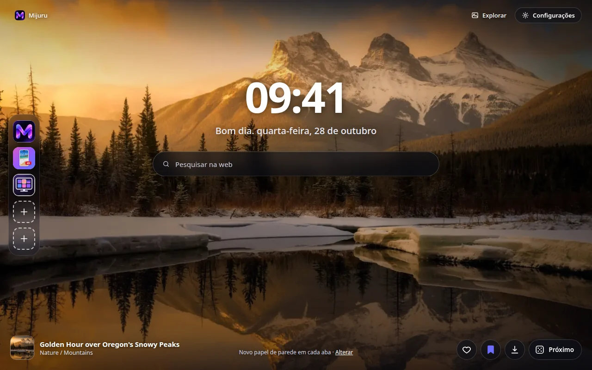
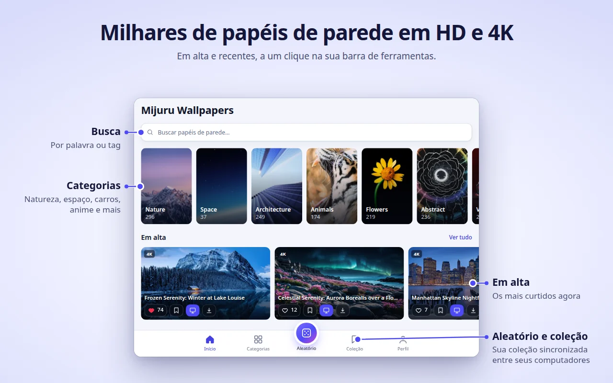
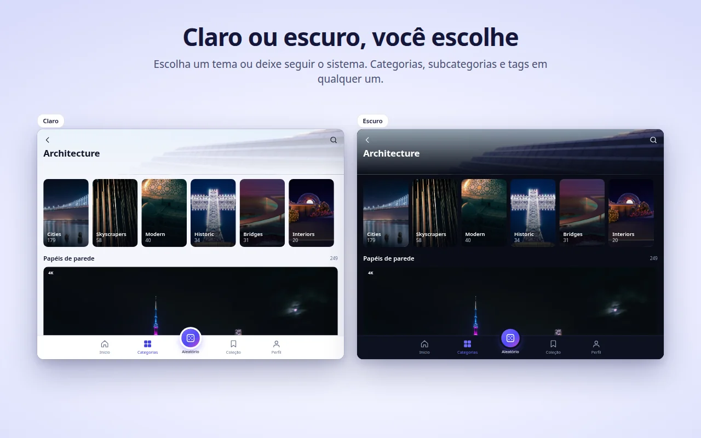
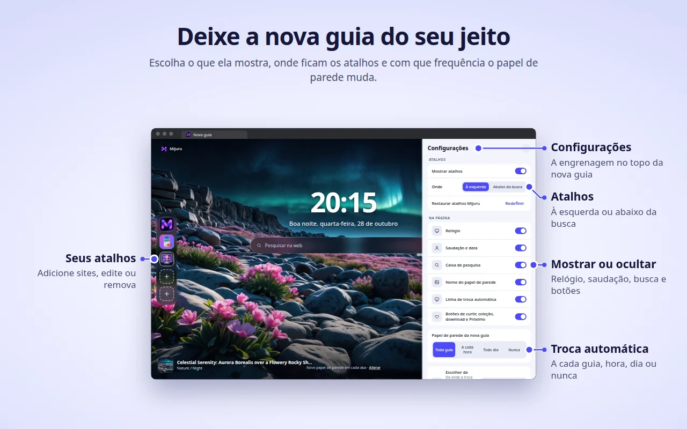

[English](README.md) · [Русский](README.ru.md) · [Українська](README.uk.md) · [Español](README.es.md) · **Português** · [Deutsch](README.de.md) · [Français](README.fr.md) · [Italiano](README.it.md) · [Türkçe](README.tr.md) · [Polski](README.pl.md) · [한국어](README.ko.md) · [Tiếng Việt](README.vi.md) · [Bahasa Indonesia](README.id.md) · [العربية](README.ar.md)

  

<h1 align="center">Mijuru Wallpapers</h1>

  <b>Um papel de parede 4K novo a cada nova guia.</b> 
  Milhares de papéis de parede HD e 4K do <a href="https://mijuru.com">mijuru.com</a>, a um clique na barra de ferramentas. 
  Grátis · sem anúncios · sem conta.

  

Este repositório reúne a **documentação e o rastreador público de problemas** da extensão de navegador Mijuru Wallpapers. O código-fonte da extensão é fechado.

## Instalar a extensão

| Navegador | Loja | Status |
|---|---|---|
| Google Chrome | [Chrome Web Store](https://chromewebstore.google.com/detail/mijuru-wallpapers/jlkpdnlkhknaifdjfjdepbfmklfpamfh) | ✅ Disponível |
| Microsoft Edge | [Complementos do Edge](https://microsoftedge.microsoft.com/addons/detail/mijuru-wallpapers/cdnegcioifbeoldnojbgcopnklpneodo) | ✅ Disponível |
| Mozilla Firefox | [Complementos do Firefox (AMO)](https://addons.mozilla.org/firefox/addon/mijuru-wallpapers/) | ✅ Disponível |
| Opera | Opera add-ons | ⏳ Em análise na loja |

Versão atual: **1.4.0** — veja o [histórico de mudanças](CHANGELOG.md). As lojas podem levar alguns dias para liberar uma nova versão.

## Capturas de tela

| | |
|---|---|
|  |  |
|  |  |
|  | |

## Recursos

**Nova guia**
- Um papel de parede em tela cheia, no tamanho certo para a sua tela. Se o arquivo em tamanho real não carregar, aparece uma prévia — a guia nunca fica vazia.
- O próximo papel de parede é baixado com antecedência, então as novas guias abrem na hora.
- Relógio, uma saudação com a data ("Bom dia…") e uma caixa de pesquisa que usa o mecanismo de pesquisa padrão do seu navegador.
- O nome e a categoria do papel de parede — clique para abrir a página dele no mijuru.com.
- Botões: Curtir, adicionar à Coleção, Baixar (abre o papel de parede no mijuru.com) e Próximo.

**Troca automática**
- A cada nova guia (padrão), a cada hora, todo dia ou nunca.
- O próximo papel de parede é escolhido aleatoriamente e nunca repete os 10 últimos.
- Origem: todos os papéis de parede, sua Coleção ou uma única categoria.

**Atalhos** *(novidade da 1.4.0)*
- 8 espaços: três atalhos do Mijuru por padrão (o catálogo de papéis de parede, o app para Android e o app para PC) e lugar para os seus próprios sites.
- Adicione, edite ou exclua pelo menu "⋮"; "Redefinir" traz de volta os atalhos do Mijuru.
- Posicione-os em uma coluna à esquerda ou em uma linha abaixo da busca.

**Configurações na nova guia** *(novidade da 1.4.0)*
- O botão de engrenagem (canto superior direito) permite mostrar ou ocultar o relógio, a saudação, a pesquisa, os atalhos, o nome do papel de parede, a linha de troca automática e os botões.

**Janela da extensão — o catálogo inteiro**
- Início (em alta e recentes), Categorias → subcategorias, Pesquisa (papéis de parede ou tags), um feed Aleatório infinito, sua Coleção e seu Perfil.
- Em cada card: Curtir, adicionar à Coleção, Na nova guia e Baixar.
- O catálogo mostra papéis de parede 16:9 em 4K (3840×2160) ou maiores — todos cabem em um monitor widescreen.

**Coleção**
- Salve os papéis de parede que você ama e ative "Trocar os fundos da nova guia pela coleção".

**Definir um papel de parede pelo mijuru.com**
- Na página de um papel de parede para desktop no mijuru.com, clique em **Definir como papel de parede da nova guia** — a extensão aplica na hora.

**E mais**
- Tema claro, escuro ou do sistema.
- 14 idiomas de interface: English, Русский, Українська, Español, Português (Brasil), Deutsch, Français, Italiano, Türkçe, Polski, 한국어, Tiếng Việt, Bahasa Indonesia, العربية (da direita para a esquerda).
- Configurações, curtidas, Coleção e atalhos acompanham a sincronização do navegador, se ela estiver ativada.

## Navegadores compatíveis

| Navegador | Versão mínima | Substitui a nova guia | Observações |
|---|---|---|---|
| Chrome | 116 | Sim | |
| Edge | Versões atuais | Sim | Mesma versão do Chrome |
| Firefox (desktop) | 140 | Sim | O Firefox para Android não é compatível |
| Opera | Versões atuais | **Não** | O Opera não permite que extensões substituam a nova guia — use a **guia Mijuru** (veja abaixo) |

## Instalação

1. Abra a página da loja do seu navegador pela [tabela acima](#instalar-a-extensão).
2. Clique em **Usar no Chrome** / **Obter** / **Adicionar ao Firefox**.
3. Abra uma nova guia. Após a primeira instalação, uma breve página de boas-vindas no mijuru.com explica o básico.

**Opera.** Assim que a extensão for publicada, abra a janela da extensão → **Perfil → Abrir a guia Mijuru**. Você pode definir essa página como página inicial nas configurações do Opera.

## Primeiros passos

1. **Abra uma nova guia** — você verá um papel de parede, o relógio e a pesquisa.
2. **Clique no ícone do Mijuru** na barra de ferramentas para explorar o catálogo. Fixe-o pelo menu de extensões (a peça de quebra-cabeça) para que fique sempre visível.
3. **Curta um papel de parede ou adicione-o à sua Coleção** a partir de qualquer card ou direto da nova guia.
4. **Escolha com que frequência o papel de parede muda**: Perfil → Papel de parede da nova guia, ou o link **Alterar** na nova guia.
5. **Personalize a página**: o botão de engrenagem na nova guia mostra ou oculta cada elemento.
6. **Baixe um papel de parede**: o botão Baixar abre a página dele no mijuru.com, onde você escolhe o tamanho (4K UHD, 2K QHD, Full HD, 16:10, 21:9, 32:9…).

## Perguntas frequentes

<b>É grátis mesmo? Tem anúncios?</b>

Sim, é grátis. Não há anúncios, conta nem login.

<b>Posso usar minha própria imagem como fundo?</b>

No momento, não. A extensão mostra papéis de parede do catálogo do mijuru.com. Se você quer esse recurso, vote nele ou sugira-o em [Ideas](https://github.com/orgs/mijuru-dev/discussions/categories/ideas).

<b>Por que só há papéis de parede na horizontal?</b>

A extensão foi feita para telas de computador, então o catálogo da janela mostra papéis de parede 16:9 em 4K ou maiores. Papéis de parede para celular estão no [mijuru.com](https://mijuru.com) e no [app para Android](https://play.google.com/store/apps/details?id=com.mijuru.wallpaper).

<b>Como mantenho sempre o mesmo papel de parede?</b>

Defina a troca automática como **Nunca** (Perfil → Papel de parede da nova guia, ou o link **Alterar** na nova guia). Definir um papel de parede manualmente com **Na nova guia** também desativa a troca automática.

<b>Como mostro só papéis de parede da minha Coleção ou de uma categoria?</b>

Perfil → Papel de parede da nova guia → Escolher de: **Coleção** ou uma categoria. Na aba Coleção também há a opção "Trocar os fundos da nova guia pela coleção".

<b>Como volto para a nova guia padrão do navegador?</b>

Desative ou remova a extensão: abra `chrome://extensions`, `edge://extensions` ou `about:addons` (Firefox) e desative o Mijuru Wallpapers. A nova guia do próprio navegador volta na hora.

<b>Minhas curtidas, Coleção e atalhos vão para outro computador?</b>

Sim, se a sincronização do navegador estiver ativada (conta Google, Microsoft ou Firefox). A extensão usa o armazenamento sincronizado integrado do navegador; ela não tem conta própria.

<b>De onde vêm os papéis de parede baixados? Posso escolher o tamanho?</b>

Baixar abre a página do papel de parede no mijuru.com, onde você escolhe o tamanho exato. A extensão em si não salva arquivos.

<b>Posso ocultar o relógio, a saudação ou a pesquisa?</b>

Sim. Clique no botão de engrenagem no canto superior direito da nova guia e desative o elemento que quiser.

<b>A caixa de pesquisa envia minhas buscas para o Mijuru?</b>

Não. As buscas vão direto para o mecanismo de pesquisa padrão do seu navegador, pela API de pesquisa do próprio navegador. A extensão não as lê nem armazena.

<b>Por que o Opera funciona de outro jeito?</b>

O Opera não permite que extensões substituam a nova guia. Use **Perfil → Abrir a guia Mijuru** — é a mesma página em uma guia normal, e você pode defini-la como página inicial.

<b>Posso usar os papéis de parede comercialmente?</b>

Os papéis de parede do mijuru.com são gratuitos para uso pessoal. Revenda e uso comercial não são permitidos.

## Solução de problemas

**A nova guia não mostra o Mijuru.**
Só uma extensão pode controlar a nova guia por vez — é assim que os navegadores funcionam. Se você tem outra extensão de nova guia, o navegador usa uma delas. Desative a outra extensão e abra uma nova guia de novo.

**O Chrome pergunta se você quer voltar para o Google ou manter as alterações.**
O Chrome mostra esse aviso sempre que uma extensão substitui a nova guia. Escolha **manter as alterações** para continuar com o Mijuru. Se você escolheu reverter, o Chrome desativa a extensão — ative-a de novo em `chrome://extensions`.

**O navegador da empresa ignora a extensão.**
Navegadores gerenciados (do trabalho ou da escola) podem bloquear extensões ou impor uma nova guia específica por meio de políticas. Fale com o administrador.

**Opera: sem papel de parede na nova guia e sem o botão "Na nova guia".**
Isso é esperado — veja [Por que o Opera funciona de outro jeito?](#perguntas-frequentes). Use a **guia Mijuru**.

**Os títulos dos papéis de parede estão em inglês, mesmo com outro idioma escolhido.**
Para coreano, vietnamita, indonésio e árabe o catálogo ainda não tem títulos traduzidos, então eles aparecem em inglês. A interface em si está traduzida. Os links do catálogo sempre abrem a versão em inglês do mijuru.com.

**"Não foi possível carregar. Verifique sua conexão."**
A extensão precisa de acesso à internet para o mijuru.com. Verifique sua conexão, VPN ou firewall e clique em **Tentar novamente**. Se o fundo em tamanho real não carregar, aparece uma prévia no lugar.

**Um atalho mostra uma letra em vez de um ícone.**
Não foi possível carregar o ícone do site (`/favicon.ico`), então o bloco mostra a primeira letra do nome. O atalho continua funcionando.

**O papel de parede parou de mudar.**
Confira Perfil → Papel de parede da nova guia: se você definiu um papel de parede manualmente, a troca automática passou para **Nunca**. Se a origem é a sua Coleção, verifique se ela não está vazia.

Ainda com problemas? [Abra uma issue](https://github.com/mijuru-dev/wallpapers-browser-extension/issues/new/choose).

## Permissões e privacidade

A extensão pede apenas o que precisa:

| Permissão | Para quê |
|---|---|
| `storage` | Suas configurações, os IDs dos papéis de parede curtidos e da coleção, seus atalhos e um cache. |
| `alarms` | Troca automática a cada hora e todo dia, e o download antecipado do próximo papel de parede. |
| `search` | A caixa de pesquisa da nova guia envia sua busca ao mecanismo de pesquisa padrão do navegador. A extensão não lê nem armazena as buscas. |
| `https://mijuru.com/*` | Carregar o catálogo e as imagens pela API somente leitura do mijuru.com, e o botão "Definir como papel de parede da nova guia" no mijuru.com (veja abaixo). |

**Não** há acesso às suas guias, histórico, downloads ou ao conteúdo de outros sites.

**O que a extensão faz e não faz**
- **Sem análises, anúncios, cookies, contas ou rastreadores de terceiros.** A página do Firefox declara que não há coleta de dados.
- **As solicitações vão para o mijuru.com** — catálogo e imagens (solicitações `GET` somente leitura com o idioma, a categoria, a tag, o texto de pesquisa ou os IDs de papéis de parede selecionados).
- **Ícones dos atalhos.** Para os atalhos que você adiciona, a nova guia carrega o ícone do site em `https://<esse site>/favicon.ico`. É uma solicitação comum ao site que você adicionou; nenhum dado da extensão é enviado junto.
- **Integração com o mijuru.com.** Um pequeno script roda apenas nas páginas `https://mijuru.com/*`. Ele permite que o botão "Definir como papel de parede da nova guia" do site passe o ID de um papel de parede para a extensão e informa ao site a versão da extensão, o nome do navegador e o ID do papel de parede atual, para que o botão mostre o estado correto. Ele não lê mais nada e não roda em nenhum outro site.
- **Suas curtidas ficam com você.** As curtidas e a Coleção ficam no armazenamento do navegador (sincronizadas pelo navegador, se a sincronização estiver ativada). Nada é enviado ao servidor quando você curte um papel de parede.
- **Páginas de instalação e desinstalação.** Após a primeira instalação, a extensão abre uma página de boas-vindas no mijuru.com; ao removê-la, o navegador abre uma página de despedida com uma pesquisa opcional de uma pergunta. Esses links contêm apenas o idioma, o nome do navegador, a versão da extensão e tags `utm_*` — nenhum identificador de usuário. As mesmas tags `utm_*` são adicionadas a outros links para o mijuru.com. Uma vez no mijuru.com, vale a política de privacidade do próprio site.

Política completa: **[mijuru.com/browser-extension-privacy-policy](https://mijuru.com/browser-extension-privacy-policy)**

## Feedback e suporte

| O quê | Onde | |
|---|---|---|
| 🐞 **Algo não funciona** | [Relatar um problema](https://github.com/mijuru-dev/wallpapers-browser-extension/issues/new/choose) | GitHub Issues |
| 💡 **Ideia ou sugestão** | [Compartilhar uma ideia](https://github.com/orgs/mijuru-dev/discussions/categories/ideas) | GitHub Discussions |
| ❓ **Dúvida** | [Perguntar no Q&A](https://github.com/orgs/mijuru-dev/discussions/categories/q-a) | GitHub Discussions |
| ✉️ **Assunto privado** | [m@mijuru.dev](mailto:m@mijuru.dev) | E-mail |

**Issues são só para problemas** — ideias, sugestões e dúvidas ficam nas [Discussions](https://github.com/orgs/mijuru-dev/discussions), onde todos podem votar com 👍 nas ideias de que mais gostam.
Escreva em inglês para que todos possam encontrar e acompanhar a conversa — uma tradução automática do seu idioma está ótima. Antes de publicar, pesquise nas issues e discussões existentes: um 👍 em uma que já existe ajuda mais do que uma duplicata.

🚩 Para denunciar um papel de parede (direitos autorais, conteúdo impróprio), use **Denunciar imagem** na página do papel de parede no mijuru.com.

## Mais papéis de parede no mijuru.com

A coleção completa está no site — útil quando você quer escolher um papel de parede em outro dispositivo ou em um tamanho que a extensão não mostra:

- [Papéis de parede para desktop por resolução — 4K, 2K, Full HD, ultrawide](https://mijuru.com/wallpapers/resolutions)
- [Pacotes de papéis de parede — coleções temáticas](https://mijuru.com/wallpapers/packs)
- [Papéis de parede para celular por marca — iPhone, Samsung, Xiaomi e outras](https://mijuru.com/wallpapers/device-brands)
- [Avatares e fotos de perfil para Instagram, Discord, TikTok](https://mijuru.com/avatars)

## Outros apps do Mijuru

- 🌐 **[mijuru.com](https://mijuru.com)** — papéis de parede grátis para celular, computador e tablet em HD, 4K e 8K.
- 📱 **[Wallpapers by Mijuru para Android](https://play.google.com/store/apps/details?id=com.mijuru.wallpaper)** — defina papéis de parede na tela inicial e na tela de bloqueio.
- 🖥️ **[Wallpapers by Mijuru para Linux](https://snapcraft.io/wallpapers-by-mijuru)** — defina papéis de parede com um clique e troque-os de forma programada.

Todos os produtos e a documentação: **[github.com/mijuru-dev](https://github.com/mijuru-dev)**

## Licença

© 2026 Mijuru. Todos os direitos reservados. O uso da extensão é gratuito; o código-fonte não é publicado. A documentação e as imagens deste repositório não podem ser reutilizadas sem permissão.
