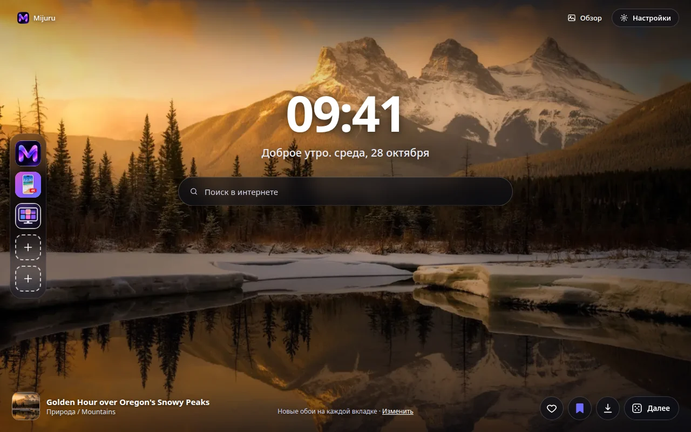
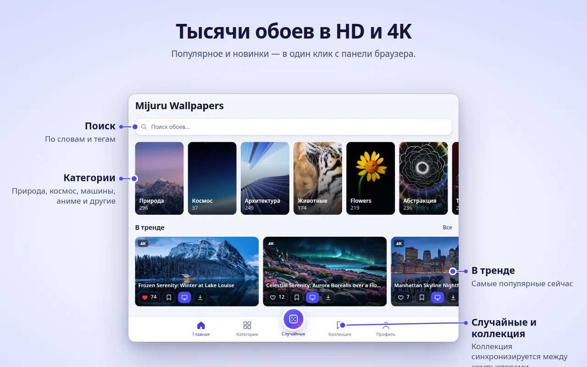
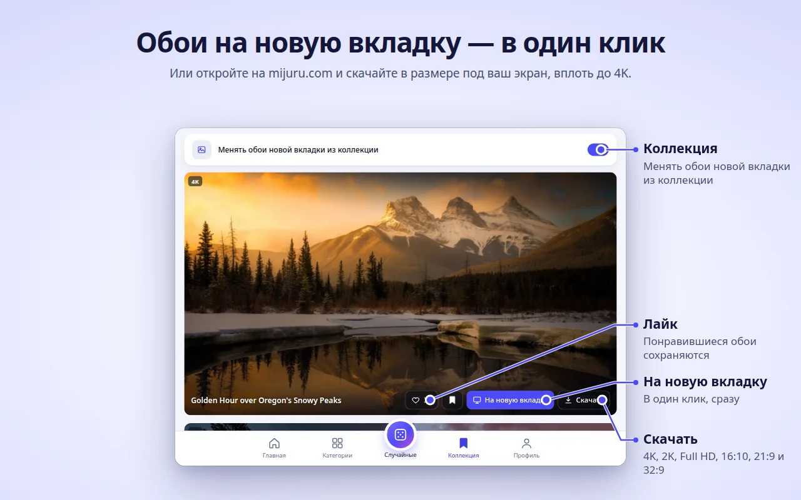
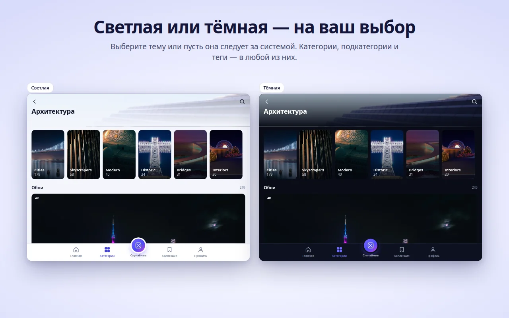
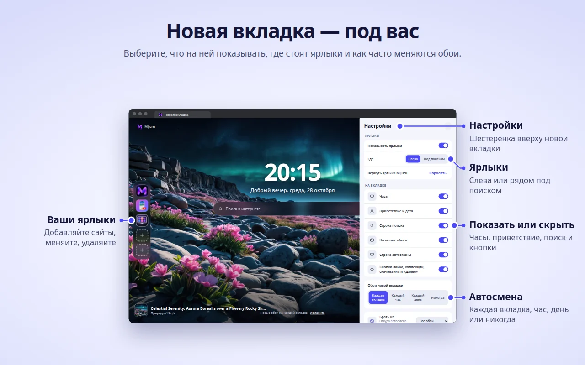

[English](README.md) · **Русский** · [Українська](README.uk.md) · [Español](README.es.md) · [Português](README.pt.md) · [Deutsch](README.de.md) · [Français](README.fr.md) · [Italiano](README.it.md) · [Türkçe](README.tr.md) · [Polski](README.pl.md) · [한국어](README.ko.md) · [Tiếng Việt](README.vi.md) · [Bahasa Indonesia](README.id.md) · [العربية](README.ar.md)

  

<h1 align="center">Mijuru Wallpapers</h1>

  <b>Новые обои в 4K на каждой новой вкладке.</b> 
  Тысячи обоев в HD и 4K с <a href="https://mijuru.com">mijuru.com</a> — в один клик с панели браузера. 
  Бесплатно · без рекламы · без регистрации.

  

В этом репозитории — **документация и публичный трекер обращений** для расширения Mijuru Wallpapers. Исходный код расширения закрыт.

## Установить

| Браузер | Магазин | Статус |
|---|---|---|
| Google Chrome | [Интернет-магазин Chrome](https://chromewebstore.google.com/detail/mijuru-wallpapers/jlkpdnlkhknaifdjfjdepbfmklfpamfh) | ✅ Доступно |
| Microsoft Edge | [Надстройки Edge](https://microsoftedge.microsoft.com/addons/detail/mijuru-wallpapers/cdnegcioifbeoldnojbgcopnklpneodo) | ✅ Доступно |
| Mozilla Firefox | [Дополнения Firefox (AMO)](https://addons.mozilla.org/firefox/addon/mijuru-wallpapers/) | ✅ Доступно |
| Opera | Opera add-ons | ⏳ На проверке в магазине |

Текущая версия — **1.4.0**, см. [список изменений](CHANGELOG.md). Обновление в магазинах может появиться на несколько дней позже релиза.

## Скриншоты

| | |
|---|---|
|  |  |
|  |  |
|  | |

## Возможности

**Новая вкладка**
- Обои на весь экран в размере под ваш монитор. Если полный файл не загрузился, показывается превью — вкладка не остаётся пустой.
- Следующие обои скачиваются заранее, поэтому новая вкладка открывается мгновенно.
- Часы, приветствие с датой («Доброе утро…») и поиск через поисковую систему вашего браузера по умолчанию.
- Название и категория обоев — по клику открывается их страница на mijuru.com.
- Кнопки: «Нравится», «В коллекцию», «Скачать» (открывает обои на mijuru.com) и «Следующие».

**Автосмена**
- На каждой новой вкладке (по умолчанию), раз в час, раз в день или никогда.
- Следующие обои выбираются случайно и не повторяют 10 последних.
- Источник: все обои, ваша коллекция или одна категория.

**Ярлыки** *(новое в 1.4.0)*
- 8 ячеек: по умолчанию три ярлыка Mijuru (каталог обоев, приложение для Android, приложение для ПК) и место для ваших сайтов.
- Добавить, изменить или удалить — через меню «⋮»; «Сбросить» возвращает ярлыки Mijuru.
- Колонкой слева или рядом под поиском.

**Настройки на новой вкладке** *(новое в 1.4.0)*
- Кнопка-шестерёнка справа вверху: часы, приветствие, поиск, ярлыки, название обоев, строку автосмены и кнопки можно скрыть или вернуть.

**Окно расширения — весь каталог**
- Главная (популярные и новые), Категории → подкатегории, Поиск (по обоям или тегам), бесконечная лента «Случайные», Коллекция и Профиль.
- На каждой карточке: «Нравится», «В коллекцию», «Поставить на новую вкладку», «Скачать».
- В каталоге — обои 16:9 в 4K (3840×2160) и выше: каждые подходят к широкому монитору.

**Коллекция**
- Сохраняйте понравившиеся обои и включите «Менять обои новой вкладки из коллекции».

**Обои с mijuru.com в один клик**
- На странице обоев для ПК на mijuru.com нажмите **«Поставить на новую вкладку»** — расширение сразу их установит.

**А также**
- Светлая, тёмная или системная тема.
- 14 языков интерфейса: English, Русский, Українська, Español, Português (Brasil), Deutsch, Français, Italiano, Türkçe, Polski, 한국어, Tiếng Việt, Bahasa Indonesia, العربية (справа налево).
- Настройки, лайки, коллекция и ярлыки синхронизируются через синхронизацию браузера, если она включена.

## Поддерживаемые браузеры

| Браузер | Минимальная версия | Заменяет новую вкладку | Примечание |
|---|---|---|---|
| Chrome | 116 | Да | |
| Edge | Актуальные версии | Да | Та же сборка, что для Chrome |
| Firefox (для компьютера) | 140 | Да | Firefox для Android не поддерживается |
| Opera | Актуальные версии | **Нет** | Opera не разрешает расширениям заменять новую вкладку — используйте **вкладку Mijuru** (см. ниже) |

## Установка

1. Откройте страницу расширения в магазине вашего браузера — [таблица выше](#установить).
2. Нажмите **«Установить»** / **«Получить»** / **«Добавить в Firefox»**.
3. Откройте новую вкладку. После первой установки на mijuru.com откроется короткая страница с подсказками.

**Opera.** Когда расширение опубликуют, откройте окно расширения → **Профиль → Открыть вкладку Mijuru**. Эту страницу можно сделать стартовой в настройках Opera.

## Первые шаги

1. **Откройте новую вкладку** — вы увидите обои, часы и поиск.
2. **Нажмите на иконку Mijuru** на панели браузера, чтобы открыть каталог. Закрепите её через меню расширений (значок пазла), чтобы она всегда была на виду.
3. **Ставьте лайки и добавляйте обои в коллекцию** — с любой карточки или прямо с новой вкладки.
4. **Выберите, как часто менять обои**: Профиль → Обои новой вкладки или ссылка **«Изменить»** на новой вкладке.
5. **Настройте страницу**: шестерёнка на новой вкладке показывает или скрывает каждый элемент.
6. **Скачайте обои**: кнопка «Скачать» открывает их страницу на mijuru.com, где можно выбрать размер (4K UHD, 2K QHD, Full HD, 16:10, 21:9, 32:9…).

## Частые вопросы

<b>Это правда бесплатно? Есть реклама?</b>

Да, бесплатно. Рекламы нет, аккаунт и вход не нужны.

<b>Можно поставить своё изображение?</b>

Пока нет: расширение показывает обои из каталога mijuru.com. Если вам нужна эта функция — проголосуйте за неё или предложите её в [Ideas](https://github.com/orgs/mijuru-dev/discussions/categories/ideas).

<b>Почему только горизонтальные обои?</b>

Расширение сделано для экранов компьютеров, поэтому в каталоге — обои 16:9 в 4K и выше. Обои для телефона есть на [mijuru.com](https://mijuru.com) и в [приложении для Android](https://play.google.com/store/apps/details?id=com.mijuru.wallpaper).

<b>Как оставить одни и те же обои?</b>

Выберите автосмену **«Никогда»** (Профиль → Обои новой вкладки или ссылка **«Изменить»** на новой вкладке). Если поставить обои вручную кнопкой «Поставить на новую вкладку», автосмена тоже выключается.

<b>Как показывать обои только из коллекции или одной категории?</b>

Профиль → Обои новой вкладки → Источник: **Коллекция** или категория. Во вкладке «Коллекция» также есть переключатель «Менять обои новой вкладки из коллекции».

<b>Как вернуть стандартную новую вкладку браузера?</b>

Отключите или удалите расширение: откройте `chrome://extensions`, `edge://extensions` или `about:addons` (Firefox) и выключите Mijuru Wallpapers. Стандартная вкладка вернётся сразу.

<b>Лайки, коллекция и ярлыки перенесутся на другой компьютер?</b>

Да, если включена синхронизация браузера (аккаунт Google, Microsoft или Firefox). Расширение использует встроенное хранилище синхронизации браузера; своего аккаунта у него нет.

<b>Откуда скачиваются обои? Можно выбрать размер?</b>

Кнопка «Скачать» открывает страницу обоев на mijuru.com, там и выбирается нужный размер. Само расширение файлы не сохраняет.

<b>Можно скрыть часы, приветствие или поиск?</b>

Да. Нажмите шестерёнку в правом верхнем углу новой вкладки и выключите ненужное.

<b>Поиск отправляет мои запросы в Mijuru?</b>

Нет. Запросы уходят напрямую в поисковую систему браузера по умолчанию через встроенный механизм поиска браузера. Расширение их не читает и не хранит.

<b>Почему в Opera всё по-другому?</b>

Opera не разрешает расширениям заменять новую вкладку. Используйте **Профиль → Открыть вкладку Mijuru** — это та же страница в обычной вкладке, её можно сделать стартовой.

<b>Можно использовать обои в коммерческих целях?</b>

Обои с mijuru.com бесплатны для личного использования. Перепродажа и коммерческое использование не допускаются.

## Решение проблем

**На новой вкладке нет Mijuru.**
Новой вкладкой может управлять только одно расширение — так устроены браузеры. Если установлено другое расширение для новой вкладки, браузер использует одно из них. Отключите второе расширение и снова откройте новую вкладку.

**Chrome спрашивает «Вернуться к Google?» / «Сохранить изменения?»**
Chrome показывает это предупреждение после того, как любое расширение заменяет новую вкладку. Нажмите **«Сохранить»**, чтобы оставить Mijuru. Если вы выбрали «Восстановить», Chrome отключает расширение — включите его снова на странице `chrome://extensions`.

**Рабочий браузер не применяет расширение.**
В управляемых (рабочих или учебных) браузерах администратор может запретить расширения или задать свою новую вкладку политиками. Обратитесь к администратору.

**Opera: нет обоев на новой вкладке и нет кнопки «Поставить на новую вкладку».**
Так и должно быть — см. вопрос [«Почему в Opera всё по-другому?»](#частые-вопросы). Используйте **вкладку Mijuru**.

**Названия обоев на английском, хотя выбран другой язык.**
Для корейского, вьетнамского, индонезийского и арабского в каталоге пока нет переведённых названий, поэтому они показываются на английском. Сам интерфейс переведён. Ссылки на каталог всегда открывают английскую версию mijuru.com.

**«Не удалось загрузить. Проверьте подключение».**
Расширению нужен доступ к mijuru.com. Проверьте интернет, VPN или файрвол и нажмите **«Повторить»**. Если полноразмерный фон не загрузился, вместо него показывается превью.

**У ярлыка буква вместо иконки.**
Не удалось загрузить иконку сайта (`/favicon.ico`), поэтому на плитке показана первая буква названия. Ярлык при этом работает.

**Обои перестали меняться.**
Проверьте Профиль → Обои новой вкладки: если вы ставили обои вручную, автосмена переключилась на **«Никогда»**. Если источник — коллекция, убедитесь, что она не пустая.

Не помогло? [Создайте обращение](https://github.com/mijuru-dev/wallpapers-browser-extension/issues/new/choose).

## Разрешения и конфиденциальность

Расширение запрашивает только необходимое:

| Разрешение | Зачем |
|---|---|
| `storage` | Ваши настройки, ID понравившихся обоев и обоев из коллекции, ярлыки и кэш. |
| `alarms` | Автосмена раз в час и раз в день, заблаговременная загрузка следующих обоев. |
| `search` | Поиск на новой вкладке отправляет запрос в поисковую систему браузера по умолчанию. Расширение запросы не читает и не хранит. |
| `https://mijuru.com/*` | Загрузка каталога и изображений с mijuru.com (только чтение) и кнопка «Поставить на новую вкладку» на сайте (см. ниже). |

Доступа к вашим вкладкам, истории, загрузкам и содержимому других сайтов **нет**.

**Что расширение делает и чего не делает**
- **Никакой аналитики, рекламы, cookie, аккаунтов и сторонних трекеров.** В Firefox расширение официально заявляет, что не собирает данные.
- **Запросы идут на mijuru.com** — каталог и изображения (только чтение; передаются выбранный язык, категория, тег, поисковый запрос или ID обоев).
- **Иконки ярлыков.** Для ярлыков, которые вы добавили сами, новая вкладка загружает иконку сайта по адресу `https://<этот сайт>/favicon.ico`. Это обычный запрос к добавленному вами сайту; данные расширения к нему не прикладываются.
- **Связь с mijuru.com.** Небольшой скрипт работает только на страницах `https://mijuru.com/*`. Он позволяет кнопке «Поставить на новую вкладку» на сайте передать расширению ID обоев и сообщает сайту версию расширения, название браузера и ID текущих обоев — чтобы кнопка показывала верное состояние. Больше он ничего не читает и на других сайтах не запускается.
- **Лайки остаются у вас.** Лайки и коллекция хранятся в хранилище браузера (и синхронизируются браузером, если синхронизация включена). При лайке на сервер ничего не отправляется.
- **Страницы установки и удаления.** После первой установки открывается приветственная страница на mijuru.com; при удалении браузер открывает страницу прощания с необязательным опросом из одного вопроса. В этих ссылках только язык, название браузера, версия расширения и метки `utm_*` — никаких идентификаторов пользователя. Такие же метки `utm_*` добавляются к другим ссылкам на mijuru.com. На самом сайте действует его собственная политика конфиденциальности.

Полная политика: **[mijuru.com/browser-extension-privacy-policy](https://mijuru.com/browser-extension-privacy-policy)**

## Обратная связь и поддержка

| Что | Где | |
|---|---|---|
| 🐞 **Что-то не работает** | [Сообщить о проблеме](https://github.com/mijuru-dev/wallpapers-browser-extension/issues/new/choose) | GitHub Issues |
| 💡 **Идея или предложение** | [Поделиться идеей](https://github.com/orgs/mijuru-dev/discussions/categories/ideas) | GitHub Discussions |
| ❓ **Вопрос** | [Спросить в Q&A](https://github.com/orgs/mijuru-dev/discussions/categories/q-a) | GitHub Discussions |
| ✉️ **Личный вопрос** | [m@mijuru.dev](mailto:m@mijuru.dev) | Почта |

**Issues — только для проблем.** Идеи, предложения и вопросы — в [Discussions](https://github.com/orgs/mijuru-dev/discussions), где каждый может поставить 👍 идеям, которые нравятся больше всего.
Пожалуйста, пишите на английском, чтобы все могли найти обсуждение и следить за ним, — машинный перевод вполне подойдёт. Перед публикацией поищите среди существующих issues и обсуждений: 👍 под уже существующим помогает больше, чем дубликат.

🚩 Чтобы пожаловаться на обои (авторские права, неприемлемый контент), нажмите **«Пожаловаться»** на странице обоев на mijuru.com.

## Ещё обои на mijuru.com

Вся коллекция — на сайте: удобно, когда нужно подобрать обои для другого устройства или в размере, которого нет в приложении:

- [Обои для рабочего стола по разрешению — 4K, 2K, Full HD, ultrawide](https://mijuru.com/wallpapers/resolutions)
- [Подборки обоев по темам](https://mijuru.com/wallpapers/packs)
- [Обои для телефона по брендам — iPhone, Samsung, Xiaomi и другие](https://mijuru.com/wallpapers/device-brands)
- [Аватарки для Instagram, Discord, TikTok](https://mijuru.com/avatars)

## Другие продукты Mijuru

- 🌐 **[mijuru.com](https://mijuru.com)** — бесплатные обои для телефона, компьютера и планшета в HD, 4K и 8K.
- 📱 **[Wallpapers by Mijuru для Android](https://play.google.com/store/apps/details?id=com.mijuru.wallpaper)** — обои на главный экран и экран блокировки.
- 🖥️ **[Wallpapers by Mijuru для Linux](https://snapcraft.io/wallpapers-by-mijuru)** — обои в один клик и автосмена по расписанию.

Все продукты и документация: **[github.com/mijuru-dev](https://github.com/mijuru-dev)**

## Лицензия

© 2026 Mijuru. Все права защищены. Расширение бесплатно для использования; исходный код не публикуется. Документацию и изображения из этого репозитория нельзя использовать повторно без разрешения.
