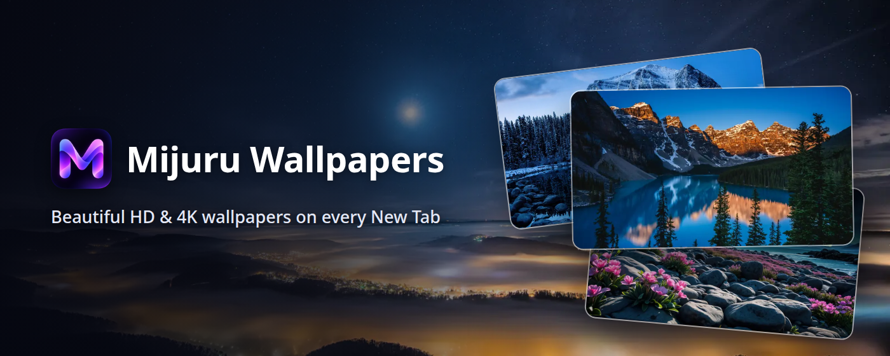
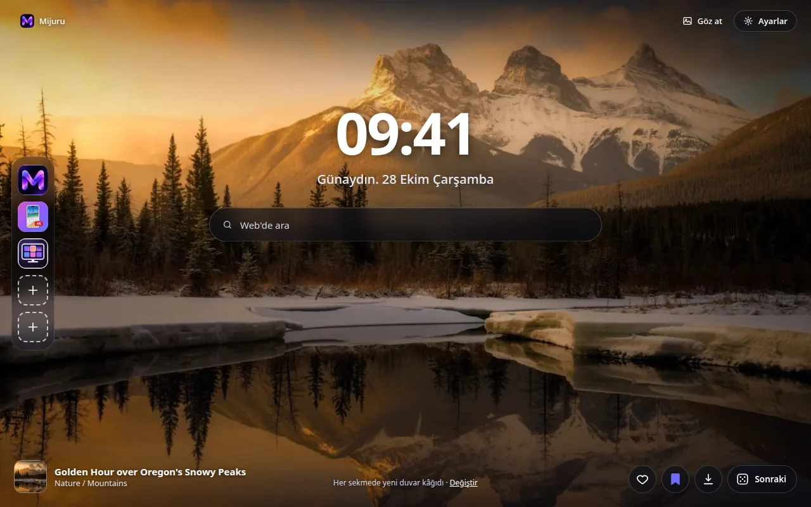
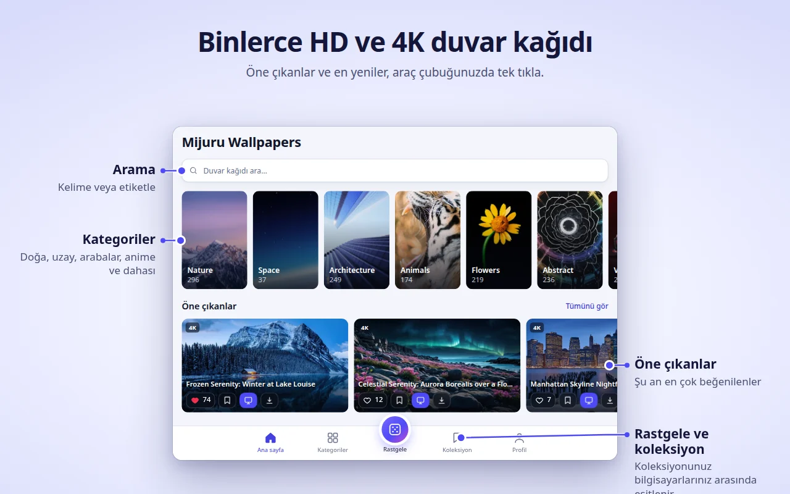
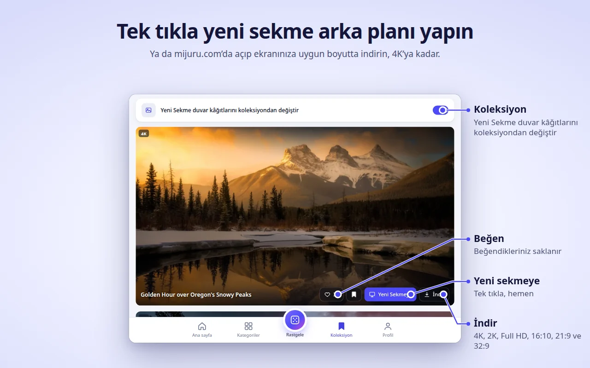
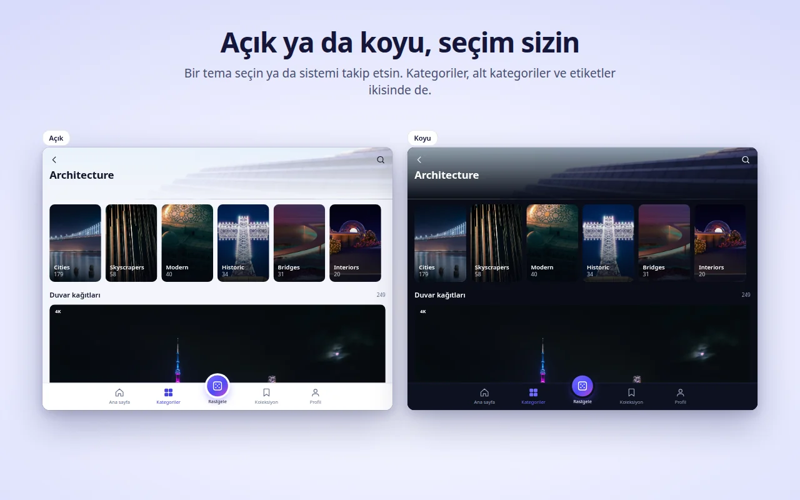
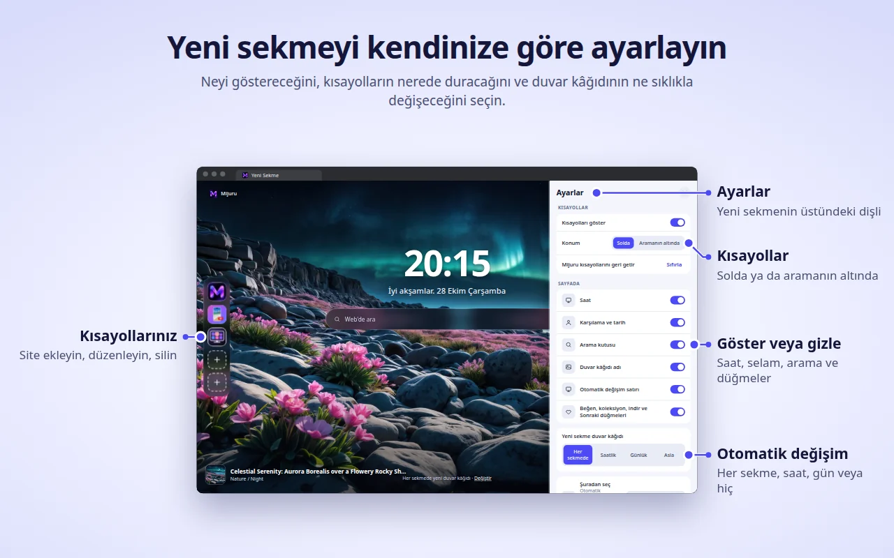

[English](README.md) · [Русский](README.ru.md) · [Українська](README.uk.md) · [Español](README.es.md) · [Português](README.pt.md) · [Deutsch](README.de.md) · [Français](README.fr.md) · [Italiano](README.it.md) · **Türkçe** · [Polski](README.pl.md) · [한국어](README.ko.md) · [Tiếng Việt](README.vi.md) · [Bahasa Indonesia](README.id.md) · [العربية](README.ar.md)

  

<h1 align="center">Mijuru Wallpapers</h1>

  <b>Her yeni sekmede yepyeni bir 4K duvar kâğıdı.</b> 
  <a href="https://mijuru.com">mijuru.com</a>'dan binlerce HD ve 4K duvar kâğıdı, araç çubuğunuzda bir tık uzağınızda. 
  Ücretsiz · reklamsız · hesap gerektirmez.

  

Bu depo, Mijuru Wallpapers tarayıcı eklentisinin **belgelerini ve herkese açık sorun takipçisini** barındırır. Eklentinin kaynak kodu kapalıdır.

## Eklentiyi edinin

| Tarayıcı | Mağaza | Durum |
|---|---|---|
| Google Chrome | [Chrome Web Mağazası](https://chromewebstore.google.com/detail/mijuru-wallpapers/jlkpdnlkhknaifdjfjdepbfmklfpamfh) | ✅ Yayında |
| Microsoft Edge | [Edge Eklentileri](https://microsoftedge.microsoft.com/addons/detail/mijuru-wallpapers/cdnegcioifbeoldnojbgcopnklpneodo) | ✅ Yayında |
| Mozilla Firefox | [Firefox Eklentileri (AMO)](https://addons.mozilla.org/firefox/addon/mijuru-wallpapers/) | ✅ Yayında |
| Opera | Opera add-ons | ⏳ Mağaza incelemesinde |

Güncel sürüm: **1.4.0** — [değişiklik günlüğüne](CHANGELOG.md) göz atın. Mağazalarda yeni sürüm, yayından birkaç gün sonra görünebilir.

## Ekran görüntüleri

| | |
|---|---|
|  |  |
|  |  |
|  | |

## Özellikler

**Yeni sekme**
- Ekranınıza uygun boyutta, tam ekran bir duvar kâğıdı. Tam boyutlu dosya yüklenemezse bir önizleme gösterilir — sekme asla boş kalmaz.
- Sonraki duvar kâğıdı önceden indirilir, bu yüzden yeni sekmeler anında açılır.
- Saat, tarihli bir karşılama mesajı ("Günaydın…") ve tarayıcınızın varsayılan arama motorunu kullanan bir arama kutusu.
- Duvar kâğıdının adı ve kategorisi — tıklayınca mijuru.com'daki sayfası açılır.
- Düğmeler: Beğen, Koleksiyona ekle, İndir (duvar kâğıdını mijuru.com'da açar) ve Sonraki.

**Otomatik değişim**
- Her yeni sekmede (varsayılan), saatlik, günlük veya asla.
- Sonraki duvar kâğıdı rastgele seçilir ve son 10 duvar kâğıdını asla tekrarlamaz.
- Kaynak: tüm duvar kâğıtları, Koleksiyonunuz ya da tek bir kategori.

**Kısayollar** *(1.4.0'da yeni)*
- 8 yuva: varsayılan olarak üç Mijuru kısayolu (duvar kâğıdı kataloğu, Android uygulaması, PC uygulaması) ve kendi siteleriniz için yer.
- "⋮" menüsünden ekleyin, düzenleyin veya silin; "Sıfırla" Mijuru kısayollarını geri getirir.
- Solda bir sütun ya da aramanın altında bir satır olarak yerleştirin.

**Yeni sekmede ayarlar** *(1.4.0'da yeni)*
- Dişli düğmesi (sağ üstte) saati, karşılamayı, aramayı, kısayolları, duvar kâğıdı adını, otomatik değişim satırını ve düğmeleri göstermenizi veya gizlemenizi sağlar.

**Eklenti penceresi — kataloğun tamamı**
- Ana sayfa (öne çıkanlar ve en yeniler), Kategoriler → alt kategoriler, Arama (duvar kâğıtları veya etiketler), sonsuz Rastgele akış, Koleksiyonunuz ve Profiliniz.
- Her duvar kâğıdı kartında: Beğen, Koleksiyona ekle, Yeni Sekmeye, İndir.
- Katalog 4K (3840×2160) veya daha yüksek çözünürlükte 16:9 duvar kâğıtları gösterir — hepsi geniş ekran monitöre uyar.

**Koleksiyon**
- Sevdiğiniz duvar kâğıtlarını kaydedin ve "Yeni Sekme duvar kâğıtlarını koleksiyondan değiştir" seçeneğini açın.

**mijuru.com'dan duvar kâğıdı ayarlama**
- mijuru.com'da bir masaüstü duvar kâğıdının sayfasında **Yeni sekme duvar kâğıdı olarak ayarla** düğmesine basın — eklenti onu hemen uygular.

**Ayrıca**
- Açık, koyu veya sistem teması.
- 14 arayüz dili: English, Русский, Українська, Español, Português (Brasil), Deutsch, Français, Italiano, Türkçe, Polski, 한국어, Tiếng Việt, Bahasa Indonesia, العربية (sağdan sola).
- Ayarlar, beğeniler, Koleksiyon ve kısayollar, açıksa tarayıcınızın senkronizasyonuyla taşınır.

## Tarayıcı desteği

| Tarayıcı | En düşük sürüm | Yeni sekmenin yerini alır | Notlar |
|---|---|---|---|
| Chrome | 116 | Evet | |
| Edge | Güncel sürümler | Evet | Chrome ile aynı sürüm |
| Firefox (masaüstü) | 140 | Evet | Android için Firefox desteklenmez |
| Opera | Güncel sürümler | **Hayır** | Opera, eklentilerin yeni sekmenin yerini almasına izin vermez — bunun yerine **Mijuru sekmesini** kullanın (aşağıya bakın) |

## Kurulum

1. [Yukarıdaki tablodan](#eklentiyi-edinin) tarayıcınızın mağaza sayfasını açın.
2. **Chrome'a ekle** / **Al** / **Firefox'a ekle** düğmesine tıklayın.
3. Yeni bir sekme açın. İlk kurulumdan sonra mijuru.com'da kısa bir karşılama sayfası temel bilgileri anlatır.

**Opera.** Eklenti yayınlandığında, eklenti penceresini açın → **Profil → Mijuru sekmesini aç**. Opera ayarlarından bu sayfayı başlangıç sayfanız yapabilirsiniz.

## Başlarken

1. **Yeni bir sekme açın** — bir duvar kâğıdı, saat ve arama kutusu göreceksiniz.
2. Kataloğa göz atmak için araç çubuğundaki **Mijuru simgesine tıklayın**. Her zaman görünür olması için yapboz parçası (Uzantılar) menüsünden sabitleyin.
3. **Bir duvar kâğıdını beğenin veya Koleksiyonunuza ekleyin** — herhangi bir karttan ya da doğrudan yeni sekmeden.
4. **Duvar kâğıdının ne sıklıkla değişeceğini seçin**: Profil → Yeni sekme duvar kâğıdı veya yeni sekmedeki **Değiştir** bağlantısı.
5. **Sayfayı özelleştirin**: yeni sekmedeki dişli düğmesi her öğeyi gösterir veya gizler.
6. **Duvar kâğıdı indirin**: İndir düğmesi, boyut seçebileceğiniz (4K UHD, 2K QHD, Full HD, 16:10, 21:9, 32:9…) mijuru.com sayfasını açar.

## Sık sorulan sorular

<b>Gerçekten ücretsiz mi? Reklam var mı?</b>

Evet, ücretsiz. Reklam yok, hesap yok, oturum açma yok.

<b>Arka plan olarak kendi resmimi kullanabilir miyim?</b>

Şu an için hayır. Eklenti, mijuru.com kataloğundaki duvar kâğıtlarını gösterir. Bu özelliği istiyorsanız oy verin veya [Ideas](https://github.com/orgs/mijuru-dev/discussions/categories/ideas) bölümünde önerin.

<b>Neden yalnızca yatay duvar kâğıtları var?</b>

Eklenti bilgisayar ekranları için yapıldığından, penceredeki katalog 4K veya daha yüksek çözünürlükte 16:9 duvar kâğıtları gösterir. Telefon duvar kâğıtları [mijuru.com](https://mijuru.com)'da ve [Android uygulamasında](https://play.google.com/store/apps/details?id=com.mijuru.wallpaper) bulunur.

<b>Aynı duvar kâğıdını nasıl sabit tutarım?</b>

Otomatik değişimi **Asla** olarak ayarlayın (Profil → Yeni sekme duvar kâğıdı veya yeni sekmedeki **Değiştir** bağlantısı). Bir duvar kâğıdını **Yeni Sekmeye** ile elle ayarlamak da otomatik değişimi kapatır.

<b>Yalnızca Koleksiyonumdaki veya tek bir kategorideki duvar kâğıtlarını nasıl gösteririm?</b>

Profil → Yeni sekme duvar kâğıdı → Şuradan seç: **Koleksiyon** veya bir kategori. Koleksiyon sekmesinde ayrıca "Yeni Sekme duvar kâğıtlarını koleksiyondan değiştir" anahtarı bulunur.

<b>Tarayıcımın varsayılan yeni sekmesini nasıl geri getiririm?</b>

Eklentiyi devre dışı bırakın veya kaldırın: `chrome://extensions`, `edge://extensions` ya da `about:addons` (Firefox) sayfasını açıp Mijuru Wallpapers'ı kapatın. Tarayıcının kendi yeni sekmesi hemen geri gelir.

<b>Beğenilerim, Koleksiyonum ve kısayollarım başka bir bilgisayara taşınır mı?</b>

Evet, tarayıcı senkronizasyonu açıksa (Google, Microsoft veya Firefox hesabı). Eklenti, tarayıcının yerleşik senkronizasyon depolamasını kullanır; kendine ait bir hesabı yoktur.

<b>İndirilen duvar kâğıtları nereden geliyor? Boyutu seçebilir miyim?</b>

İndir, duvar kâğıdının mijuru.com'daki sayfasını açar; tam boyutu orada seçersiniz. Eklentinin kendisi dosya kaydetmez.

<b>Saati, karşılamayı veya aramayı gizleyebilir miyim?</b>

Evet. Yeni sekmenin sağ üst köşesindeki dişli düğmesine tıklayın ve istediğiniz öğeyi kapatın.

<b>Arama kutusu aramalarımı Mijuru'ya gönderiyor mu?</b>

Hayır. Aramalar, tarayıcının kendi arama API'si üzerinden doğrudan tarayıcınızın varsayılan arama motoruna gider. Eklenti bunları okumaz ve saklamaz.

<b>Opera neden farklı çalışıyor?</b>

Opera, eklentilerin yeni sekmenin yerini almasına izin vermez. **Profil → Mijuru sekmesini aç** seçeneğini kullanın — normal bir sekmede açılan aynı sayfadır ve başlangıç sayfanız olarak ayarlayabilirsiniz.

<b>Duvar kâğıtlarını ticari amaçla kullanabilir miyim?</b>

mijuru.com'daki duvar kâğıtları kişisel kullanım için ücretsizdir. Yeniden satış ve ticari kullanıma izin verilmez.

## Sorun giderme

**Yeni sekmede Mijuru görünmüyor.**
Yeni sekmeyi aynı anda yalnızca bir eklenti yönetebilir — tarayıcılar böyle çalışır. Başka bir yeni sekme eklentiniz varsa tarayıcı bunlardan birini kullanır. Diğer eklentiyi devre dışı bırakıp yeniden yeni bir sekme açın.

**Chrome, Google'a geri dönmek mi yoksa değişiklikleri korumak mı istediğinizi soruyor.**
Chrome, herhangi bir eklenti yeni sekmenin yerini aldığında bu uyarıyı gösterir. Mijuru'yu tutmak için **değişiklikleri koruma** seçeneğini seçin. Geri almayı seçtiyseniz Chrome eklentiyi devre dışı bırakır — `chrome://extensions` sayfasından yeniden açın.

**Şirket tarayıcım eklentiyi yok sayıyor.**
Yönetilen (iş veya okul) tarayıcılar, politikalar aracılığıyla eklentileri engelleyebilir veya belirli bir yeni sekmeyi zorunlu kılabilir. Yöneticinize danışın.

**Opera: yeni sekmede duvar kâğıdı ve "Yeni Sekmeye" düğmesi yok.**
Bu beklenen bir durumdur — [Opera neden farklı çalışıyor?](#sık-sorulan-sorular) sorusuna bakın. **Mijuru sekmesini** kullanın.

**Başka bir dil seçmeme rağmen duvar kâğıdı başlıkları İngilizce.**
Korece, Vietnamca, Endonezce ve Arapça için katalogda henüz çevrilmiş başlık yok, bu yüzden İngilizce gösterilir. Arayüzün kendisi çevrilmiştir. Katalog bağlantıları her zaman mijuru.com'un İngilizce sürümünü açar.

**"Yüklenemedi. Bağlantınızı kontrol edin."**
Eklentinin mijuru.com'a internet erişimi olması gerekir. Bağlantınızı, VPN'inizi veya güvenlik duvarınızı kontrol edin, ardından **Tekrar dene**'ye basın. Tam boyutlu arka plan yüklenemezse yerine bir önizleme gösterilir.

**Bir kısayol simge yerine harf gösteriyor.**
Sitenin simgesi (`/favicon.ico`) yüklenemediği için kutucukta adın ilk harfi gösterilir. Kısayol yine de çalışır.

**Duvar kâğıdı değişmeyi bıraktı.**
Profil → Yeni sekme duvar kâğıdı bölümünü kontrol edin: bir duvar kâğıdını elle ayarladıysanız otomatik değişim **Asla** olarak değiştirilmiştir. Kaynak Koleksiyonunuzsa boş olmadığından emin olun.

Hâlâ sorun mu var? [Bir sorun bildirin](https://github.com/mijuru-dev/wallpapers-browser-extension/issues/new/choose).

## İzinler ve gizlilik

Eklenti yalnızca ihtiyaç duyduğu izinleri ister:

| İzin | Neden |
|---|---|
| `storage` | Ayarlarınız, beğendiğiniz ve koleksiyonunuzdaki duvar kâğıtlarının kimlikleri, kısayollarınız ve bir önbellek. |
| `alarms` | Saatlik ve günlük otomatik değişim ve sonraki duvar kâğıdının önceden indirilmesi. |
| `search` | Yeni sekmedeki arama kutusu, aramanızı tarayıcının varsayılan arama motoruna gönderir. Eklenti aramaları okumaz ve saklamaz. |
| `https://mijuru.com/*` | Duvar kâğıdı kataloğunu ve görselleri mijuru.com'un salt okunur API'sinden yüklemek ve mijuru.com'daki "Yeni sekme duvar kâğıdı olarak ayarla" düğmesi (aşağıya bakın). |

Sekmelerinize, geçmişinize, indirmelerinize veya diğer web sitelerinin içeriğine **hiçbir** erişim yoktur.

**Eklentinin yaptıkları ve yapmadıkları**
- **Analiz, reklam, çerez, hesap veya üçüncü taraf izleyici yok.** Firefox sayfasında veri toplanmadığı beyan edilir.
- **İstekler mijuru.com'a gider** — katalog ve görseller (seçilen dil, kategori, etiket, arama metni veya duvar kâğıdı kimlikleriyle salt okunur `GET` istekleri).
- **Kısayol simgeleri.** Kendi eklediğiniz kısayollar için yeni sekme, sitenin simgesini `https://<o site>/favicon.ico` adresinden yükler. Bu, eklediğiniz siteye yapılan normal bir istektir; eklentiye ait hiçbir veri eklenmez.
- **mijuru.com entegrasyonu.** Küçük bir betik yalnızca `https://mijuru.com/*` sayfalarında çalışır. Sitedeki "Yeni sekme duvar kâğıdı olarak ayarla" düğmesinin bir duvar kâğıdı kimliğini eklentiye iletmesini sağlar ve düğmenin doğru durumu göstermesi için siteye eklenti sürümünü, tarayıcı adını ve mevcut duvar kâğıdı kimliğini bildirir. Başka hiçbir şeyi okumaz ve başka hiçbir sitede çalışmaz.
- **Beğenileriniz sizde kalır.** Beğeniler ve Koleksiyonunuz tarayıcı depolamasında saklanır (senkronizasyon açıksa tarayıcı tarafından senkronize edilir). Bir duvar kâğıdını beğendiğinizde sunucuya hiçbir şey gönderilmez.
- **Kurulum / kaldırma sayfaları.** İlk kurulumdan sonra eklenti mijuru.com'da bir karşılama sayfası açar; kaldırıldığında tarayıcı, isteğe bağlı tek soruluk bir anket içeren bir veda sayfası açar. Bu bağlantılar yalnızca dili, tarayıcı adını, eklenti sürümünü ve `utm_*` etiketlerini içerir — kullanıcı kimliği yoktur. Aynı `utm_*` etiketleri mijuru.com'a giden diğer bağlantılara da eklenir. mijuru.com'a geçtiğinizde sitenin kendi gizlilik politikası geçerlidir.

Politikanın tamamı: **[mijuru.com/browser-extension-privacy-policy](https://mijuru.com/browser-extension-privacy-policy)**

## Geri bildirim ve destek

| Ne | Nerede | |
|---|---|---|
| 🐞 **Bir şey çalışmıyor** | [Sorun bildirin](https://github.com/mijuru-dev/wallpapers-browser-extension/issues/new/choose) | GitHub Issues |
| 💡 **Fikir veya öneri** | [Fikrinizi paylaşın](https://github.com/orgs/mijuru-dev/discussions/categories/ideas) | GitHub Discussions |
| ❓ **Soru** | [Q&A'da sorun](https://github.com/orgs/mijuru-dev/discussions/categories/q-a) | GitHub Discussions |
| ✉️ **Özel konu** | [m@mijuru.dev](mailto:m@mijuru.dev) | E-posta |

**Issues yalnızca sorunlar içindir** — fikirler, öneriler ve sorular [Discussions](https://github.com/orgs/mijuru-dev/discussions) bölümünde yer alır; orada herkes en beğendiği fikirlere 👍 ile oy verebilir.
Herkesin konuşmayı bulup takip edebilmesi için lütfen İngilizce yazın — kendi dilinizden makine çevirisi kullanmanız tamamen uygundur. Paylaşmadan önce mevcut issue'ları ve tartışmaları arayın: var olan birine verilen 👍, yinelenen bir kayıttan daha faydalıdır.

🚩 Bir duvar kâğıdını bildirmek için (telif hakkı, uygunsuz içerik) mijuru.com'daki duvar kâğıdı sayfasında **Görseli bildir** seçeneğini kullanın.

## mijuru.com'da daha fazla duvar kâğıdı

Koleksiyonun tamamı web sitesindedir — başka bir cihaz için ya da eklentinin göstermediği bir boyutta duvar kâğıdı seçmek istediğinizde kullanışlıdır:

- [Çözünürlüğe göre masaüstü duvar kâğıtları — 4K, 2K, Full HD, ultra geniş](https://mijuru.com/wallpapers/resolutions)
- [Duvar kâğıdı paketleri — temalı koleksiyonlar](https://mijuru.com/wallpapers/packs)
- [Markaya göre telefon duvar kâğıtları — iPhone, Samsung, Xiaomi ve daha fazlası](https://mijuru.com/wallpapers/device-brands)
- [Instagram, Discord, TikTok için avatarlar ve profil resimleri](https://mijuru.com/avatars)

## Diğer Mijuru uygulamaları

- 🌐 **[mijuru.com](https://mijuru.com)** — telefon, masaüstü ve tablet için HD, 4K ve 8K ücretsiz duvar kâğıtları.
- 📱 **[Android için Wallpapers by Mijuru](https://play.google.com/store/apps/details?id=com.mijuru.wallpaper)** — ana ekranınıza ve kilit ekranınıza duvar kâğıdı ayarlayın.
- 🖥️ **[Linux için Wallpapers by Mijuru](https://snapcraft.io/wallpapers-by-mijuru)** — duvar kâğıtlarını tek tıkla ayarlayın ve bir zamanlamaya göre değiştirin.

Tüm ürünler ve belgeler: **[github.com/mijuru-dev](https://github.com/mijuru-dev)**

## Lisans

© 2026 Mijuru. Tüm hakları saklıdır. Eklentinin kullanımı ücretsizdir; kaynak kodu yayımlanmamaktadır. Bu depodaki belgeler ve görseller izinsiz yeniden kullanılamaz.
