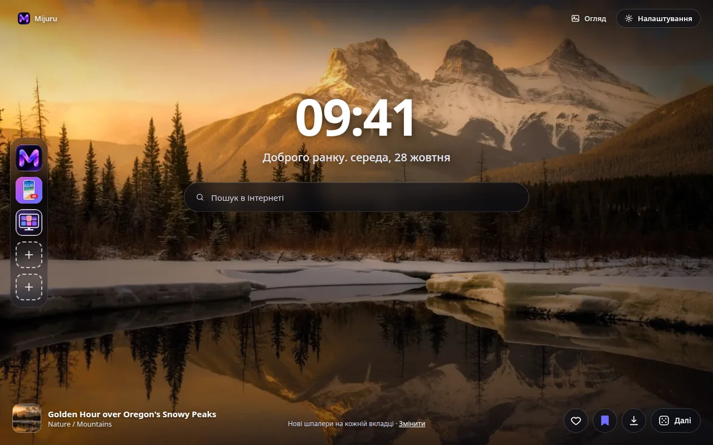
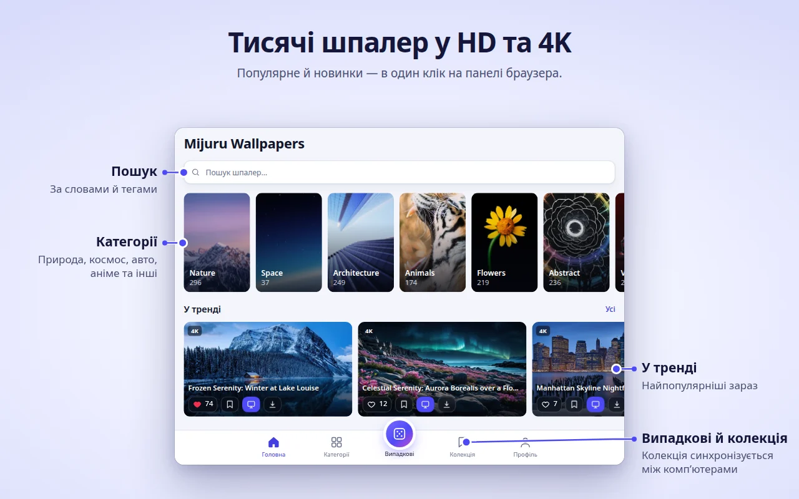
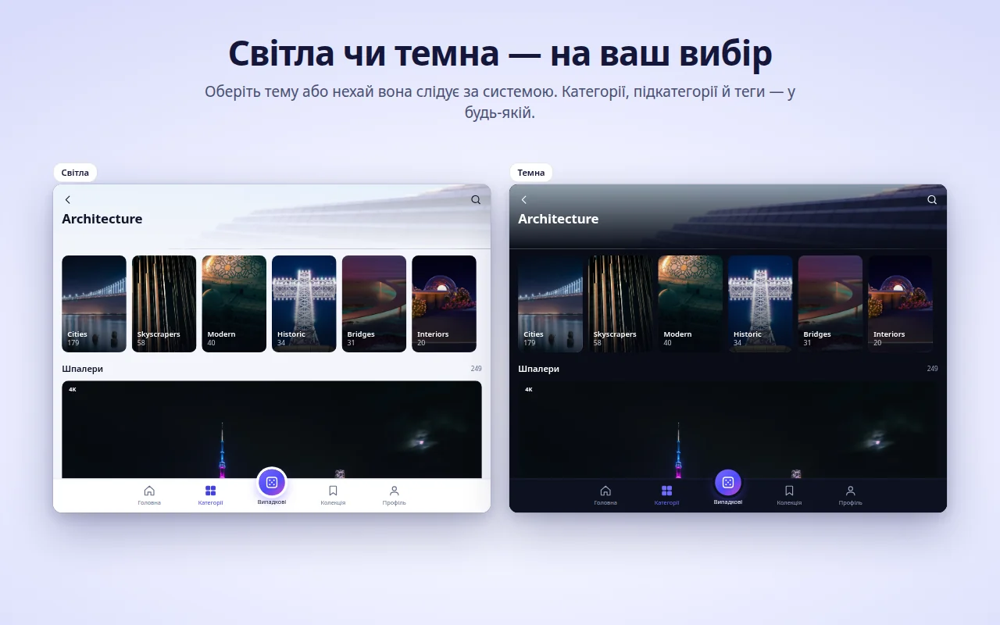
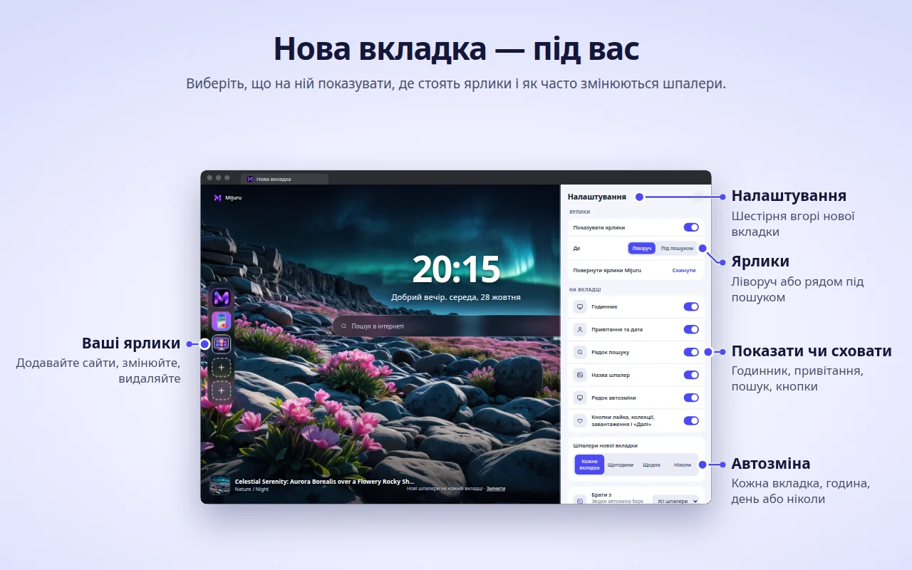

[English](README.md) · [Русский](README.ru.md) · **Українська** · [Español](README.es.md) · [Português](README.pt.md) · [Deutsch](README.de.md) · [Français](README.fr.md) · [Italiano](README.it.md) · [Türkçe](README.tr.md) · [Polski](README.pl.md) · [한국어](README.ko.md) · [Tiếng Việt](README.vi.md) · [Bahasa Indonesia](README.id.md) · [العربية](README.ar.md)

  

<h1 align="center">Mijuru Wallpapers</h1>

  <b>Нові шпалери в 4K на кожній новій вкладці.</b> 
  Тисячі шпалер у HD та 4K з <a href="https://mijuru.com">mijuru.com</a> — в один клік з панелі браузера. 
  Безкоштовно · без реклами · без реєстрації.

  

У цьому репозиторії — **документація та публічний трекер звернень** для розширення Mijuru Wallpapers. Вихідний код розширення закритий.

## Встановити

| Браузер | Магазин | Статус |
|---|---|---|
| Google Chrome | [Інтернет-магазин Chrome](https://chromewebstore.google.com/detail/mijuru-wallpapers/jlkpdnlkhknaifdjfjdepbfmklfpamfh) | ✅ Доступно |
| Microsoft Edge | [Надбудови Edge](https://microsoftedge.microsoft.com/addons/detail/mijuru-wallpapers/cdnegcioifbeoldnojbgcopnklpneodo) | ✅ Доступно |
| Mozilla Firefox | [Додатки Firefox (AMO)](https://addons.mozilla.org/firefox/addon/mijuru-wallpapers/) | ✅ Доступно |
| Opera | Opera add-ons | ⏳ На перевірці в магазині |

Поточна версія — **1.4.0**, див. [список змін](CHANGELOG.md). Оновлення в магазинах може з'явитися на кілька днів пізніше за реліз.

## Скриншоти

| | |
|---|---|
|  |  |
|  |  |
|  | |

## Можливості

**Нова вкладка**
- Шпалери на весь екран у розмірі під ваш монітор. Якщо повний файл не завантажився, показується прев'ю — вкладка не залишається порожньою.
- Наступні шпалери завантажуються заздалегідь, тож нова вкладка відкривається миттєво.
- Годинник, привітання з датою («Доброго ранку…») і пошук через пошукову систему вашого браузера за замовчуванням.
- Назва й категорія шпалер — за кліком відкривається їхня сторінка на mijuru.com.
- Кнопки: «Подобається», «До колекції», «Завантажити» (відкриває шпалери на mijuru.com) і «Наступні».

**Автозміна**
- На кожній новій вкладці (за замовчуванням), щогодини, щодня або ніколи.
- Наступні шпалери обираються випадково й не повторюють 10 останніх.
- Джерело: усі шпалери, ваша колекція або одна категорія.

**Ярлики** *(нове в 1.4.0)*
- 8 комірок: за замовчуванням три ярлики Mijuru (каталог шпалер, застосунок для Android, застосунок для ПК) і місце для ваших сайтів.
- Додати, змінити чи видалити — через меню «⋮»; «Скинути» повертає ярлики Mijuru.
- Колонкою ліворуч або рядом під пошуком.

**Налаштування на новій вкладці** *(нове в 1.4.0)*
- Кнопка-шестерня праворуч угорі: годинник, привітання, пошук, ярлики, назву шпалер, рядок автозміни й кнопки можна сховати або повернути.

**Вікно розширення — увесь каталог**
- Головна (популярні та нові), Категорії → підкатегорії, Пошук (за шпалерами або тегами), нескінченна стрічка «Випадкові», Колекція та Профіль.
- На кожній картці: «Подобається», «До колекції», «Встановити на нову вкладку», «Завантажити».
- У каталозі — шпалери 16:9 у 4K (3840×2160) і вище: кожні пасують до широкого монітора.

**Колекція**
- Зберігайте шпалери, що сподобалися, і ввімкніть «Змінювати шпалери нової вкладки з колекції».

**Шпалери з mijuru.com в один клік**
- На сторінці шпалер для ПК на mijuru.com натисніть **«Встановити на нову вкладку»** — розширення одразу їх встановить.

**А також**
- Світла, темна або системна тема.
- 14 мов інтерфейсу: English, Русский, Українська, Español, Português (Brasil), Deutsch, Français, Italiano, Türkçe, Polski, 한국어, Tiếng Việt, Bahasa Indonesia, العربية (справа наліво).
- Налаштування, вподобання, колекція та ярлики синхронізуються через синхронізацію браузера, якщо її ввімкнено.

## Підтримувані браузери

| Браузер | Мінімальна версія | Замінює нову вкладку | Примітка |
|---|---|---|---|
| Chrome | 116 | Так | |
| Edge | Актуальні версії | Так | Та сама збірка, що й для Chrome |
| Firefox (для комп'ютера) | 140 | Так | Firefox для Android не підтримується |
| Opera | Актуальні версії | **Ні** | Opera не дозволяє розширенням замінювати нову вкладку — використовуйте **вкладку Mijuru** (див. нижче) |

## Встановлення

1. Відкрийте сторінку розширення в магазині вашого браузера — [таблиця вище](#встановити).
2. Натисніть **«Встановити»** / **«Отримати»** / **«Додати до Firefox»**.
3. Відкрийте нову вкладку. Після першого встановлення на mijuru.com відкриється коротка сторінка з підказками.

**Opera.** Коли розширення опублікують, відкрийте вікно розширення → **Профіль → Відкрити вкладку Mijuru**. Цю сторінку можна зробити стартовою в налаштуваннях Opera.

## Перші кроки

1. **Відкрийте нову вкладку** — ви побачите шпалери, годинник і пошук.
2. **Натисніть на іконку Mijuru** на панелі браузера, щоб відкрити каталог. Закріпіть її через меню розширень (значок пазла), щоб вона завжди була на виду.
3. **Вподобайте шпалери та додавайте їх до колекції** — з будь-якої картки або просто з нової вкладки.
4. **Оберіть, як часто змінювати шпалери**: Профіль → Шпалери нової вкладки або посилання **«Змінити»** на новій вкладці.
5. **Налаштуйте сторінку**: шестерня на новій вкладці показує або ховає кожен елемент.
6. **Завантажте шпалери**: кнопка «Завантажити» відкриває їхню сторінку на mijuru.com, де можна обрати розмір (4K UHD, 2K QHD, Full HD, 16:10, 21:9, 32:9…).

## Часті запитання

<b>Це справді безкоштовно? Є реклама?</b>

Так, безкоштовно. Реклами немає, акаунт і вхід не потрібні.

<b>Чи можна поставити власне зображення?</b>

Поки ні: розширення показує шпалери з каталогу mijuru.com. Якщо вам потрібна ця функція — проголосуйте за неї або запропонуйте її в [Ideas](https://github.com/orgs/mijuru-dev/discussions/categories/ideas).

<b>Чому лише горизонтальні шпалери?</b>

Розширення створене для екранів комп'ютерів, тому в каталозі — шпалери 16:9 у 4K і вище. Шпалери для телефона є на [mijuru.com](https://mijuru.com) та в [застосунку для Android](https://play.google.com/store/apps/details?id=com.mijuru.wallpaper).

<b>Як залишити одні й ті самі шпалери?</b>

Оберіть автозміну **«Ніколи»** (Профіль → Шпалери нової вкладки або посилання **«Змінити»** на новій вкладці). Якщо встановити шпалери вручну кнопкою «Встановити на нову вкладку», автозміна теж вимикається.

<b>Як показувати шпалери лише з колекції або однієї категорії?</b>

Профіль → Шпалери нової вкладки → Джерело: **Колекція** або категорія. У вкладці «Колекція» також є перемикач «Змінювати шпалери нової вкладки з колекції».

<b>Як повернути стандартну нову вкладку браузера?</b>

Вимкніть або видаліть розширення: відкрийте `chrome://extensions`, `edge://extensions` або `about:addons` (Firefox) і вимкніть Mijuru Wallpapers. Стандартна вкладка повернеться одразу.

<b>Вподобання, колекція та ярлики перенесуться на інший комп'ютер?</b>

Так, якщо ввімкнено синхронізацію браузера (акаунт Google, Microsoft або Firefox). Розширення використовує вбудоване сховище синхронізації браузера; власного акаунта в нього немає.

<b>Звідки завантажуються шпалери? Чи можна обрати розмір?</b>

Кнопка «Завантажити» відкриває сторінку шпалер на mijuru.com, там і обирається потрібний розмір. Саме розширення файли не зберігає.

<b>Чи можна сховати годинник, привітання або пошук?</b>

Так. Натисніть шестерню в правому верхньому куті нової вкладки й вимкніть зайве.

<b>Пошук надсилає мої запити в Mijuru?</b>

Ні. Запити йдуть напряму до пошукової системи браузера за замовчуванням через вбудований механізм пошуку браузера. Розширення їх не читає й не зберігає.

<b>Чому в Opera все інакше?</b>

Opera не дозволяє розширенням замінювати нову вкладку. Використовуйте **Профіль → Відкрити вкладку Mijuru** — це та сама сторінка у звичайній вкладці, її можна зробити стартовою.

<b>Чи можна використовувати шпалери в комерційних цілях?</b>

Шпалери з mijuru.com безкоштовні для особистого використання. Перепродаж і комерційне використання не дозволяються.

## Розв'язання проблем

**На новій вкладці немає Mijuru.**
Новою вкладкою може керувати лише одне розширення — так влаштовані браузери. Якщо встановлено інше розширення для нової вкладки, браузер використовує одне з них. Вимкніть друге розширення й знову відкрийте нову вкладку.

**Chrome питає «Повернутися до Google?» / «Зберегти зміни?»**
Chrome показує це попередження після того, як будь-яке розширення замінює нову вкладку. Натисніть **«Зберегти»**, щоб залишити Mijuru. Якщо ви обрали «Відновити», Chrome вимикає розширення — увімкніть його знову на сторінці `chrome://extensions`.

**Робочий браузер не застосовує розширення.**
У керованих (робочих або навчальних) браузерах адміністратор може заборонити розширення або задати свою нову вкладку політиками. Зверніться до адміністратора.

**Opera: немає шпалер на новій вкладці й немає кнопки «Встановити на нову вкладку».**
Так і має бути — див. питання [«Чому в Opera все інакше?»](#часті-запитання). Використовуйте **вкладку Mijuru**.

**Назви шпалер англійською, хоча обрано іншу мову.**
Для корейської, в'єтнамської, індонезійської та арабської в каталозі поки немає перекладених назв, тому вони показуються англійською. Сам інтерфейс перекладено. Посилання на каталог завжди відкривають англійську версію mijuru.com.

**«Не вдалося завантажити. Перевірте з'єднання».**
Розширенню потрібен доступ до mijuru.com. Перевірте інтернет, VPN або файрвол і натисніть **«Повторити»**. Якщо повнорозмірний фон не завантажився, замість нього показується прев'ю.

**У ярлика літера замість іконки.**
Не вдалося завантажити іконку сайту (`/favicon.ico`), тому на плитці показано першу літеру назви. Ярлик при цьому працює.

**Шпалери перестали змінюватися.**
Перевірте Профіль → Шпалери нової вкладки: якщо ви встановлювали шпалери вручну, автозміна перемкнулася на **«Ніколи»**. Якщо джерело — колекція, переконайтеся, що вона не порожня.

Не допомогло? [Створіть звернення](https://github.com/mijuru-dev/wallpapers-browser-extension/issues/new/choose).

## Дозволи та конфіденційність

Розширення запитує лише необхідне:

| Дозвіл | Навіщо |
|---|---|
| `storage` | Ваші налаштування, ID вподобаних шпалер і шпалер із колекції, ярлики та кеш. |
| `alarms` | Автозміна щогодини й щодня, завчасне завантаження наступних шпалер. |
| `search` | Пошук на новій вкладці надсилає запит до пошукової системи браузера за замовчуванням. Розширення запити не читає й не зберігає. |
| `https://mijuru.com/*` | Завантаження каталогу й зображень з mijuru.com (лише читання) і кнопка «Встановити на нову вкладку» на сайті (див. нижче). |

Доступу до ваших вкладок, історії, завантажень і вмісту інших сайтів **немає**.

**Що розширення робить і чого не робить**
- **Жодної аналітики, реклами, cookie, акаунтів і сторонніх трекерів.** У Firefox розширення офіційно заявляє, що не збирає дані.
- **Запити йдуть на mijuru.com** — каталог і зображення (лише читання; передаються обрана мова, категорія, тег, пошуковий запит або ID шпалер).
- **Іконки ярликів.** Для ярликів, які ви додали самі, нова вкладка завантажує іконку сайту за адресою `https://<цей сайт>/favicon.ico`. Це звичайний запит до доданого вами сайту; дані розширення до нього не додаються.
- **Зв'язок із mijuru.com.** Невеликий скрипт працює лише на сторінках `https://mijuru.com/*`. Він дає змогу кнопці «Встановити на нову вкладку» на сайті передати розширенню ID шпалер і повідомляє сайту версію розширення, назву браузера та ID поточних шпалер — щоб кнопка показувала правильний стан. Більше він нічого не читає й на інших сайтах не запускається.
- **Вподобання залишаються у вас.** Вподобання й колекція зберігаються у сховищі браузера (і синхронізуються браузером, якщо синхронізацію ввімкнено). Під час вподобання на сервер нічого не надсилається.
- **Сторінки встановлення та видалення.** Після першого встановлення відкривається вітальна сторінка на mijuru.com; під час видалення браузер відкриває сторінку прощання з необов'язковим опитуванням з одного питання. У цих посиланнях лише мова, назва браузера, версія розширення та мітки `utm_*` — жодних ідентифікаторів користувача. Такі самі мітки `utm_*` додаються до інших посилань на mijuru.com. На самому сайті діє його власна політика конфіденційності.

Повна політика: **[mijuru.com/browser-extension-privacy-policy](https://mijuru.com/browser-extension-privacy-policy)**

## Зворотний зв'язок і підтримка

| Що | Де | |
|---|---|---|
| 🐞 **Щось не працює** | [Повідомити про проблему](https://github.com/mijuru-dev/wallpapers-browser-extension/issues/new/choose) | GitHub Issues |
| 💡 **Ідея чи пропозиція** | [Поділитися ідеєю](https://github.com/orgs/mijuru-dev/discussions/categories/ideas) | GitHub Discussions |
| ❓ **Запитання** | [Запитати в Q&A](https://github.com/orgs/mijuru-dev/discussions/categories/q-a) | GitHub Discussions |
| ✉️ **Особисте питання** | [m@mijuru.dev](mailto:m@mijuru.dev) | Пошта |

**Issues — лише для проблем.** Ідеї, пропозиції та запитання — у [Discussions](https://github.com/orgs/mijuru-dev/discussions), де кожен може поставити 👍 ідеям, які подобаються найбільше.
Будь ласка, пишіть англійською, щоб усі могли знайти обговорення й стежити за ним, — машинний переклад цілком підійде. Перед публікацією пошукайте серед наявних issues та обговорень: 👍 під наявним допомагає більше, ніж дублікат.

🚩 Щоб поскаржитися на шпалери (авторські права, неприйнятний вміст), натисніть **«Поскаржитися»** на сторінці шпалер на mijuru.com.

## Ще шпалери на mijuru.com

Уся колекція — на сайті: зручно, коли потрібно дібрати шпалери для іншого пристрою або в розмірі, якого немає в застосунку:

- [Шпалери для робочого столу за роздільною здатністю — 4K, 2K, Full HD, ultrawide](https://mijuru.com/wallpapers/resolutions)
- [Добірки шпалер за темами](https://mijuru.com/wallpapers/packs)
- [Шпалери для телефона за брендами — iPhone, Samsung, Xiaomi та інші](https://mijuru.com/wallpapers/device-brands)
- [Аватарки для Instagram, Discord, TikTok](https://mijuru.com/avatars)

## Інші продукти Mijuru

- 🌐 **[mijuru.com](https://mijuru.com)** — безкоштовні шпалери для телефона, комп'ютера й планшета в HD, 4K та 8K.
- 📱 **[Wallpapers by Mijuru для Android](https://play.google.com/store/apps/details?id=com.mijuru.wallpaper)** — шпалери на головний екран і екран блокування.
- 🖥️ **[Wallpapers by Mijuru для Linux](https://snapcraft.io/wallpapers-by-mijuru)** — шпалери в один клік і автозміна за розкладом.

Усі продукти й документація: **[github.com/mijuru-dev](https://github.com/mijuru-dev)**

## Ліцензія

© 2026 Mijuru. Усі права захищено. Розширення безкоштовне для використання; вихідний код не публікується. Документацію та зображення з цього репозиторію не можна використовувати повторно без дозволу.
