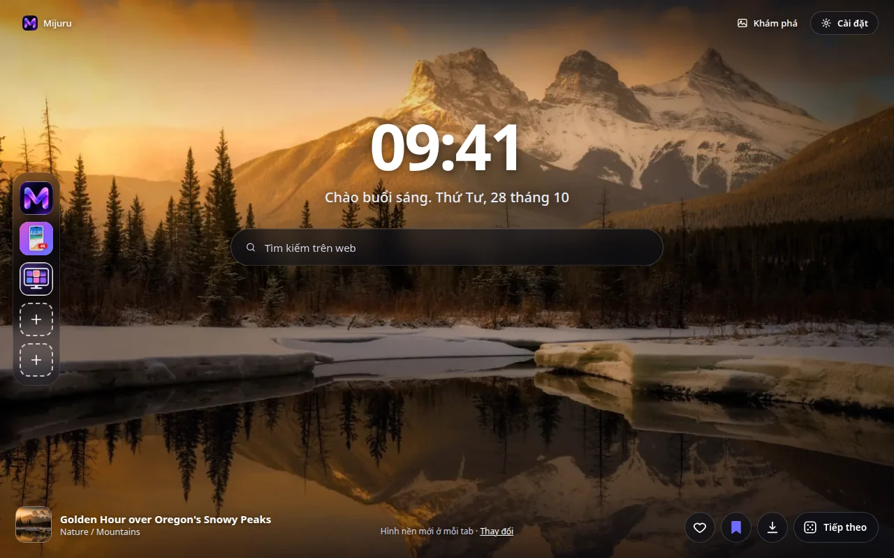
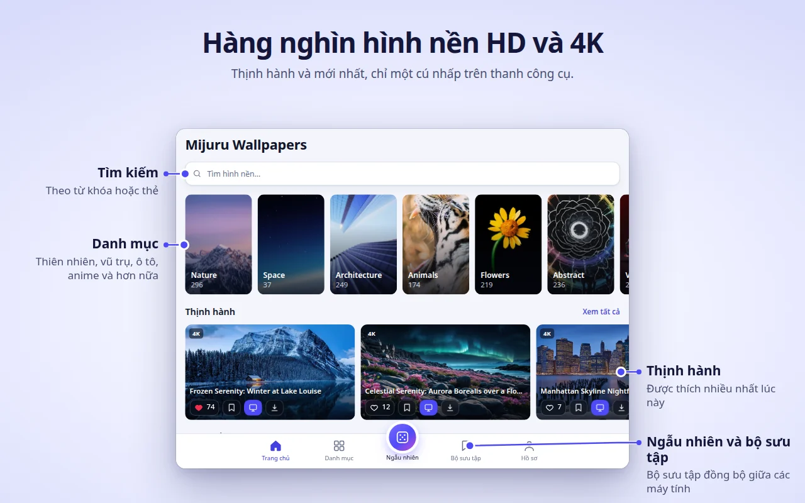
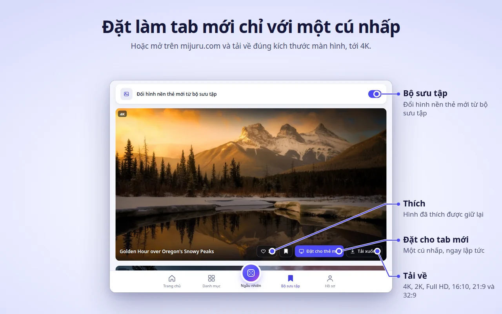
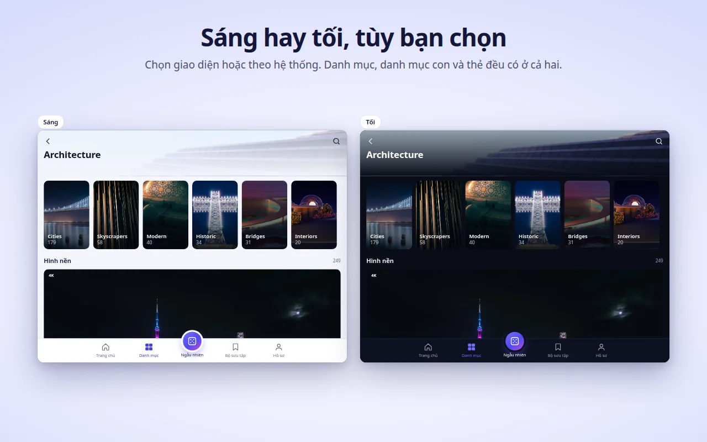
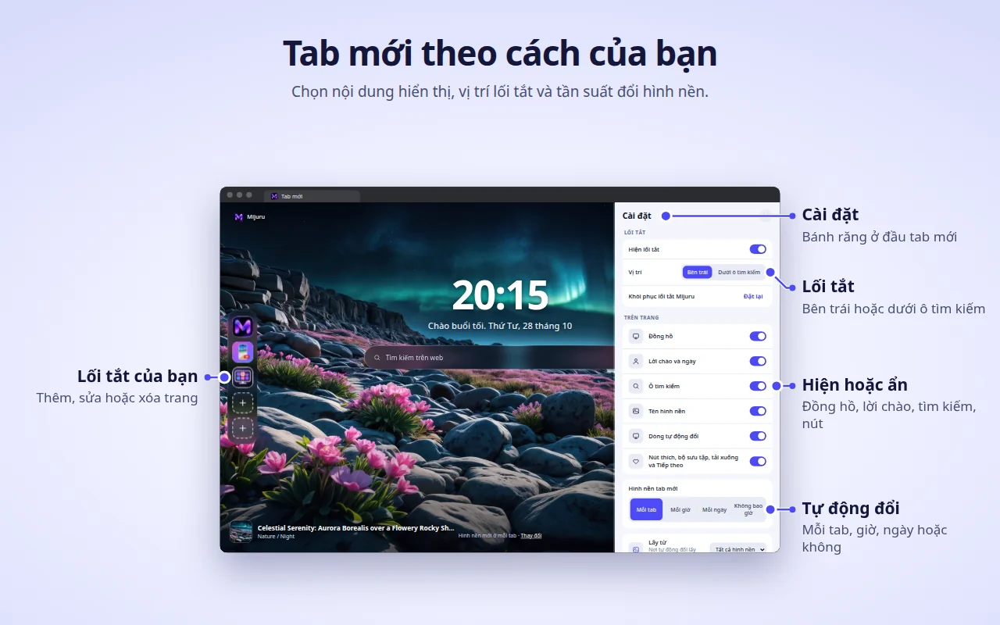

[English](README.md) · [Русский](README.ru.md) · [Українська](README.uk.md) · [Español](README.es.md) · [Português](README.pt.md) · [Deutsch](README.de.md) · [Français](README.fr.md) · [Italiano](README.it.md) · [Türkçe](README.tr.md) · [Polski](README.pl.md) · [한국어](README.ko.md) · **Tiếng Việt** · [Bahasa Indonesia](README.id.md) · [العربية](README.ar.md)

  

<h1 align="center">Mijuru Wallpapers</h1>

  <b>Hình nền 4K mới mỗi khi mở tab mới.</b> 
  Hàng nghìn hình nền HD và 4K từ <a href="https://mijuru.com">mijuru.com</a>, chỉ cách một cú nhấp trên thanh công cụ. 
  Miễn phí · không quảng cáo · không cần tài khoản.

  

Kho lưu trữ này chứa **tài liệu và trình theo dõi vấn đề công khai** của tiện ích trình duyệt Mijuru Wallpapers. Mã nguồn của tiện ích không được công khai.

## Tải tiện ích

| Trình duyệt | Cửa hàng | Trạng thái |
|---|---|---|
| Google Chrome | [Cửa hàng Chrome trực tuyến](https://chromewebstore.google.com/detail/mijuru-wallpapers/jlkpdnlkhknaifdjfjdepbfmklfpamfh) | ✅ Đã có |
| Microsoft Edge | [Tiện ích bổ sung Edge](https://microsoftedge.microsoft.com/addons/detail/mijuru-wallpapers/cdnegcioifbeoldnojbgcopnklpneodo) | ✅ Đã có |
| Mozilla Firefox | [Tiện ích bổ sung Firefox (AMO)](https://addons.mozilla.org/firefox/addon/mijuru-wallpapers/) | ✅ Đã có |
| Opera | Opera add-ons | ⏳ Đang chờ cửa hàng duyệt |

Phiên bản mới nhất: **1.4.0** — xem [nhật ký thay đổi](CHANGELOG.md). Bản cập nhật trên cửa hàng có thể xuất hiện chậm vài ngày so với ngày phát hành.

## Ảnh chụp màn hình

| | |
|---|---|
|  |  |
|  |  |
|  | |

## Tính năng

**Tab mới**
- Hình nền toàn màn hình với kích thước phù hợp với màn hình của bạn. Nếu không tải được tệp kích thước đầy đủ, bản xem trước sẽ được hiển thị — tab không bao giờ bị trống.
- Hình nền tiếp theo được tải trước, nên tab mới mở ra ngay lập tức.
- Đồng hồ, lời chào kèm ngày ("Chào buổi sáng…") và ô tìm kiếm dùng công cụ tìm kiếm mặc định của trình duyệt.
- Tên và danh mục của hình nền — nhấp để mở trang của hình nền trên mijuru.com.
- Các nút: Thích, Thêm vào bộ sưu tập, Tải xuống (mở hình nền trên mijuru.com) và Tiếp theo.

**Tự động đổi**
- Mỗi tab mới (mặc định), mỗi giờ, mỗi ngày hoặc không bao giờ.
- Hình nền tiếp theo được chọn ngẫu nhiên và không bao giờ lặp lại 10 hình gần nhất.
- Nguồn: tất cả hình nền, Bộ sưu tập của bạn hoặc một danh mục.

**Lối tắt** *(mới trong 1.4.0)*
- 8 ô: mặc định có ba lối tắt Mijuru (kho hình nền, ứng dụng Android, ứng dụng PC) và chỗ cho các trang web của riêng bạn.
- Thêm, sửa hoặc xóa qua menu "⋮"; "Đặt lại" khôi phục các lối tắt Mijuru.
- Đặt chúng thành một cột bên trái hoặc một hàng dưới ô tìm kiếm.

**Cài đặt ngay trên tab mới** *(mới trong 1.4.0)*
- Nút bánh răng (góc trên bên phải) cho phép hiện hoặc ẩn đồng hồ, lời chào, ô tìm kiếm, lối tắt, tên hình nền, dòng tự động đổi và các nút.

**Cửa sổ tiện ích — toàn bộ kho hình nền**
- Trang chủ (thịnh hành và mới nhất), Danh mục → danh mục con, Tìm kiếm (hình nền hoặc thẻ), luồng Ngẫu nhiên không giới hạn, Bộ sưu tập và Hồ sơ của bạn.
- Trên mỗi thẻ hình nền: Thích, Thêm vào bộ sưu tập, Đặt cho thẻ mới, Tải xuống.
- Kho hiển thị hình nền 16:9 ở độ phân giải 4K (3840×2160) trở lên — hình nào cũng vừa màn hình rộng.

**Bộ sưu tập**
- Lưu những hình nền bạn yêu thích và bật "Đổi hình nền thẻ mới từ bộ sưu tập".

**Đặt hình nền từ mijuru.com**
- Trên trang hình nền máy tính tại mijuru.com, nhấn **Đặt làm hình nền tab mới** — tiện ích sẽ áp dụng ngay.

**Và còn nữa**
- Giao diện sáng, tối hoặc theo hệ thống.
- 14 ngôn ngữ giao diện: English, Русский, Українська, Español, Português (Brasil), Deutsch, Français, Italiano, Türkçe, Polski, 한국어, Tiếng Việt, Bahasa Indonesia, العربية (từ phải sang trái).
- Cài đặt, lượt thích, Bộ sưu tập và lối tắt được đồng bộ theo trình duyệt, nếu bạn bật đồng bộ hóa.

## Trình duyệt được hỗ trợ

| Trình duyệt | Phiên bản tối thiểu | Thay thế tab mới | Ghi chú |
|---|---|---|---|
| Chrome | 116 | Có | |
| Edge | Các phiên bản hiện tại | Có | Cùng bản dựng với Chrome |
| Firefox (máy tính) | 140 | Có | Không hỗ trợ Firefox cho Android |
| Opera | Các phiên bản hiện tại | **Không** | Opera không cho phép tiện ích thay thế tab mới — hãy dùng **tab Mijuru** (xem bên dưới) |

## Cài đặt

1. Mở trang cửa hàng cho trình duyệt của bạn từ [bảng ở trên](#tải-tiện-ích).
2. Nhấp **Thêm vào Chrome** / **Nhận** / **Thêm vào Firefox**.
3. Mở một tab mới. Sau lần cài đặt đầu tiên, một trang chào mừng ngắn trên mijuru.com sẽ giới thiệu những điều cơ bản.

**Opera.** Khi tiện ích được phát hành, mở cửa sổ tiện ích → **Hồ sơ → Mở tab Mijuru**. Bạn có thể đặt trang này làm trang khởi động trong cài đặt của Opera.

## Bắt đầu

1. **Mở một tab mới** — bạn sẽ thấy hình nền, đồng hồ và ô tìm kiếm.
2. **Nhấp vào biểu tượng Mijuru** trên thanh công cụ để duyệt kho hình nền. Ghim biểu tượng qua menu hình mảnh ghép (Tiện ích) để luôn nhìn thấy.
3. **Thích một hình nền hoặc thêm vào Bộ sưu tập** từ bất kỳ thẻ nào hoặc ngay trên tab mới.
4. **Chọn tần suất đổi hình nền**: Hồ sơ → Hình nền tab mới, hoặc liên kết **Thay đổi** trên tab mới.
5. **Tùy chỉnh trang**: nút bánh răng trên tab mới giúp hiện hoặc ẩn từng thành phần.
6. **Tải hình nền**: nút Tải xuống mở trang của hình nền trên mijuru.com, nơi bạn chọn kích thước (4K UHD, 2K QHD, Full HD, 16:10, 21:9, 32:9…).

## Câu hỏi thường gặp

<b>Có thật sự miễn phí không? Có quảng cáo không?</b>

Có, hoàn toàn miễn phí. Không quảng cáo, không tài khoản, không cần đăng nhập.

<b>Tôi có thể dùng ảnh của mình làm hình nền không?</b>

Hiện tại thì chưa. Tiện ích hiển thị hình nền từ kho của mijuru.com. Nếu bạn muốn có tính năng này, hãy bình chọn hoặc đề xuất trong [Ideas](https://github.com/orgs/mijuru-dev/discussions/categories/ideas).

<b>Tại sao chỉ có hình nền ngang?</b>

Tiện ích được làm cho màn hình máy tính, nên kho trong cửa sổ hiển thị hình nền 16:9 ở 4K trở lên. Hình nền điện thoại có trên [mijuru.com](https://mijuru.com) và trong [ứng dụng Android](https://play.google.com/store/apps/details?id=com.mijuru.wallpaper).

<b>Làm sao để giữ nguyên một hình nền?</b>

Đặt tự động đổi thành **Không bao giờ** (Hồ sơ → Hình nền tab mới, hoặc liên kết **Thay đổi** trên tab mới). Đặt hình nền thủ công bằng **Đặt cho thẻ mới** cũng sẽ tắt tự động đổi.

<b>Làm sao để chỉ hiển thị hình nền từ Bộ sưu tập hoặc một danh mục?</b>

Hồ sơ → Hình nền tab mới → Lấy từ: **Bộ sưu tập** hoặc một danh mục. Trong tab Bộ sưu tập cũng có công tắc "Đổi hình nền thẻ mới từ bộ sưu tập".

<b>Làm sao để lấy lại tab mới mặc định của trình duyệt?</b>

Tắt hoặc gỡ tiện ích: mở `chrome://extensions`, `edge://extensions` hoặc `about:addons` (Firefox) và tắt Mijuru Wallpapers. Tab mới của trình duyệt sẽ quay lại ngay.

<b>Lượt thích, Bộ sưu tập và lối tắt có chuyển sang máy tính khác không?</b>

Có, nếu bạn bật đồng bộ hóa trình duyệt (tài khoản Google, Microsoft hoặc Firefox). Tiện ích dùng bộ nhớ đồng bộ tích hợp sẵn của trình duyệt; tiện ích không có tài khoản riêng.

<b>Hình nền tải xuống lấy từ đâu? Tôi có chọn được kích thước không?</b>

Tải xuống sẽ mở trang hình nền trên mijuru.com, nơi bạn chọn đúng kích thước mình cần. Bản thân tiện ích không lưu tệp.

<b>Tôi có thể ẩn đồng hồ, lời chào hoặc ô tìm kiếm không?</b>

Có. Nhấp nút bánh răng ở góc trên bên phải tab mới và tắt bất kỳ thành phần nào.

<b>Ô tìm kiếm có gửi truy vấn của tôi tới Mijuru không?</b>

Không. Truy vấn được gửi thẳng tới công cụ tìm kiếm mặc định của trình duyệt qua API tìm kiếm của chính trình duyệt. Tiện ích không đọc hay lưu chúng.

<b>Vì sao Opera hoạt động khác?</b>

Opera không cho phép tiện ích thay thế tab mới. Hãy dùng **Hồ sơ → Mở tab Mijuru** — đó là cùng một trang trong tab thường, và bạn có thể đặt nó làm trang khởi động.

<b>Tôi có thể dùng hình nền cho mục đích thương mại không?</b>

Hình nền từ mijuru.com miễn phí cho mục đích cá nhân. Không được bán lại hoặc sử dụng cho mục đích thương mại.

## Khắc phục sự cố

**Tab mới không hiển thị Mijuru.**
Mỗi lúc chỉ một tiện ích được điều khiển tab mới — trình duyệt hoạt động như vậy. Nếu bạn có tiện ích tab mới khác, trình duyệt sẽ dùng một trong số đó. Hãy tắt tiện ích kia rồi mở lại tab mới.

**Chrome hỏi bạn muốn quay lại Google hay giữ thay đổi.**
Chrome hiển thị thông báo này sau khi bất kỳ tiện ích nào thay thế tab mới. Chọn **giữ thay đổi** để tiếp tục dùng Mijuru. Nếu bạn đã chọn khôi phục, Chrome sẽ tắt tiện ích — hãy bật lại trong `chrome://extensions`.

**Trình duyệt ở công ty bỏ qua tiện ích.**
Trình duyệt được quản lý (cơ quan hoặc trường học) có thể chặn tiện ích hoặc buộc dùng một tab mới cụ thể bằng chính sách. Hãy hỏi quản trị viên của bạn.

**Opera: không có hình nền trên tab mới và không có nút "Đặt cho thẻ mới".**
Đây là điều bình thường — xem [Vì sao Opera hoạt động khác?](#câu-hỏi-thường-gặp). Hãy dùng **tab Mijuru**.

**Tên hình nền hiển thị bằng tiếng Anh dù tôi đã chọn ngôn ngữ khác.**
Với tiếng Hàn, tiếng Việt, tiếng Indonesia và tiếng Ả Rập, kho hình nền chưa có tên được dịch nên tên hiển thị bằng tiếng Anh. Bản thân giao diện đã được dịch. Liên kết trong kho luôn mở phiên bản tiếng Anh của mijuru.com.

**"Không thể tải. Hãy kiểm tra kết nối của bạn."**
Tiện ích cần kết nối internet tới mijuru.com. Hãy kiểm tra kết nối, VPN hoặc tường lửa rồi nhấn **Thử lại**. Nếu không tải được hình nền kích thước đầy đủ, bản xem trước sẽ được hiển thị thay thế.

**Lối tắt hiển thị một chữ cái thay vì biểu tượng.**
Không tải được biểu tượng của trang (`/favicon.ico`), nên ô hiển thị chữ cái đầu của tên. Lối tắt vẫn hoạt động bình thường.

**Hình nền không còn tự đổi.**
Kiểm tra Hồ sơ → Hình nền tab mới: nếu bạn đã đặt hình nền thủ công, tự động đổi đã được chuyển sang **Không bao giờ**. Nếu nguồn là Bộ sưu tập, hãy đảm bảo nó không trống.

Vẫn chưa giải quyết được? [Gửi báo cáo vấn đề](https://github.com/mijuru-dev/wallpapers-browser-extension/issues/new/choose).

## Quyền và quyền riêng tư

Tiện ích chỉ yêu cầu những gì cần thiết:

| Quyền | Lý do |
|---|---|
| `storage` | Cài đặt của bạn, ID của các hình nền đã thích và trong bộ sưu tập, lối tắt của bạn và bộ nhớ đệm. |
| `alarms` | Tự động đổi mỗi giờ, mỗi ngày và tải trước hình nền tiếp theo. |
| `search` | Ô tìm kiếm trên tab mới gửi truy vấn tới công cụ tìm kiếm mặc định của trình duyệt. Tiện ích không đọc hay lưu truy vấn. |
| `https://mijuru.com/*` | Tải kho hình nền và hình ảnh từ API chỉ đọc của mijuru.com, và nút "Đặt làm hình nền tab mới" trên mijuru.com (xem bên dưới). |

Tiện ích **không** truy cập tab, lịch sử, tệp tải xuống hoặc nội dung của các trang web khác.

**Tiện ích làm gì và không làm gì**
- **Không phân tích, quảng cáo, cookie, tài khoản hay trình theo dõi của bên thứ ba.** Trang thông tin trên Firefox khai báo không thu thập dữ liệu.
- **Yêu cầu được gửi tới mijuru.com** — kho hình nền và hình ảnh (yêu cầu `GET` chỉ đọc kèm ngôn ngữ, danh mục, thẻ, nội dung tìm kiếm hoặc ID hình nền đã chọn).
- **Biểu tượng lối tắt.** Với các lối tắt do bạn tự thêm, tab mới tải biểu tượng từ `https://<trang đó>/favicon.ico`. Đây là yêu cầu bình thường tới trang bạn đã thêm; không kèm theo dữ liệu nào từ tiện ích.
- **Tích hợp với mijuru.com.** Một tập lệnh nhỏ chỉ chạy trên các trang `https://mijuru.com/*`. Tập lệnh cho phép nút "Đặt làm hình nền tab mới" của trang web chuyển ID hình nền cho tiện ích, đồng thời cho trang web biết phiên bản tiện ích, tên trình duyệt và ID hình nền hiện tại để nút hiển thị đúng trạng thái. Tập lệnh không đọc gì khác và không chạy trên bất kỳ trang nào khác.
- **Lượt thích ở lại với bạn.** Lượt thích và Bộ sưu tập được lưu trong bộ nhớ trình duyệt (được trình duyệt đồng bộ nếu bật đồng bộ hóa). Khi bạn thích một hình nền, không có gì được gửi lên máy chủ.
- **Trang cài đặt / gỡ cài đặt.** Sau lần cài đặt đầu tiên, tiện ích mở trang chào mừng trên mijuru.com; khi gỡ, trình duyệt mở trang tạm biệt với một khảo sát tùy chọn chỉ một câu hỏi. Các liên kết này chỉ chứa ngôn ngữ, tên trình duyệt, phiên bản tiện ích và thẻ `utm_*` — không có mã định danh người dùng. Các thẻ `utm_*` tương tự cũng được thêm vào các liên kết khác tới mijuru.com. Khi bạn đã ở trên mijuru.com, chính sách quyền riêng tư của trang web sẽ được áp dụng.

Chính sách đầy đủ: **[mijuru.com/browser-extension-privacy-policy](https://mijuru.com/browser-extension-privacy-policy)**

## Phản hồi và hỗ trợ

| Nội dung | Nơi gửi | |
|---|---|---|
| 🐞 **Có gì đó không hoạt động** | [Báo cáo sự cố](https://github.com/mijuru-dev/wallpapers-browser-extension/issues/new/choose) | GitHub Issues |
| 💡 **Ý tưởng hoặc góp ý** | [Chia sẻ ý tưởng](https://github.com/orgs/mijuru-dev/discussions/categories/ideas) | GitHub Discussions |
| ❓ **Câu hỏi** | [Hỏi trong Q&A](https://github.com/orgs/mijuru-dev/discussions/categories/q-a) | GitHub Discussions |
| ✉️ **Vấn đề riêng tư** | [m@mijuru.dev](mailto:m@mijuru.dev) | Email |

**Issues chỉ dành cho sự cố** — ý tưởng, góp ý và câu hỏi được đặt trong [Discussions](https://github.com/orgs/mijuru-dev/discussions), nơi mọi người có thể bình chọn 👍 cho những ý tưởng mình thích nhất.
Vui lòng viết bằng tiếng Anh để mọi người đều có thể tìm thấy và theo dõi cuộc thảo luận — dùng bản dịch máy từ ngôn ngữ của bạn cũng hoàn toàn được. Trước khi đăng, hãy tìm trong các issue và thảo luận hiện có: một lượt 👍 cho bài đã có hữu ích hơn một bài trùng lặp.

🚩 Để báo cáo hình nền (bản quyền, nội dung không phù hợp), hãy dùng **Báo cáo hình ảnh** trên trang hình nền tại mijuru.com.

## Thêm hình nền trên mijuru.com

Toàn bộ bộ sưu tập có trên trang web — tiện khi bạn muốn chọn hình nền cho thiết bị khác hoặc ở kích thước mà tiện ích không hiển thị:

- [Hình nền máy tính theo độ phân giải — 4K, 2K, Full HD, siêu rộng](https://mijuru.com/wallpapers/resolutions)
- [Gói hình nền — bộ sưu tập theo chủ đề](https://mijuru.com/wallpapers/packs)
- [Hình nền điện thoại theo hãng — iPhone, Samsung, Xiaomi và nhiều hãng khác](https://mijuru.com/wallpapers/device-brands)
- [Avatar và ảnh đại diện cho Instagram, Discord, TikTok](https://mijuru.com/avatars)

## Ứng dụng Mijuru khác

- 🌐 **[mijuru.com](https://mijuru.com)** — hình nền miễn phí cho điện thoại, máy tính và máy tính bảng ở độ phân giải HD, 4K và 8K.
- 📱 **[Wallpapers by Mijuru cho Android](https://play.google.com/store/apps/details?id=com.mijuru.wallpaper)** — đặt hình nền cho màn hình chính và màn hình khóa.
- 🖥️ **[Wallpapers by Mijuru cho Linux](https://snapcraft.io/wallpapers-by-mijuru)** — đặt hình nền chỉ với một cú nhấp và đổi theo lịch.

Tất cả sản phẩm và tài liệu: **[github.com/mijuru-dev](https://github.com/mijuru-dev)**

## Giấy phép

© 2026 Mijuru. Bảo lưu mọi quyền. Tiện ích được sử dụng miễn phí; mã nguồn không được công bố. Không được tái sử dụng tài liệu và hình ảnh trong kho lưu trữ này khi chưa được phép.
